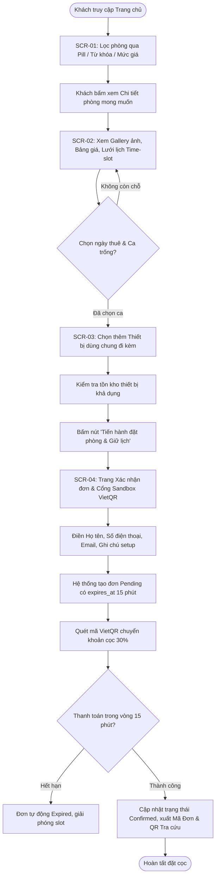
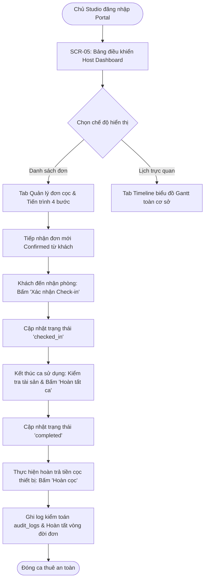
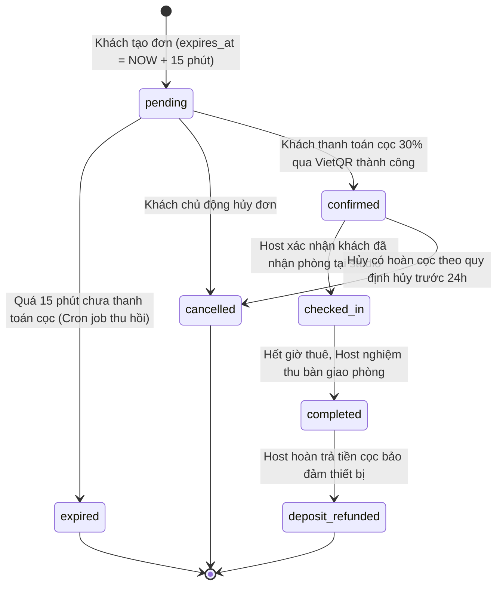

# Thiết Kế Giao Diện Người Dùng & Luồng Tương Tác (Mục 3.4 Báo Cáo Đồ Án)

> **Hệ thống:** Nền tảng Đặt Thuê Studio & Thiết Bị (StudioHub)  
> **Ngôn ngữ & Nền tảng:** Next.js 14 (App Router) + Tailwind CSS + Lucide Icons  
> **Backend:** PHP 8.2 Native RESTful API + MySQL 8.0 (16 Bảng CSDL theo mục 3.2)  
> **Bộ mã màu định danh:** Cam chủ đạo `#F89C1E`, Giá & Điểm nhấn `#D0021B`, Nền `#F4F4F4`, Thẻ `#FFFFFF`  
> **Thư mục hình ảnh chụp thực tế:** [`docs/mockups/`](file:///home/kedora/SEM5/web/Project/docs/mockups/)  

---

## 1. Tổng Quan Hệ Thống Giao Diện & Design System (Mục 3.4.1)

### 1.1 Triết Lý Thiết Kế & Nguyên Tắc Trải Nghiệm (Design Philosophy)
1. **Phong cách Thương mại điện tử Hiện đại (E-Commerce Style):** Lấy cảm hứng từ các nền tảng thương mại dịch vụ hàng đầu (Nhà Tốt / Chợ Tốt / Airbnb). Bố cục phân tách theo dạng khối thẻ (card-based), tương phản màu sắc cao, lược bỏ các hiệu ứng bóng đổ rườm rà để tập trung làm nổi bật hình ảnh không gian phòng và thông số kỹ thuật.
2. **Bộ lọc dạng "Pill" Một chạm (Instant Pill Filters):** Giúp người thuê nhanh chóng phân loại phòng theo mục đích (Chụp ảnh lookbook, Quay MV/Video, Livestream, Concept cổ trang/nghệ thuật) mà không cần mở các hộp thoại modal phức tạp.
3. **Lưới Lịch Thời Gian Trực Quan (Dynamic Time-Slot Calendar):** Trực quan hóa các ca thuê (Session / Khung giờ) bằng bảng màu đèn giao thông:
   - **Xanh lục (`#E8F5E9` / `#2E7D32`):** Khung giờ trống sẵn sàng đặt.
   - **Xám nhạt gạch chéo (`#EEEEEE` / `#8C8C8C`):** Khung giờ đã kín chỗ, quá khứ hoặc đang trong thời gian đệm dọn phòng (30 phút vệ sinh).
   - **Cam thương hiệu (`#F89C1E` / `#FFFFFF`):** Khung giờ người dùng đang chọn trong phiên hiện tại.
4. **Cơ chế Thuê Thiết Bị Đi Kèm Không Trùng Lịch (Shared Equipment Add-ons):** Thiết bị được quản lý tồn kho theo thời gian thực tại Studio (`available_stock`). Khách hàng chọn trực tiếp tại trang chi tiết phòng để hệ thống tự động gộp đơn và tính toán chi phí minh bạch.
5. **Thanh Toán Cọc Minh Bạch 30% (Sandbox VietQR):** Khách hàng chỉ cần quét mã QR để giữ chỗ. Hệ thống hiển thị rõ ràng đồng hồ đếm ngược 15 phút giữ chỗ (`expires_at`), sau 15 phút nếu chưa thanh toán đơn sẽ tự động giải phóng lịch tránh giữ ảo (phantom booking).

---

### 1.2 Bảng Mã Màu Chuẩn (Color Palette)

| Loại màu | Mã màu (HEX) | RGB | Ứng dụng trong giao diện |
|---|---|---|---|
| **Primary (Chủ đạo)** | `#F89C1E` | `rgb(248, 156, 30)` | Header bar, Nút CTA chính, Tag active, Viền ô slot đang chọn, Tab active |
| **Primary Hover** | `#E08914` | `rgb(224, 137, 20)` | Trạng thái rê chuột (hover) trên nút bấm chính |
| **Price / Accent** | `#D0021B` | `rgb(208, 2, 27)` | Giá tiền VND nổi bật, Thẻ giảm giá, Nhãn "Cọc 30% bắt buộc" |
| **Page Background** | `#F4F4F4` | `rgb(244, 244, 244)` | Màu nền toàn trang web, tạo chiều sâu cho các khối thẻ màu trắng |
| **Card / Surface** | `#FFFFFF` | `rgb(255, 255, 255)` | Thẻ hiển thị phòng, Bảng lịch, Modal thiết bị, Form thanh toán |
| **Border / Divider** | `#E8E8E8` | `rgb(232, 232, 232)` | Đường kẻ phân cách, viền card, viền input field |
| **Text Primary** | `#222222` | `rgb(34, 34, 34)` | Tiêu đề H1, H2, Tên phòng, Nhãn form (Font-weight 600 - 700) |
| **Text Secondary** | `#4A4A4A` | `rgb(74, 74, 74)` | Đoạn văn mô tả, thông số diện tích, tiện ích phụ (Font-weight 400 - 500) |
| **Text Muted** | `#8C8C8C` | `rgb(140, 140, 140)` | Placeholder, Ghi chú dưới chân, Đơn vị tính "/giờ", "/buổi" |
| **Success (Khả dụng)** | `#2E7D32` | `rgb(46, 125, 50)` | Chữ ô slot trống, Badge "Đang hoạt động", Thông báo thanh toán thành công |
| **Success Background** | `#E8F5E9` | `rgb(232, 245, 233)` | Nền ô slot trống, Nền badge thanh toán hoàn tất |
| **Warning / Pending** | `#E65100` | `rgb(230, 81, 0)` | Trạng thái "Chờ thanh toán cọc", Đồng hồ đếm ngược 15 phút |
| **Warning Background** | `#FFF3E0` | `rgb(255, 243, 224)` | Nền cảnh báo giữ chỗ, Nền thông tin đặt cọc |
| **Disabled / Occupied**| `#EEEEEE` | `rgb(238, 238, 238)` | Nền ô slot đã kín chỗ / hết hạn, Nút bấm vô hiệu hóa |

---

### 1.3 Hệ Thống Typography & Breakpoints

- **Font Family:** `Inter, -apple-system, BlinkMacSystemFont, "Segoe UI", Roboto, sans-serif`
- **Hệ thống cấp bậc văn bản (Typography Hierarchy):**
  - **H1 - Tiêu đề trang chính:** 24px - 28px / Bold (700) / Line-height 1.2
  - **H2 - Tiêu đề khối / Section:** 20px - 22px / Bold (700) / Line-height 1.3
  - **H3 - Tiêu đề thẻ con / Modal:** 16px - 18px / Semi-bold (600) / Line-height 1.4
  - **Body - Văn bản thông thường:** 14px / Regular (400) hoặc Medium (500) / Line-height 1.5
  - **Caption / Pill / Badge:** 11px - 12px / Semi-bold (600) / Uppercase hoặc Title case
  - **Price Text:** 18px - 22px / Bold (700) / Màu `#D0021B`
- **Hệ thống Lưới (Grid) & Breakpoints Responsive:**
  - **Mobile (`< 640px`):** Lưới 1 cột (100% width), padding cạnh 16px, Navigation thu gọn dưới dạng hamburger hoặc icon bar.
  - **Tablet (`640px - 1024px`):** Lưới 2 cột cho danh sách phòng, Form chia đôi 50/50.
  - **Desktop (`>= 1024px`):** Lưới 3 hoặc 4 cột cho danh sách phòng, Chi tiết phòng chia tỉ lệ 65% (Nội dung + Lịch) / 35% (Hộp đặt cọc & Thiết bị ghim dính `sticky`). Max container width: `1280px` (`max-w-7xl`).

---

## 2. Sơ Đồ Luồng Tương Tác Người Dùng (Mục 3.4.2 - User Flows)

### 2.1 Luồng Khách Hàng Thuê Phòng & Thiết Bị (Customer Rental Journey)



---

### 2.2 Luồng Vận Hành Của Chủ Studio (Host Portal Operations Flow)



---

### 2.3 Sơ Đồ Máy Trạng Thái Đơn Đặt Chỗ (Booking State Machine)



---

## 3. Đặc Tả Chi Tiết 5 Màn Hình Trọng Tâm (Mục 3.4.3 - Core Screens)

### 3.1 Màn Hình 1 (SCR-01): Khám Phá & Bộ Lọc Phòng Studio Dạng Pill (Home & Catalog)

- **Mã màn hình:** `SCR-01`
- **Tên màn hình:** Trang chủ & Danh mục phòng Studio (Home / Search & Catalog Page)
- **Đáp ứng yêu cầu chức năng:** `FR-11` (Tìm kiếm phòng theo bộ lọc không gian, mức giá, diện tích), `FR-12` (Phân trang danh sách phòng).
- **Đường dẫn (URL Route):** `/`
- **Ảnh chụp giao diện thực tế:**  
  

#### A. Sơ đồ bố cục Wireframe (ASCII Layout)
```text
+--------------------------------------------------------------------------------------------------+
| [LOGO StudioHub]   [Khám phá]  [Về chúng tôi]           [Tìm nhanh: Phông xanh...]  [Đăng nhập] |
+--------------------------------------------------------------------------------------------------+
| [BANNER: KHÔNG GIAN SÁNG TẠO HÀNG ĐẦU - TÌM & ĐẶT STUDIO CHUYÊN NGHIỆP TRONG 60 GIÂY]           |
|  +--------------------------------------------------------------------------------------------+  |
|  | [Icon Kính lúp] Nhập tên phòng, quận huyện...        | [Chọn đơn vị tính: Theo Giờ v]      |  |
|  | [Giá từ: 100k]  [Giá đến: 1000k]   [Diện tích tối thiểu: 30 m2]   [NÚT: TÌM KIẾM NGAY]    |  |
|  +--------------------------------------------------------------------------------------------+  |
+--------------------------------------------------------------------------------------------------+
| BỘ LỌC NHANH (PILL CATEGORIES):                                                                 |
| ( Tất cả )  ( Cyclorama Trắng )  ( Concept Hàn Quốc )  ( Phông Xanh VFX )  ( Livestream Pro )  |
+--------------------------------------------------------------------------------------------------+
| DANH SÁCH PHÒNG STUDIO KHẢ DỤNG (Tìm thấy: 6 phòng phù hợp):                                      |
| +-------------------------+ +-------------------------+ +-------------------------+            |
| | [ẢNH THỰC TẾ 16:9]      | | [ẢNH THỰC TẾ 16:9]      | | [ẢNH THỰC TẾ 16:9]      |            |
| | Tag: Chụp ảnh Lookbook  | | Tag: Quay MV / Concept  | | Tag: Livestream 4K      |            |
| | Studio Artemis - Cyclo  | | The Muse Studio - Vườn  | | Red Dot Sound & Stream  |            |
| | Đ/c: Quận 1, TP.HCM     | | Đ/c: Bình Thạnh, TP.HCM | | Đ/c: Quận 3, TP.HCM     |            |
| | D.tích: 45m2 | Cao: 3.5m| | D.tích: 60m2 | Cao: 4.2m| | D.tích: 35m2 | Cao: 3.0m|            |
| | Tiện ích: Cách âm, Wifi | | Tiện ích: Đèn Godox, WC | | Tiện ích: Internet 1Gbps|            |
| | Giá: 250.000 đ / giờ    | | Giá: 350.000 đ / giờ    | | Giá: 300.000 đ / giờ    |            |
| | [Xem Chi Tiết & Đặt ->] | | [Xem Chi Tiết & Đặt ->] | | [Xem Chi Tiết & Đặt ->] |            |
| +-------------------------+ +-------------------------+ +-------------------------+            |
+--------------------------------------------------------------------------------------------------+
| PHÂN TRANG:                                                                                      |
|                     [ < Trang trước ]   [ 1 ]   ( 2 )   [ Trang sau > ]                          |
+--------------------------------------------------------------------------------------------------+
| FOOTER: StudioHub - Bản quyền & Quy chuẩn thiết kế Chương 3.4 Báo cáo HTTT                      |
+--------------------------------------------------------------------------------------------------+
```

#### B. Danh sách thành phần giao diện & Quy tắc tương tác
1. **Search Bar Container:**
   - Input `keyword`: Cho phép gõ tìm kiếm tương đối theo tên phòng hoặc tên studio.
   - Select `rate_unit`: Cho phép chọn khung giá hiển thị (`hour`, `session`, `half_day`, `day`).
   - Range Input `min_price` & `max_price`: Lọc giá trị từ `100.000 đ` đến `5.000.000 đ`.
   - Number Input `min_area`: Lọc phòng có diện tích từ giá trị nhập trở lên (tính bằng $m^2$).
2. **Pill Categories (Nút lọc nhanh hình viên thuốc):**
   - Click chọn một Pill: Lập tức gán `space_type_id` vào tham số truy vấn, tự động kích hoạt tải lại danh sách phòng mà không cần reload cả trang web. Nút được chọn sẽ có nền cam nhạt `#FFF4E6` và viền cam đậm `#F89C1E`.
3. **Room Card Component:**
   - Ảnh thumbnail tỉ lệ 16:9 bo góc 8px với badge thể loại góc trái trên.
   - Hiển thị đầy đủ 4 chỉ số cơ bản của dân quay chụp: Diện tích ($m^2$), Chiều cao trần ($m$), Sức chứa (người), Tiêu chuẩn cách âm.
   - Giá tiền in đậm màu đỏ `#D0021B` font size 18px.
   - Bấm vào bất kỳ vị trí nào trên thẻ sẽ điều hướng sang `SCR-02` (`/rooms/[id]`).

---

### 3.2 Màn Hình 2 (SCR-02): Chi Tiết Phòng & Lịch Trống/Bận Dạng Time-Slot (Room Detail & Calendar)

- **Mã màn hình:** `SCR-02`
- **Tên màn hình:** Chi Tiết Phòng & Lịch Biểu Khung Giờ (Room Detail & Time-Slot Picker)
- **Đáp ứng yêu cầu chức năng:** `FR-13` (Xem thông tin chi tiết phòng & bộ sưu tập ảnh), `FR-14` (Xem lịch bận theo ngày và chọn ca trống).
- **Đường dẫn (URL Route):** `/rooms/[id]` (Ví dụ: `/rooms/1`)
- **Ảnh chụp giao diện thực tế:**  
  

#### A. Sơ đồ bố cục Wireframe (ASCII Layout)
```text
+--------------------------------------------------------------------------------------------------+
| [<- Quay lại danh mục]   Trang chủ / Studio Artemis / Phòng Cyclorama Vô Cực Trắng               |
+--------------------------------------------------------------------------------------------------+
| [CỘT TRÁI - 65% CHI TIẾT & LỊCH TRỐNG]           | [CỘT PHẢI - 35% HỘP GIỮ CHỖ & THANH TOÁN]    |
| +----------------------------------------------+ | +-------------------------------------------+ |
| | [ẢNH LỚN CHÍNH CỦA PHÒNG]                    | | | GIÁ THUÊ TỪNG KHUNG:                      | |
| | +------------------------------------------+ | | |  * Theo giờ:    250.000 đ / 60 phút       | |
| | | [Thumb 1]  [Thumb 2]  [Thumb 3]  [Thumb 4]| | |  * Theo ca (4h): 900.000 đ / buổi          | |
| | +------------------------------------------+ | | +-------------------------------------------+ |
| | TÊN PHÒNG: Studio Artemis - Cyclorama Trắng | | | NGÀY ĐANG CHỌN: [ 2026-10-06  [Lịch v] ]  | |
| | Cơ sở: Artemis Creative Hub (Quận 1)         | | | KHUNG GIỜ ĐÃ CHỌN:                        | |
| | Thông số: 45 m2 | Trần 3.8m | Sức chứa 15 ng| | |  [X] Ca 01: 08:00 - 10:00 (500.000 đ)      | |
| | Tiện ích: Cách âm chuẩn A, Máy lạnh công suất| | | THIẾT BỊ ĐÃ CHỌN THÊM (02 món):           | |
| |           Wifi 500Mbps, Phòng thay đồ riêng. | | |  * Đèn Godox SL60W x 2:     160.000 đ     | |
| +----------------------------------------------+ | |  * Phông cuốn tự động:      100.000 đ     | |
| | LỊCH TRỐNG/BẬN THEO NGÀY (TIME-SLOT GRID):   | | +-------------------------------------------+ |
| | Chọn ngày kiểm tra: [ 2026-10-06 [Lịch v] ]  | | | TẠM TÍNH CHI PHÍ:                         | |
| |                                              | | | Tiền phòng (2h):            500.000 đ     | |
| | [08:00 - 10:00]  [10:30 - 12:30]  [13:00 - ] | | | Tiền thiết bị:              260.000 đ     | |
| | [ĐANG CHỌN CAM]  [XANH TRỐNG]     [XÁM KÍN]  | | | TỔNG CỘNG:                  760.000 đ     | |
| |                                              | | | TIỀN CỌC 30% BẮT BUỘC:      228.000 đ     | |
| | [15:30 - 17:30]  [18:00 - 20:00]  [20:30 - ] | | +-------------------------------------------+ |
| | [XANH TRỐNG]     [XÁM KÍN]        [XANH TRỐNG] | | [ NÚT: TIẾN HÀNH ĐẶT PHÒNG & GIỮ LỊCH -> ] | |
| | (Lưu ý: Giữa 2 ca có 30 phút dọn vệ sinh)   | | | (Cam kết giữ lịch trong 15 phút đếm ngược)| |
| +----------------------------------------------+ | +-------------------------------------------+ |
+--------------------------------------------------------------------------------------------------+
```

#### B. Cơ chế hiển thị Lưới Lịch Time-Slot & Chặn Trùng Lịch
1. **Trạng thái trực quan của ô Slot (Slot Visual States):**
   - **Ô màu xanh (`status = 'available'`):** Khung giờ chưa có đơn đặt nào hoặc đơn cũ đã bị hủy/hết hạn. Khách bấm chuột vào để chọn. Ô chuyển ngay sang màu cam thương hiệu.
   - **Ô màu xám gạch chéo (`status = 'booked'`):** Khung giờ đã có khách thanh toán cọc hoặc đang trong đơn `pending` còn hiệu lực. Ô này bị vô hiệu hóa (`cursor: not-allowed`), không thể chọn.
   - **Đệm dọn phòng 30 phút (`cleaning buffer`):** Hệ thống tự động khóa 30 phút tiếp sau mỗi ca đặt để bảo đảm chủ studio có đủ thời gian vệ sinh, thu dọn đèn và phông bạt cho ca kế tiếp.
2. **Khối Bảng Giá Đa Đơn Vị (Multi-unit Rates):** Nạp dữ liệu động từ bảng `room_rates` với các khung `hour`, `session`, `half_day`, `day`, có nhãn độ dài cố định tính bằng phút (`unit_minutes`) theo chuẩn D6.

---

### 3.3 Màn Hình 3 (SCR-03): Khung Chọn Thiết Bị Dùng Chung Đi Kèm (Shared Equipment Add-ons)

- **Mã màn hình:** `SCR-03`
- **Tên màn hình:** Khung Thêm Thiết Bị Dùng Chung Của Studio (Equipment Add-ons Section)
- **Đáp ứng yêu cầu chức năng:** `FR-15` (Xem danh mục thiết bị của studio và chọn số lượng thuê kèm phòng).
- **Đường dẫn (URL Route):** `/rooms/[id]` (Khối nằm ngay bên dưới bảng lịch)
- **Ảnh chụp giao diện thực tế:**  
  

#### A. Sơ đồ bố cục Wireframe (ASCII Layout)
```text
+--------------------------------------------------------------------------------------------------+
| THIẾT BỊ VÀ PHỤ KIỆN CHO THUÊ KÈM TẠI STUDIO ARTEMIS (DÙNG CHUNG CẢ CƠ SỞ):                       |
| Lọc theo nhóm: [Tất cả]  [Đèn & Ánh sáng]  [Tản sáng / Softbox]  [Phông nền]  [Gimbal / Tripod]  |
+--------------------------------------------------------------------------------------------------+
| +-------------------------------+ +-------------------------------+ +--------------------------+ |
| | [ẢNH THIẾT BỊ]                | | [ẢNH THIẾT BỊ]                | | [ẢNH THIẾT BỊ]           | |
| | Đèn Godox SL60W Video Light   | | Softbox Cầu Lanterna 65cm     | | Phông giấy Mỹ Savage Vàng| |
| | Loại: Đèn & Ánh sáng          | | Loại: Tản sáng & Modifier     | | Loại: Phông nền giấy     | |
| | Tồn kho khả dụng: 3 / 4 cái   | | Tồn kho khả dụng: 2 / 2 cái   | | Tồn kho: Sẵn sàng        | |
| | Giá thuê: 80.000 đ / ca       | | Giá thuê: 40.000 đ / ca       | | Giá thuê: 100.000 đ / ca | |
| |                               | |                               | |                          | |
| | [ - ]   [  02  ]   [ + ]      | | [ - ]   [  01  ]   [ + ]      | | [ - ]   [  00  ]   [ + ] | |
| +-------------------------------+ +-------------------------------+ +--------------------------+ |
| TỔNG PHÍ THIẾT BỊ TẠM TÍNH: 200.000 đ (Đã tự động cộng vào Bảng tính tiền bên phải)              |
+--------------------------------------------------------------------------------------------------+
```

#### B. Logic Kiểm Soát Tồn Kho & Giá Thiết Bị
1. **Kiểm tra tồn kho thời gian thực:** Bộ đếm `[ - ] [ Số lượng ] [ + ]` không cho phép người dùng chọn vượt quá `available_stock` hiện tại trong cơ sở dữ liệu (`StockCalculator`). Nếu `available_stock = 0`, nút `+` bị mờ và hiển thị nhãn "Hết hàng trong ca này".
2. **Cơ chế tính giá thuê thiết bị:** Tuân thủ quy định kỹ thuật D7 và P0.3: Giá thiết bị được tính theo đơn vị `session` (theo ca thuê phòng) hoặc `hour`. Khi số lượng tăng lên, tổng tiền được cộng ngay lập tức vào bảng tính tiền của phiên đặt phòng.

---

### 3.4 Màn Hình 4 (SCR-04): Xác Nhận Đơn & Cổng Thanh Toán Cọc Sandbox VietQR (Checkout & QR Payment)

- **Mã màn hình:** `SCR-04`
- **Tên màn hình:** Xác Nhận Đơn Đặt & Thanh Toán Đặt Cọc (Booking Checkout & Sandbox VietQR)
- **Đáp ứng yêu cầu chức năng:** `FR-16` (Tạo đơn đặt phòng kèm thiết bị), `FR-17` (Tích hợp cổng quét mã VietQR thanh toán cọc 30%).
- **Đường dẫn (URL Route):** `/checkout`
- **Ảnh chụp giao diện thực tế:**  
  

#### A. Sơ đồ bố cục Wireframe (ASCII Layout)
```text
+--------------------------------------------------------------------------------------------------+
| [LOGO StudioHub]                  BƯỚC THANH TOÁN: XÁC NHẬN & QUÉT MÃ VIETQR                     |
+--------------------------------------------------------------------------------------------------+
| [CỘT TRÁI - 55% THÔNG TIN ĐẶT THUÊ]            | [CỘT PHẢI - 45% THANH TOÁN CỌC SANDBOX VIETQR]   |
| +--------------------------------------------+ | +----------------------------------------------+ |
| | THÔNG TIN LIÊN HỆ NGƯỜI THUÊ:              | | | MÃ ĐƠN TẠM: STD-2026-9901                    | |
| | Họ và tên: [ Nguyễn Văn Tuấn             ] | | | Trạng thái: ĐANG CHỜ THANH TOÁN CỌC (PENDING)| |
| | Số điện thoại: [ 0908 776 543            ] | | | ĐỒNG HỒ GIỮ LỊCH: [ 14:59 ] (Đếm ngược 15p)  | |
| | Email nhận vé: [ tuan.visuals@gmail.com  ] | | +----------------------------------------------+ |
| | Ghi chú setup: [ Cần bật trước máy lạnh 15p] | | [ KHUNG MÃ VIETQR ĐỘNG ]                     | |
| +--------------------------------------------+ | | +------------------------------------------+ | |
| | CHI TIẾT ĐƠN ĐẶT PHÒNG:                    | | | |  [ ẢNH MÃ QR CODE CHUẨN VIETQR / NAPAS247 ] | | |
| | Phòng: Studio Artemis - Cyclorama Trắng    | | | |  Ngân hàng: MB Bank (Quân Đội)           | | |
| | Thời gian: 08:00 - 10:00 (Ngày 06/10/2026) | | | |  Số tài khoản: 9876543210                | |
| | Thiết bị đi kèm:                           | | | |  Tên chủ TK: STUDIOHUB ESCROW SYSTEM     | | |
| |  - 02x Đèn Godox SL60W       (160.000 đ)   | | | |  Nội dung CK: STD20269901                | |
| |  - 01x Softbox Cầu 65cm      ( 40.000 đ)   | | | +------------------------------------------+ | |
| +--------------------------------------------+ | | SỐ TIỀN CỌC CẦN CHUYỂN: 228.000 đ (30%)     | |
| | BẢNG KÊ MINH BẠCH CHI PHÍ:                 | | | (70% còn lại thanh toán tại quầy khi xong ca)| |
| |  * Tiền thuê phòng:            500.000 đ   | | +----------------------------------------------+ |
| |  * Tiền thuê thiết bị:         200.000 đ   | | [ NÚT: GIẢ LẬP THANH TOÁN THÀNH CÔNG (SANDBOX) ] |
| |  * Phí vệ sinh phòng:           60.000 đ   | | | [ Quay lại chỉnh sửa lịch ]                  | |
| |  * TỔNG GIÁ TRỊ ĐƠN:           760.000 đ   | | +----------------------------------------------+ |
| |  * TIỀN CỌC BẮT BUỘC (30%):    228.000 đ   | |                                                  |
| +--------------------------------------------+ |                                                  |
+--------------------------------------------------------------------------------------------------+
```

#### B. Quy Trình Xử Lý Đơn Cọc & Bảo Mật Thanh Toán
1. **Khởi tạo đơn Pending & Thời hạn `expires_at`:**
   - Khi khách mở trang thanh toán, hệ thống kích hoạt API tạo đơn `pending`. Đơn giữ chỗ này nhận thời hạn chính xác `expires_at = NOW() + INTERVAL 15 MINUTE`.
   - Lịch phòng ngay lập tức chuyển sang trạng thái bận để ngăn chặn các khách hàng khác đặt trùng.
2. **Cơ chế QR Động (VietQR Dynamic Code):**
   - Mã QR được tạo động chứa đúng số tiền cọc (30%) và mã giao dịch duy nhất trong nội dung chuyển khoản.
   - Nút **"Giả lập thanh toán thành công (Sandbox)"** cho phép hội đồng chấm điểm kiểm thử tức thì luồng webhook ngân hàng mà không cần giao dịch tiền mặt thực tế.
3. **Phản hồi sau thanh toán thành công:**
   - Hệ thống hiển thị Modal Chúc mừng thành công với mã tra cứu, gửi biên nhận cọc và hướng dẫn nhận phòng qua email, đồng thời tự động cập nhật đơn lên Host Portal.

---

### 3.5 Màn Hình 5 (SCR-05): Bảng Điều Khiển Chủ Studio (Host Portal - Timeline & Quản Lý Đơn Cọc)

- **Mã màn hình:** `SCR-05`
- **Tên màn hình:** Bảng Điều Khiển Dành Cho Chủ Studio (Host Management Portal)
- **Đáp ứng yêu cầu chức năng:** `FR-18` (Xem danh sách đơn đặt theo cơ sở), `FR-19` (Quản lý trạng thái đơn qua 4 bước và theo dõi lịch biểu trực quan dạng Timeline).
- **Đường dẫn (URL Route):** `/host`
- **Ảnh chụp giao diện thực tế:**  
  

#### A. Sơ đồ bố cục Wireframe (ASCII Layout)
```text
+--------------------------------------------------------------------------------------------------+
| [LOGO StudioHub]  KÊNH QUẢN LÝ CHỦ STUDIO (HOST PORTAL)           [Cơ sở: Artemis Hub v] [Host 1]|
+--------------------------------------------------------------------------------------------------+
| THỐNG KÊ NHANH CƠ SỞ:                                                                            |
| [ Tổng doanh thu: 14.850.000 đ ]  [ Đơn đã tiếp nhận: 18 ]  [ Cọc đang giữ: 4.455.000 đ ]        |
+--------------------------------------------------------------------------------------------------+
| THANH CHỌN TAB:                                                                                  |
| [ TAB 1: QUẢN LÝ TIẾN TRÌNH ĐƠN (4 BƯỚC) ]     |  [ TAB 2: TIMELINE BIỂU ĐỒ GANTT THEO PHÒNG ]  |
+--------------------------------------------------------------------------------------------------+
| [NỘI DUNG TAB 1 - DANH SÁCH ĐƠN HÀNG]:                                                           |
| Bộ lọc trạng thái: ( Tất cả )  ( Đã cọc )  ( Đang sử dụng )  ( Hoàn thành )  ( Đã hoàn cọc )    |
|                                                                                                  |
| +----------------------------------------------------------------------------------------------+ |
| | Mã đơn: STD-2026-9901 | Khách: Nguyễn Văn Tuấn (0908 776 543) | Phòng: Cyclo Trắng           | |
| | Thời gian: 08:00 - 10:00 (06/10/2026) | Thiết bị: 2 Đèn Godox + 1 Softbox                   | |
| | Tổng tiền: 760.000 đ | ĐÃ THU CỌC 30%: 228.000 đ | Còn lại: 532.000 đ                        | |
| | Tiến trình hiện tại: [ ĐÃ CỌC (CONFIRMED) ]                                                  | |
| | -> NÚT HÀNH ĐỘNG: [ TIẾP NHẬN & XÁC NHẬN KHÁCH ĐÃ CHECK-IN ]                                 | |
| +----------------------------------------------------------------------------------------------+ |
|                                                                                                  |
| [NỘI DUNG TAB 2 - TIMELINE BIỂU ĐỒ GANTT]:                                                      |
| Ngày quan sát: [ 2026-10-06 [Lịch v] ]                                                           |
| PHÒNG            | 08:00     10:00     12:00     14:00     16:00     18:00     20:00     22:00   |
| Cyclorama Trắng  | [Tuấn - ĐÃ CỌC   ]  |Dọn|   [Trống      ]   [Vy Lookbook       ]    [Trống]   |
| Green Screen VFX | [Trống            ]       [Quay MV Rap        ] |Dọn|   [Livestream Talkshow] |
+--------------------------------------------------------------------------------------------------+
```

#### B. Quy Tắc Chuyển Đổi Trạng Thái 4 Bước (State Machine Transition Rules)
Chủ studio chỉ được phép chuyển trạng thái theo đúng trình tự nghiệp vụ đã được kiểm duyệt:
1. **Bước 1 (Tiếp nhận):** Khi khách đã thanh toán cọc VietQR thành công $\rightarrow$ Đơn có trạng thái `confirmed`.
2. **Bước 2 (Check-in):** Khi khách có mặt tại studio và nhận bàn giao phòng/thiết bị $\rightarrow$ Host bấm **"Xác nhận Check-in"** $\rightarrow$ Chuyển thành `checked_in`.
3. **Bước 3 (Hoàn tất):** Khi hết ca sử dụng và khách bàn giao lại nguyên vẹn không gian/thiết bị $\rightarrow$ Host bấm **"Nghiệm thu & Hoàn tất"** $\rightarrow$ Chuyển thành `completed`.
4. **Bước 4 (Hoàn cọc):** Host bấm **"Xác nhận Hoàn cọc thiết bị"** $\rightarrow$ Chuyển thành `deposit_refunded`, đồng thời tự động ghi lịch sử vào bảng `audit_logs` để bảo đảm tính minh bạch kế toán.

---

## 4. Các Màn Hình Bổ Trợ & Xác Thực (Mục 3.4.4 - Auxiliary Screens)

### 4.1 Màn Hình Đăng Nhập & Phân Quyền Nhanh (`/login`)
- **Mã màn hình:** `SCR-06`
- **Đáp ứng yêu cầu:** `FR-01` (Xác thực tài khoản qua JWT HS256), `FR-02` (Phân quyền người dùng theo vai trò Customer, Host, Admin).
- **Tính năng độc quyền cho việc báo cáo:** Tích hợp sẵn 4 nút điền nhanh (Quick-fill) tài khoản demo:
  - Khách hàng (`customer@example.com`)
  - Chủ Studio 1 (`host1@example.com` - Quản lý Artemis Hub)
  - Chủ Studio 2 (`host2@example.com` - Quản lý The Muse)
  - Quản trị viên (`admin@example.com`)
- **Ảnh chụp thực tế:**  
  

### 4.2 Màn Hình Đăng Ký Tài Khoản (`/register`)
- **Mã màn hình:** `SCR-07`
- **Đáp ứng yêu cầu:** `FR-01` (Đăng ký tài khoản mới an toàn).
- **Quy tắc bảo mật:** Tự động gán cứng vai trò `customer` phía server (chống leo thang đặc quyền `privilege escalation`), kiểm tra độ mạnh mật khẩu $\ge 8$ ký tự, mã hóa an toàn bằng `PASSWORD_BCRYPT`.
- **Ảnh chụp thực tế:**  
  

### 4.3 Màn Hình Quản Lý Hồ Sơ Cá Nhân & Đổi Mật Khẩu (`/profile`)
- **Mã màn hình:** `SCR-08`
- **Đáp ứng yêu cầu:** `FR-03` (Xem và cập nhật thông tin cá nhân), `FR-04` (Đổi mật khẩu tài khoản).
- **Tính năng:** Xác thực lại mật khẩu hiện tại trước khi lưu mật khẩu mới; cập nhật số điện thoại và tên hiển thị trong thời gian thực.
- **Ảnh chụp thực tế:**  
  

### 4.4 Màn Hình Giám Sát DevOps & API Health Check (`/health`)
- **Mã màn hình:** `SCR-09`
- **Đáp ứng yêu cầu:** `NFR-01` (Độ tin cậy và khả năng kiểm tra sức khỏe hệ thống tự động).
- **Tính năng:** Kết nối trực tiếp đến endpoint `GET /api/health` của backend PHP 8.2, hiển thị chi tiết trạng thái kết nối MySQL, phiên bản PHP runtime, thời gian hoạt động của container và độ trễ phản hồi (latency).
- **Ảnh chụp thực tế:**  
  

---

## 5. Ma Trận Ánh Xạ Chức Năng (Mục 3.4.5 - Requirement Traceability Matrix)

Bảng đối chiếu toàn diện giữa **Yêu cầu chức năng (FR)**, **Bảng CSDL (Mục 3.2)**, **API Endpoint Backend (Mục 3.3)** và **Màn hình UI Mockup (Mục 3.4)**:

| Mã YC | Mô tả yêu cầu chức năng | Bảng CSDL liên quan | API Endpoint Backend | Màn hình UI tương ứng |
|---|---|---|---|---|
| **FR-01** | Đăng ký tài khoản khách hàng | `users`, `roles` | `POST /api/auth/register` | `SCR-07` (`/register`) |
| **FR-02** | Đăng nhập hệ thống & cấp JWT | `users`, `roles` | `POST /api/auth/login` | `SCR-06` (`/login`) |
| **FR-03** | Xem và cập nhật thông tin cá nhân | `users` | `GET`, `PATCH /api/auth/profile` | `SCR-08` (`/profile`) |
| **FR-04** | Đổi mật khẩu tài khoản | `users` | `PUT /api/auth/password` | `SCR-08` (`/profile`) |
| **FR-11** | Tìm kiếm phòng studio theo bộ lọc | `rooms`, `studios`, `space_types`, `room_rates` | `GET /api/rooms` | `SCR-01` (`/`) |
| **FR-12** | Phân trang danh sách phòng | `rooms` | `GET /api/rooms?page=1&limit=12` | `SCR-01` (`/`) |
| **FR-13** | Xem chi tiết phòng & thông số kỹ thuật | `rooms`, `room_images`, `amenities`, `studios` | `GET /api/rooms/{id}` | `SCR-02` (`/rooms/[id]`) |
| **FR-14** | Xem lịch bận & chọn khung giờ trống | `bookings`, `room_rates` | `GET /api/rooms/{id}/calendar` | `SCR-02` (`/rooms/[id]`) |
| **FR-15** | Chọn thiết bị dùng chung thuê kèm | `equipments`, `equipment_categories` | `GET /api/rooms/{id}/equipments` | `SCR-03` (`/rooms/[id]#equipments`) |
| **FR-16** | Tạo đơn đặt phòng & giữ chỗ 15 phút | `bookings`, `booking_details` | `POST /api/bookings` | `SCR-04` (`/checkout`) |
| **FR-17** | Thanh toán cọc 30% qua VietQR Sandbox | `payments`, `bookings` | `POST /api/bookings/{id}/pay` | `SCR-04` (`/checkout`) |
| **FR-18** | Xem danh sách đơn thuê của cơ sở Host | `bookings`, `rooms`, `studios` | `GET /api/host/bookings` | `SCR-05` (`/host`) |
| **FR-19** | Cập nhật tiến trình đơn 4 bước & Timeline | `bookings`, `audit_logs` | `PATCH /api/host/bookings/{id}/status` | `SCR-05` (`/host`) |
| **NFR-01**| Kiểm tra sức khỏe dịch vụ & CSDL | Hệ thống MySQL, PHP Runtime | `GET /api/health` | `SCR-09` (`/health`) |

---

## 6. Hướng Dẫn Sử Dụng & Xuất Ảnh Báo Cáo

1. **Khởi chạy môi trường trải nghiệm trực tiếp:**
   - Ứng dụng Front-end đang chạy tại địa chỉ: `http://localhost:3000`
   - Thanh điều hướng **"5 Màn hình Core Flows (Chương 3.4)"** ghim ở đầu trang cho phép di chuyển tức thì giữa các màn hình phục vụ quay video demo hoặc chấm điểm báo cáo.
2. **File ảnh chất lượng cao để chèn vào Word/PDF:**
   - Mọi ảnh chụp độ phân giải tiêu chuẩn $1440 \times 900$ (tỉ lệ chuẩn màn hình laptop) đã được lưu trữ sẵn trong thư mục [`docs/mockups/`](file:///home/kedora/SEM5/web/Project/docs/mockups/):
     - `screen_01_catalog.png`: Màn hình tìm kiếm & lọc pill
     - `screen_02_room_detail.png`: Màn hình chi tiết phòng & lịch slot
     - `screen_03_addons.png`: Màn hình thiết bị phụ trợ đi kèm
     - `screen_04_checkout.png`: Màn hình xác nhận đơn & thanh toán cọc VietQR
     - `screen_05_host.png`: Màn hình bảng điều khiển chủ studio & timeline
     - `screen_06_login.png`, `screen_07_register.png`, `screen_08_profile.png`, `screen_09_health.png`.
