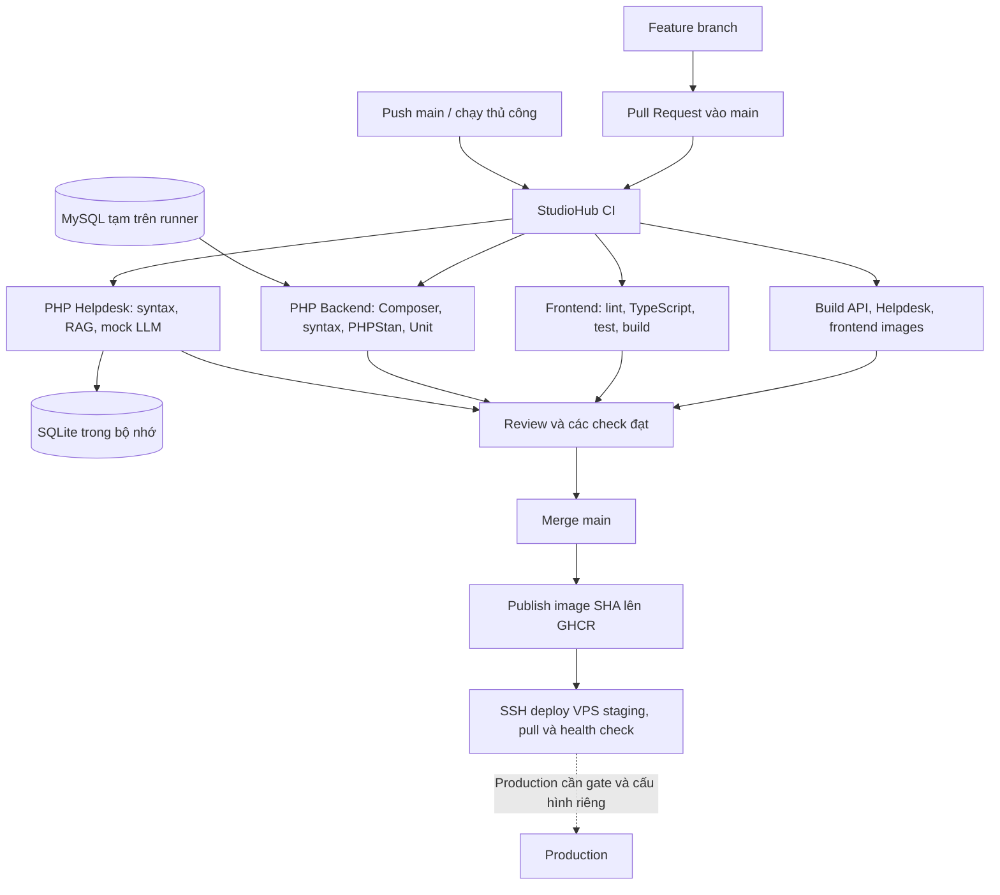

# CI/CD cho StudioHub

## Trạng thái bàn giao

Workflow [`.github/workflows/ci.yml`](../../.github/workflows/ci.yml) có bốn job kiểm tra: Frontend, PHP Backend, PHP Helpdesk và container images. Sau khi cả bốn đạt trên push `main`, workflow publish image SHA lên GHCR nếu đã đặt `STAGING_API_URL`, rồi tự deploy staging qua SSH nếu đủ cấu hình VPS/domain. Host và domain của bạn chưa được nhập vào GitHub; lần deploy thật chưa chạy.

CI/CD không deploy production. Hướng dẫn cấu hình VPS, GitHub variables/secrets và các bước lần đầu nằm trong [STAGING_DEPLOY_VI.md](STAGING_DEPLOY_VI.md). Chưa commit hoặc push các thay đổi trong workspace.

## CI/CD nghĩa là gì?

CI (Continuous Integration) chạy kiểm tra khi nhóm đưa thay đổi vào nhánh chung, giúp phát hiện lỗi trước khi merge. CD (Continuous Delivery) chuẩn bị phiên bản có thể phát hành theo quy trình kiểm soát. Trong phương án StudioHub, production luôn cần người có trách nhiệm phê duyệt.

GitHub Actions phù hợp vì mã nguồn và Pull Request đã nằm trên GitHub: PR chạy kiểm tra/build; push `main` đã qua kiểm tra sẽ phát hành image và tự cập nhật staging sau khi cấu hình được khai báo.



## Kết quả khảo sát repo

| Thành phần | Hiện trạng và lựa chọn CI |
|---|---|
| Frontend | `client/`, Next.js, TypeScript; npm, `client/package-lock.json` |
| Node.js | Chọn Node 24 theo Dockerfile frontend; lần kiểm tra hiện tại dùng 24.22.2 |
| Backend | `server/`, Composer 2, có `composer.json` và `composer.lock` |
| PHP | Cả hai Dockerfile dùng PHP 8.2; Composer yêu cầu >=8.2; CI chọn 8.2 |
| Backend tests | PHPUnit 10 từ require-dev; `server/phpunit.xml` định nghĩa suite `Unit` và `Integration` |
| Backend DB | Một số Unit test mở PDO thật qua constructor `StatsService` và `TokenRevocationRepository` trong `AuthService`, nên cần MySQL tạm |
| Helpdesk | `helpdesk-php/`, có Composer manifest nhưng không có dependency ngoài hoặc lockfile; `bootstrap.php` tự autoload |
| Helpdesk tests | `php tests/run.php`; `tests/Support.php` cấp SQLite `:memory:`, `FakeTransport`, `ScriptedModel` |
| RAG fixtures | `docs/helpdesk/knowledge/knowledge.v1.json`, `helpdesk-php/config/approval-manifest.json`; cần checkout toàn repo |
| Root npm | `package.json` ở gốc dành cho 9Router; không cần cài hay khởi chạy trong CI |
| Workflow | `.github/workflows/ci.yml` chạy khi PR/push vào `main` và khi chạy thủ công |
| Deployment | `docker-compose.staging.yml`, production API image và Caddy TLS cho VPS; cần cấu hình host/domain/secrets trong GitHub trước lần deploy đầu |
| Kiểm tra | Chạy lại frontend, PHPStan, backend Unit, Helpdesk và ba image build trên source hiện tại |

## Workflow và các kiểm tra

Workflow chạy khi mở/cập nhật/mở lại PR có nhánh đích `main`, khi push vào `main`, hoặc qua `workflow_dispatch`. Không có lọc theo đường dẫn để các required check luôn xuất hiện, kể cả PR chỉ sửa tài liệu. Run cũ cùng ref được hủy khi có run mới. Bốn job không phụ thuộc nhau, chạy trên `ubuntu-24.04`, có timeout riêng.

| Check trên GitHub | Thư mục chạy | Các lệnh theo thứ tự |
|---|---|---|
| `Frontend` | `client/` | `npm ci --no-audit --no-fund`, `npm run lint`, `npm run typecheck`, `npm test`, `npm run build` |
| `PHP Backend` | `server/` | `composer install --no-interaction --prefer-dist --no-progress`, PHP syntax, PHPStan level 5, `php vendor/bin/phpunit --configuration phpunit.xml --testsuite Unit --do-not-cache-result` |
| `PHP Helpdesk` | `helpdesk-php/` | PHP syntax, `php tests/run.php` |
| `Container Images` | repository root | Validate staging Compose và build API, Helpdesk, frontend production images. Trên push `main`, publish tag commit SHA lên GHCR khi `STAGING_API_URL` đã cấu hình |

Frontend dùng các scripts có sẵn trong `client/package.json`. Không chạy typecheck song song với build vì Next.js tạo lại `.next/types`. npm cache theo `client/package-lock.json`; vẫn chạy `npm ci` mỗi lần, không cache `node_modules`.

Backend cài cả require-dev để có PHPUnit và PHPStan; không dùng `--no-dev`. Chỉ cache các gói tải về của Composer theo OS, PHP và lockfile, không cache toàn bộ `vendor`. PHP syntax duyệt các file `.php`, bỏ `vendor`; lỗi cú pháp làm job thất bại. PHPStan dùng cấu hình level 5 hiện có trong `server/phpstan.neon`.

MySQL 8.0 của job backend dùng database rỗng `studio_ci_unit`, tài khoản giả chỉ dành cho CI và cổng host do runner cấp. `DB_PORT` lấy từ service context tại bước chạy test. Không mount dữ liệu, không gọi `docker compose`, không chạy migration/seed và không kết nối MySQL của nhóm. Toàn bộ Unit suite hiện tại chạy được với database rỗng này. Healthcheck chờ MySQL khởi động; kết nối PDO trong test kiểm chứng tiếp tài khoản và database.

Helpdesk không cần Composer install vì không có dependency ngoài; cách này cũng khớp Dockerfile hiện có. Kiểm tra syntax bỏ `vendor`, `.runtime`, `var`. Bộ test hiện tại bao gồm retrieval tiếng Việt/không dấu, điều kiện xuất bản tri thức, citation, phân quyền công cụ, parser/retry/timeout của gateway, ticket/handoff và mock LLM. Dữ liệu SQLite ở bộ nhớ, fixture tạm nằm trong `tests/.tmp`.

Không chạy `bin/gateway-smoke.php`, `bin/evaluate.php`, 9Router thật hoặc trả chi phí API trong CI thông thường. Không cài package 9Router ở gốc repo.

## Biến môi trường, quyền và Secrets

PR checks không cần secret. `GITHUB_TOKEN` mặc định có `contents: read`; riêng job `Container Images` được cấp `packages: write` để publish GHCR sau khi các job CI đạt. Job Deploy Staging chỉ lấy SSH/DB/bridge secrets từ GitHub Environment `staging`; không dùng `pull_request_target` hoặc lưu credential checkout. File `.env` staging được tạo tạm trong runner, gửi tới VPS qua SSH và không upload thành artifact/cache.

Các action được khóa bằng commit SHA đã tra từ tag của nguồn phát hành. Checkout, setup-node và cache thuộc tổ chức `actions`; setup PHP dùng action cộng đồng `shivammathur/setup-php`, cần giữ trong danh sách action được repo cho phép. Khi nâng phiên bản, kiểm tra nguồn và cập nhật SHA qua PR.

| Biến | Trong CI |
|---|---|
| `NEXT_PUBLIC_API_URL` | Job Frontend dùng URL loopback giả; image release dùng repository variable `STAGING_API_URL` |
| `NEXT_PUBLIC_DEMO_MODE`, `NEXT_PUBLIC_HELPDESK_MODE` | `false`, `connected`, khớp lựa chọn build ứng dụng |
| `NEXT_TELEMETRY_DISABLED` | `1` |
| `APP_ENV`, `TZ` | Môi trường test và múi giờ của backend |
| `DB_HOST`, `DB_PORT`, `DB_NAME`, `DB_USER`, `DB_PASS`, `DB_PASSWORD` | Chỉ MySQL tạm trên runner; mật khẩu trong workflow là dữ liệu test, không phải credential hệ thống |
| `JWT_SECRET` | Unit test tự cấp chuỗi test; CI không dùng JWT secret thật |
| Helpdesk bridge / 9Router key | Bộ test tự cấp giá trị giả; không lấy secret vận hành |

Tạo GitHub Environment `staging`, rồi thêm SSH key/known_hosts, GHCR pull token, MySQL passwords, JWT secret và Helpdesk bridge secret theo [runbook staging](STAGING_DEPLOY_VI.md). Thêm host, domain, user và `STAGING_API_URL` dưới repository variables. Workflow tự bỏ qua deploy nếu thiếu các biến host/domain; nếu đã bật deploy mà thiếu secret, job sẽ dừng ở bước kiểm tra cấu hình.

`NEXT_PUBLIC_*` là dữ liệu công khai được nhúng lúc build; `STAGING_API_URL` phải là URL công khai, không đặt API key, DB password hay bridge secret vào nhóm biến này. Không in `env`, `.env` hoặc cấu hình Compose đã nội suy vào log. Build PR chỉ tạo image tạm. Push `main` publish image GHCR; deploy staging chỉ chạy khi đủ host/domain variables và Environment secrets.

## Chạy kiểm tra trên máy

Frontend, từ `client/`:

```sh
npm ci
npm run lint
npm run typecheck
npm test
npm run build
```

Trên Windows có chính sách chặn PowerShell script, dùng `npm.cmd` thay cho `npm`.

Backend, từ `server/`:

```sh
composer install --no-interaction --prefer-dist --no-progress
php vendor/bin/phpunit --configuration phpunit.xml --testsuite Unit --do-not-cache-result
```

Trước lệnh PHPUnit, cấp các biến DB trỏ **database test riêng**, tuyệt đối không dùng dữ liệu dev/production. Cần PHP 8.2 với PDO MySQL, mbstring, DOM/XML/XMLWriter; Composer tải gói qua TLS cần OpenSSL và cài archive cần ZIP hoặc unzip. Xem service MySQL trong workflow để dựng database rỗng tương đương. Chạy suite Unit này khi chưa cấp DB sẽ lỗi constructor dù nhiều test dùng mock.

Helpdesk, từ `helpdesk-php/`, cần curl, mbstring, PDO SQLite, iconv:

```sh
php tests/run.php
```

Có thể kiểm tra file workflow bằng `actionlint .github/workflows/ci.yml` từ gốc repo. Đây là công cụ kiểm tra cục bộ, không phải dependency bắt buộc của ứng dụng.

## Kết quả xác minh cục bộ ngày 06/11/2026

| Kiểm tra | Kết quả thực tế |
|---|---|
| Workflow YAML | Đã parse được bằng PyYAML; actionlint chưa chạy được trong môi trường này |
| Frontend install/lint/typecheck/tests/build | Đạt trên Node 24.22.2, source sạch không có `.next` hay `.env`; 193 test hiện tại |
| PHPStan | Level 5, không lỗi trên PHP 8.2.34 |
| Backend Unit | 57 test, 369 assertions đạt trên PHP 8.2.34 với MySQL 8.0 tạm và DB rỗng; container đã được dừng/xóa |
| Helpdesk | 32 test, 130 assertions đạt trên PHP 8.2 trong cấu hình SQLite memory, không gọi provider thật |
| Container images | API production, Helpdesk và frontend production image đều build được trên Podman với tag `:ci` |
| Production database bootstrap | Migrator bỏ qua dữ liệu demo ở `APP_ENV=production`, vẫn tạo các role cần dùng |
| GitHub Actions thực tế | Chưa chạy/xác minh workflow mới trên GitHub |

Một số log lỗi do test chủ động mô phỏng storage failure và kiểm tra che giấu lỗi nội bộ là bình thường. Xem exit code và tổng kết PHPUnit; không kết luận thất bại chỉ từ chữ `Error` trong log fixture.

Container MySQL tạm đã được dừng và tự xóa sau kiểm thử; không mount hoặc thay đổi volume dữ liệu dự án. Các image `:ci` chỉ là tag kiểm tra cục bộ, không được push lên registry. Compose staging giữ dữ liệu trong named volumes; chưa chạy deploy vì host/domain chưa được cấu hình.

Một test frontend ban đầu phát hiện alias cũ `minArea` còn sót trong URL; sau khi sửa chuẩn hóa URL, toàn bộ 193 test chạy đạt. Một test PHP Unit đang kỳ vọng thiếu các bộ lọc mới; sau khi cập nhật expectation, suite 57 test/369 assertions đạt.

## Đưa workflow lên GitHub và đọc kết quả

Theo yêu cầu, chưa thực hiện commit/push. Sau khi nhóm xem xét, người phụ trách có thể chạy từ gốc repo:

```sh
git switch -c ci/github-actions
git add .github/workflows/ci.yml .gitignore docker-compose.staging.yml Caddyfile docs/devops/CICD_GUIDE_VI.md docs/devops/STAGING_DEPLOY_VI.md server/docker/production.Dockerfile server/database/migrate.php server/bin/init-db.php client/src/services/api/room-search.ts server/tests/Unit/RoomServiceTest.php
git diff --cached
git commit -m "ci: add gated Podman staging delivery"
git push -u origin ci/github-actions
```

Kiểm tra staged diff để tránh đưa các thay đổi khác đang làm dở vào commit. Tạo PR từ nhánh vừa push vào `main`. Nếu repo có chính sách hạn chế action hoặc phê duyệt workflow từ fork, chủ repo cần cho phép các action được dùng hoặc duyệt lần chạy.

Trong PR, mở **Checks** để xem bốn check; hoặc vào tab **Actions → StudioHub CI/CD → chọn run → chọn job → mở step lỗi**. Kiểm tra đúng commit SHA, không dùng kết quả xanh của commit cũ. Run màu vàng đang chờ/chạy, đỏ thất bại, xanh đạt; canceled không phải kết quả kiểm tra thành công.

Sau khi workflow có trên nhánh mặc định, có thể vào **Actions → StudioHub CI/CD → Run workflow** để chạy thủ công. Deploy staging tự chạy sau các check khi push `main` và đủ repository variables/secrets. Khi đã sửa lỗi, push thêm vào nhánh PR sẽ tạo run mới; **Re-run failed jobs** phù hợp với lỗi runner/network tạm thời. Chỉ được khẳng định CI trên GitHub thành công sau khi xem đủ bốn CI job đạt tại đúng SHA; deploy staging là job riêng và chưa được xác minh trên VPS thật.

## Xử lý lỗi CI

| Step lỗi | Cách kiểm tra |
|---|---|
| Checkout / setup | Quyền Actions của repo, SHA action, trạng thái GitHub runner/network |
| `npm ci` | Kiểm tra `client/package.json` và lockfile đi cùng nhau; cài lại đúng Node 24, cập nhật lockfile qua npm khi chủ động đổi dependency |
| Composer install | Kiểm tra lockfile, PHP 8.2 và extension; không đổi sang `composer update` trong CI để che lỗi |
| ESLint / TypeScript | Chạy đúng script trong `client/`, sửa lỗi tại file được báo |
| Frontend tests | Xem test đầu tiên thất bại và fixture; không tắt test hoặc bật demo để qua CI |
| Next build | Xem lỗi compile/route/server import và biến build; URL CI không đại diện staging thật |
| Backend PDO | Xem service MySQL, healthcheck, mapped port và các biến DB của step Unit; không đổi sang DB của nhóm |
| PHP syntax / PHPUnit | Dùng PHP 8.2, xem assertion đầu tiên và tổng kết. Unit suite cần cả require-dev và MySQL tạm |
| Helpdesk | Kiểm tra corpus/approval manifest, extension SQLite và fixture; không thay mock bằng API key thật |
| Cache | Thử xóa cache lỗi tại Actions hoặc đổi key có chủ đích; cache chỉ giúp tốc độ, không thay lockfile |

## Quy trình nhóm và bảo vệ main

Khuyến nghị mỗi thành viên làm việc trên nhánh `feat/...`, `fix/...` hoặc `ci/...`; tạo PR vào main, ghi rõ phạm vi và cách kiểm tra. Người làm frontend review frontend; thay đổi backend/schema cần thành viên backend review.

Chủ repo cấu hình **Settings → Rules → Rulesets** hoặc Branch protection cho `main` sau khi các check đã xuất hiện:

- Yêu cầu PR trước merge, ít nhất một approval và giải quyết các cuộc thảo luận.
- Bắt buộc bốn status check: `Frontend`, `PHP Backend`, `PHP Helpdesk`, `Container Images`; chọn đúng tên do run thực tế hiển thị.
- Yêu cầu nhánh cập nhật với main; review lại khi có thay đổi mới làm approval cũ hết hiệu lực.
- Chặn force push và xóa main; giới hạn quyền bypass phù hợp với nhóm.
- Chỉ merge sau khi cả kiểm tra và review đạt.

Nếu sau này bật merge queue, cần thêm event `merge_group` vào workflow trước khi bắt buộc các check cho queue. Chưa bật merge queue hay thay đổi bất kỳ thiết lập repo nào trong tác vụ này.

## CD staging hiện tại

Workflow publish ba image GHCR theo commit SHA sau khi CI đạt. Khi GitHub variables/secrets đã cài, nó SSH vào VPS chạy Podman Compose, Caddy cấp TLS cho frontend/API, chạy migration SQL additive rồi health-check hai public endpoint. Cấu hình lần đầu, DNS/firewall, secrets và thao tác bootstrap nằm trong [STAGING_DEPLOY_VI.md](STAGING_DEPLOY_VI.md).

Chưa có lần deploy thật vì chưa có IP/hostname VPS, domain frontend/API, SSH key, GHCR pull token hoặc secrets runtime trong GitHub. Sau khi thêm các giá trị theo runbook, push commit lên `main` sẽ kích hoạt deploy staging. Production vẫn cần Environment/gate riêng, backup/restore đã diễn tập, migration review và rollback; workflow hiện chỉ deploy staging.

## Phạm vi đã có và phần còn thiếu

CI bao phủ lint, typecheck, production build và test frontend; PHP syntax, PHPStan level 5 và Unit backend; Helpdesk/RAG/mock provider; build thử cả ba production image. Đây không phải báo cáo tỷ lệ code coverage.

Chưa đưa vào CI: PHPUnit `Integration` với database `studio_backend_test`, kiểm thử API end-to-end, browser/Playwright, security audit chuyên biệt và kiểm tra provider thật. Suite Integration hiện có cần schema/seed phù hợp và có ghi dữ liệu, nên chỉ thêm job riêng khi nhóm backend thống nhất bootstrap/cleanup trên DB tách biệt; không chạy vào DB đang sử dụng.

CI đi kèm CD staging có điều kiện cấu hình: image được publish và VPS cập nhật tự động khi GitHub variables/secrets sẵn sàng. Chưa có lần chạy staging thật; production không nằm trong workflow.

Để sẵn sàng production còn cần: một run GitHub xanh được xác minh, chủ repo bật ruleset, hạ tầng staging, registry, cấu hình triển khai riêng, smoke test, chiến lược migration/backup/rollback, monitoring và gate phê duyệt production. Các khác biệt nghiệp vụ API đã ghi trong tài liệu audit frontend/backend cần nhóm backend xử lý riêng; CI không thay đổi logic đó.

Nguồn tham khảo chính thức của các action: [checkout](https://github.com/actions/checkout), [setup-node](https://github.com/actions/setup-node), [cache](https://github.com/actions/cache), [setup-php](https://github.com/shivammathur/setup-php). Khi nâng phiên bản, đối chiếu README/release của từng nguồn thay vì sao chép SHA không kiểm chứng.
