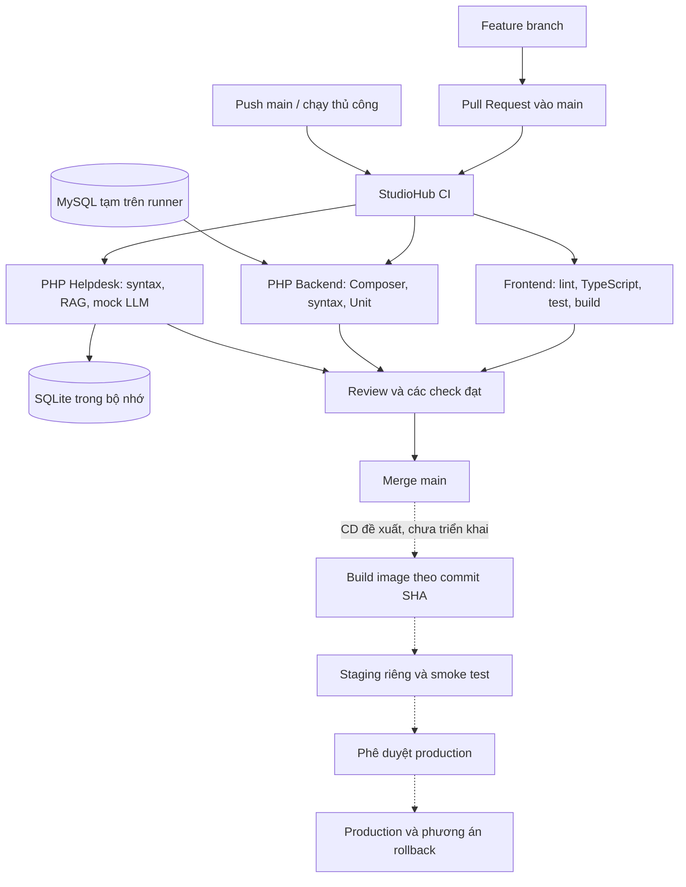

# CI/CD cho StudioHub

## Trạng thái bàn giao

CI đã được cấu hình trong [`.github/workflows/ci.yml`](../../.github/workflows/ci.yml), gồm ba job độc lập. Các lệnh kiểm tra đã được chạy tại máy phát triển; **chưa có lần chạy GitHub Actions nào được xác minh cho workflow mới này**. Chưa commit, push, đổi thiết lập GitHub hay triển khai dịch vụ.

CD hiện là phương án chuẩn bị trong tài liệu này. Repo chưa có máy staging, tên miền, registry hoặc quyền triển khai được xác định. Không có workflow giả lập deploy và không tự động triển khai production.

## CI/CD nghĩa là gì?

CI (Continuous Integration) chạy kiểm tra khi nhóm đưa thay đổi vào nhánh chung, giúp phát hiện lỗi trước khi merge. CD (Continuous Delivery) chuẩn bị phiên bản có thể phát hành theo quy trình kiểm soát. Trong phương án StudioHub, production luôn cần người có trách nhiệm phê duyệt.

GitHub Actions phù hợp vì mã nguồn và Pull Request đã nằm trên GitHub: mỗi PR có kết quả frontend, backend, Helpdesk riêng để thành viên phụ trách xử lý.



## Kết quả khảo sát repo

| Thành phần | Hiện trạng và lựa chọn CI |
|---|---|
| Frontend | `client/`, Next.js, TypeScript; npm, `client/package-lock.json` |
| Node.js | Chọn Node 24 theo Dockerfile frontend; máy kiểm tra dùng 24.21.0 |
| Backend | `server/`, Composer 2, có `composer.json` và `composer.lock` |
| PHP | Cả hai Dockerfile dùng PHP 8.2; Composer yêu cầu >=8.2; CI chọn 8.2 |
| Backend tests | PHPUnit 10 từ require-dev; `server/phpunit.xml` định nghĩa suite `Unit` và `Integration` |
| Backend DB | Một số Unit test mở PDO thật qua constructor `StatsService` và `TokenRevocationRepository` trong `AuthService`, nên cần MySQL tạm |
| Helpdesk | `helpdesk-php/`, có Composer manifest nhưng không có dependency ngoài hoặc lockfile; `bootstrap.php` tự autoload |
| Helpdesk tests | `php tests/run.php`; `tests/Support.php` cấp SQLite `:memory:`, `FakeTransport`, `ScriptedModel` |
| RAG fixtures | `docs/helpdesk/knowledge/knowledge.v1.json`, `helpdesk-php/config/approval-manifest.json`; cần checkout toàn repo |
| Root npm | `package.json` ở gốc dành cho 9Router; không cần cài hay khởi chạy trong CI |
| Workflow cũ | Chưa có `.github/workflows/` trước thay đổi này |
| Deployment | Có Dockerfiles và `docker-compose.yml` cho môi trường local; chưa xác định đích staging/production |
| Working tree | Đã có nhiều thay đổi frontend và tài liệu API chưa commit trước tác vụ; giữ nguyên. Tác vụ CI chỉ thêm workflow và tài liệu này |

## Workflow và các kiểm tra

Workflow chạy khi mở/cập nhật/mở lại PR có nhánh đích `main`, khi push vào `main`, hoặc qua `workflow_dispatch`. Không có lọc theo đường dẫn để các required check luôn xuất hiện, kể cả PR chỉ sửa tài liệu. Run cũ cùng ref được hủy khi có run mới. Ba job không phụ thuộc nhau, chạy trên `ubuntu-24.04`, có timeout riêng.

| Check trên GitHub | Thư mục chạy | Các lệnh theo thứ tự |
|---|---|---|
| `Frontend` | `client/` | `npm ci --no-audit --no-fund`, `npm run lint`, `npm run typecheck`, `npm test`, `npm run build` |
| `PHP Backend` | `server/` | `composer install --no-interaction --prefer-dist --no-progress`, PHP syntax, `php vendor/bin/phpunit --configuration phpunit.xml --testsuite Unit --do-not-cache-result` |
| `PHP Helpdesk` | `helpdesk-php/` | PHP syntax, `php tests/run.php` |

Frontend dùng các scripts có sẵn trong `client/package.json`. Không chạy typecheck song song với build vì Next.js tạo lại `.next/types`. npm cache theo `client/package-lock.json`; vẫn chạy `npm ci` mỗi lần, không cache `node_modules`.

Backend cài cả require-dev để có PHPUnit; không dùng `--no-dev`. Chỉ cache các gói tải về của Composer theo OS, PHP và lockfile, không cache toàn bộ `vendor`. PHP syntax duyệt các file `.php`, bỏ `vendor`; lỗi cú pháp làm job thất bại.

MySQL 8.0 của job backend dùng database rỗng `studio_ci_unit`, tài khoản giả chỉ dành cho CI và cổng host do runner cấp. `DB_PORT` lấy từ service context tại bước chạy test. Không mount dữ liệu, không gọi `docker compose`, không chạy migration/seed và không kết nối MySQL của nhóm. Toàn bộ Unit suite hiện tại chạy được với database rỗng này. Healthcheck chờ MySQL khởi động; kết nối PDO trong test kiểm chứng tiếp tài khoản và database.

Helpdesk không cần Composer install vì không có dependency ngoài; cách này cũng khớp Dockerfile hiện có. Kiểm tra syntax bỏ `vendor`, `.runtime`, `var`. Bộ test hiện tại bao gồm retrieval tiếng Việt/không dấu, điều kiện xuất bản tri thức, citation, phân quyền công cụ, parser/retry/timeout của gateway, ticket/handoff và mock LLM. Dữ liệu SQLite ở bộ nhớ, fixture tạm nằm trong `tests/.tmp`.

Không chạy `bin/gateway-smoke.php`, `bin/evaluate.php`, 9Router thật hoặc trả chi phí API trong CI thông thường. Không cài package 9Router ở gốc repo.

## Biến môi trường, quyền và Secrets

CI hiện tại **không cần GitHub Secret tự tạo**. `GITHUB_TOKEN` do GitHub cấp chỉ có `contents: read`; checkout tắt lưu credential. Không dùng `pull_request_target`, SSH, production environment hay upload artifact. Vì vậy không tải `.env` lên artifact/cache.

Các action được khóa bằng commit SHA đã tra từ tag của nguồn phát hành. Checkout, setup-node và cache thuộc tổ chức `actions`; setup PHP dùng action cộng đồng `shivammathur/setup-php`, cần giữ trong danh sách action được repo cho phép. Khi nâng phiên bản, kiểm tra nguồn và cập nhật SHA qua PR.

| Biến | Trong CI |
|---|---|
| `NEXT_PUBLIC_API_URL` | URL loopback giả phục vụ build; không yêu cầu API đang chạy |
| `NEXT_PUBLIC_DEMO_MODE`, `NEXT_PUBLIC_HELPDESK_MODE` | `false`, `connected`, khớp lựa chọn build ứng dụng |
| `NEXT_TELEMETRY_DISABLED` | `1` |
| `APP_ENV`, `TZ` | Môi trường test và múi giờ của backend |
| `DB_HOST`, `DB_PORT`, `DB_NAME`, `DB_USER`, `DB_PASS`, `DB_PASSWORD` | Chỉ MySQL tạm trên runner; mật khẩu trong workflow là dữ liệu test, không phải credential hệ thống |
| `JWT_SECRET` | Unit test tự cấp chuỗi test; CI không dùng JWT secret thật |
| Helpdesk bridge / 9Router key | Bộ test tự cấp giá trị giả; không lấy secret vận hành |

Nếu tương lai triển khai staging, chủ repo vào **Settings → Environments** tạo `staging` và `production`, rồi cấu hình secrets theo environment. Với secret cấp repo: **Settings → Secrets and variables → Actions → New repository secret**. Chỉ job deploy được duyệt mới tham chiếu secrets tương ứng; không thêm chúng vào job PR.

`NEXT_PUBLIC_*` là dữ liệu công khai được nhúng lúc build; không đặt API key, DB password hay bridge secret vào nhóm biến này. Không in `env`, `.env` hoặc cấu hình Compose đã nội suy vào log. Hiện tại chưa cần tạo secret nào để chạy ba job CI.

## Chạy kiểm tra trên máy

Frontend, từ `client/`:

```sh
npm ci
npm run lint
npm run typecheck
npm test
npm run build
```

Trên Windows có chính sách chặn PowerShell script, dùng `npm.cmd` thay cho `npm`.

Backend, từ `server/`:

```sh
composer install --no-interaction --prefer-dist --no-progress
php vendor/bin/phpunit --configuration phpunit.xml --testsuite Unit --do-not-cache-result
```

Trước lệnh PHPUnit, cấp các biến DB trỏ **database test riêng**, tuyệt đối không dùng dữ liệu dev/production. Cần PHP 8.2 với PDO MySQL, mbstring, DOM/XML/XMLWriter; Composer tải gói qua TLS cần OpenSSL và cài archive cần ZIP hoặc unzip. Xem service MySQL trong workflow để dựng database rỗng tương đương. Chạy suite Unit này khi chưa cấp DB sẽ lỗi constructor dù nhiều test dùng mock.

Helpdesk, từ `helpdesk-php/`, cần curl, mbstring, PDO SQLite, iconv:

```sh
php tests/run.php
```

Có thể kiểm tra file workflow bằng `actionlint .github/workflows/ci.yml` từ gốc repo. Đây là công cụ kiểm tra cục bộ, không phải dependency bắt buộc của ứng dụng.

## Kết quả xác minh cục bộ ngày 04/11/2026

| Kiểm tra | Kết quả thực tế |
|---|---|
| Workflow YAML, context/expression | `actionlint 1.7.12` đạt |
| npm lockfile | `npm ci --dry-run --ignore-scripts --offline --no-audit --no-fund` đạt; chưa chạy cài npm sạch hoàn toàn trong runner GitHub |
| ESLint / TypeScript | Đạt trên working tree hiện tại |
| Frontend unit tests | 189/189 đạt, Node 24.21.0 |
| Next.js production build | Đạt; build cục bộ có đọc `.env.local` hiện có, còn CI dùng biến giả công khai nêu trên |
| Composer backend | Cài dependencies theo lockfile thành công, gồm PHPUnit 10.5.66; không thay lockfile |
| PHP syntax | Đạt trên PHP 8.2.35 trong container với source chỉ đọc, không mạng |
| Backend Unit | 57 test, 369 assertions đạt trên PHP 8.2.35 với MySQL 8.0 tạm, không migration/seed; cũng đạt trên PHP cục bộ 8.5.12 |
| Helpdesk | 32 test, 130 assertions đạt trên PHP 8.2.35 trong container tắt mạng và PHP cục bộ 8.5.12 |
| Source backend / SQL | Đối chiếu SHA-256 của 254 file backend/Helpdesk/database với baseline: 0 file thay đổi hoặc bị thiếu |
| GitHub Actions thực tế | Chưa chạy/xác minh workflow mới trên GitHub |

Một số log lỗi do test chủ động mô phỏng storage failure và kiểm tra che giấu lỗi nội bộ là bình thường. Xem exit code và tổng kết PHPUnit; không kết luận thất bại chỉ từ chữ `Error` trong log fixture.

Container MySQL tạm đã được dừng và tự xóa sau kiểm thử; không mount hoặc thay đổi volume dữ liệu dự án.

Các kết quả trên thuộc working tree hiện tại, gồm cả thay đổi frontend có trước tác vụ CI. Workflow trên GitHub sẽ kiểm tra nội dung thực tế của commit/PR được đưa lên.

## Đưa workflow lên GitHub và đọc kết quả

Theo yêu cầu, chưa thực hiện commit/push. Sau khi nhóm xem xét, người phụ trách có thể chạy từ gốc repo:

```sh
git switch -c ci/github-actions
git add .github/workflows/ci.yml docs/devops/CICD_GUIDE_VI.md
git diff --cached
git commit -m "ci: add frontend backend and helpdesk checks"
git push -u origin ci/github-actions
```

Kiểm tra staged diff để tránh đưa các thay đổi khác đang làm dở vào commit. Tạo PR từ nhánh vừa push vào `main`. Nếu repo có chính sách hạn chế action hoặc phê duyệt workflow từ fork, chủ repo cần cho phép các action được dùng hoặc duyệt lần chạy.

Trong PR, mở **Checks** để xem ba check; hoặc vào tab **Actions → StudioHub CI → chọn run → chọn job → mở step lỗi**. Kiểm tra đúng commit SHA, không dùng kết quả xanh của commit cũ. Run màu vàng đang chờ/chạy, đỏ thất bại, xanh đạt; canceled không phải kết quả kiểm tra thành công.

Sau khi workflow có trên nhánh mặc định, có thể vào **Actions → StudioHub CI → Run workflow** để chạy thủ công. Khi đã sửa lỗi, push thêm vào nhánh PR sẽ tạo run mới; **Re-run failed jobs** phù hợp với lỗi runner/network tạm thời. Chỉ được khẳng định CI trên GitHub thành công sau khi xem đủ ba job đạt tại đúng SHA.

## Xử lý lỗi CI

| Step lỗi | Cách kiểm tra |
|---|---|
| Checkout / setup | Quyền Actions của repo, SHA action, trạng thái GitHub runner/network |
| `npm ci` | Kiểm tra `client/package.json` và lockfile đi cùng nhau; cài lại đúng Node 24, cập nhật lockfile qua npm khi chủ động đổi dependency |
| Composer install | Kiểm tra lockfile, PHP 8.2 và extension; không đổi sang `composer update` trong CI để che lỗi |
| ESLint / TypeScript | Chạy đúng script trong `client/`, sửa lỗi tại file được báo |
| Frontend tests | Xem test đầu tiên thất bại và fixture; không tắt test hoặc bật demo để qua CI |
| Next build | Xem lỗi compile/route/server import và biến build; URL CI không đại diện staging thật |
| Backend PDO | Xem service MySQL, healthcheck, mapped port và các biến DB của step Unit; không đổi sang DB của nhóm |
| PHP syntax / PHPUnit | Dùng PHP 8.2, xem assertion đầu tiên và tổng kết. Unit suite cần cả require-dev và MySQL tạm |
| Helpdesk | Kiểm tra corpus/approval manifest, extension SQLite và fixture; không thay mock bằng API key thật |
| Cache | Thử xóa cache lỗi tại Actions hoặc đổi key có chủ đích; cache chỉ giúp tốc độ, không thay lockfile |

## Quy trình nhóm và bảo vệ main

Khuyến nghị mỗi thành viên làm việc trên nhánh `feat/...`, `fix/...` hoặc `ci/...`; tạo PR vào main, ghi rõ phạm vi và cách kiểm tra. Người làm frontend review frontend; thay đổi backend/schema cần thành viên backend review.

Chủ repo cấu hình **Settings → Rules → Rulesets** hoặc Branch protection cho `main` sau khi các check đã xuất hiện:

- Yêu cầu PR trước merge, ít nhất một approval và giải quyết các cuộc thảo luận.
- Bắt buộc ba status check: `Frontend`, `PHP Backend`, `PHP Helpdesk`; chọn đúng tên do run thực tế hiển thị.
- Yêu cầu nhánh cập nhật với main; review lại khi có thay đổi mới làm approval cũ hết hiệu lực.
- Chặn force push và xóa main; giới hạn quyền bypass phù hợp với nhóm.
- Chỉ merge sau khi cả kiểm tra và review đạt.

Nếu sau này bật merge queue, cần thêm event `merge_group` vào workflow trước khi bắt buộc các check cho queue. Chưa bật merge queue hay thay đổi bất kỳ thiết lập repo nào trong tác vụ này.

## CD đề xuất: staging trước, production có phê duyệt

Chưa có hạ tầng thực để nối CD. Phương án phù hợp với cấu trúc Docker hiện tại là một máy Linux staging riêng, reverse proxy HTTPS, MySQL riêng, lưu trữ uploads và Helpdesk SQLite riêng. Chỉ proxy mở ra ngoài; MySQL và các dịch vụ nội bộ ở mạng riêng.

Trước khi thêm workflow deploy, nhóm cần thống nhất:

| Hạng mục | Cần chuẩn bị |
|---|---|
| Đích staging | VPS/platform, người quản trị, OS/Docker, tài nguyên và quyền truy cập |
| Network | Tên miền, DNS, TLS, firewall, origin frontend và đường dẫn API/Helpdesk |
| Registry | Registry chứa ba image client/API/Helpdesk, quyền publish/pull, tag theo commit SHA hoặc digest bất biến |
| Cấu hình chạy | Compose/manifest dành riêng staging; nguồn ứng dụng/dependencies được đóng gói rõ ràng, không phụ thuộc bind mount source của máy dev |
| Dữ liệu | MySQL staging, uploads và SQLite staging độc lập; dữ liệu thử đã bỏ thông tin nhạy cảm |
| Migration | Backend owner duyệt lệnh và thứ tự migration; backup trước thay đổi. Cơ chế Compose hiện tại chỉ bootstrap DB rỗng, không thay thế kế hoạch nâng schema |
| Health / monitoring | Probe API `/api/health`, frontend, Helpdesk theo healthcheck của image, log/alert và người nhận sự cố |
| AI | Tắt provider thật mặc định khi smoke test; kiểm tra live riêng theo phê duyệt và ngân sách |

Secrets tương lai phụ thuộc phương thức deploy, chưa tạo và chưa được workflow nào sử dụng:

| Secret / variable đề xuất | Mục đích |
|---|---|
| `STAGING_HOST`, `STAGING_USER`, `STAGING_SSH_PORT` | Thông tin máy staging, có thể dùng environment variables |
| `STAGING_SSH_KEY`, `STAGING_KNOWN_HOSTS` | Credential hạn chế quyền và xác minh host nếu chọn SSH; không tắt host verification |
| Credential registry | Chỉ tạo nếu registry cần; GHCR có thể dùng token quyền phù hợp tại job publish riêng |
| `JWT_SECRET`, `HELPDESK_BRIDGE_SECRET` | Giá trị staging riêng, bridge secret khớp giữa frontend server và Helpdesk |
| `DB_PASSWORD`, `DB_ROOT_PASSWORD` | Credential DB staging; DB host/name/user/port là cấu hình runtime tương ứng |
| `NINEROUTER_API_KEY` | Chỉ nếu chủ dự án cho phép dùng provider trên môi trường đó; không cấp vào PR CI |
| URL/origin | Public API URL ở build; internal API/Helpdesk URL, allowlist host, frontend origin và CORS ở runtime |

Luồng phát hành tương lai: chọn commit main đã qua CI → build/publish image với cấu hình staging → phê duyệt/chạy deploy staging → backup và migration được duyệt → khởi động → health/smoke test → ghi nhận SHA/digest và kết quả. Public URL của Next.js được nhúng lúc build, nên cần build theo môi trường hoặc có chiến lược cấu hình runtime được thiết kế riêng.

Production dùng GitHub Environment riêng với required reviewers, quyền deploy hạn chế và secret riêng. Nếu gói GitHub/chính sách repo không hỗ trợ gate cần thiết, phải có cơ chế phê duyệt thay thế trước khi cho phép deploy. Không dùng event push để tự triển khai production.

Rollback phải lưu image digest/config của bản trước, backup MySQL nhất quán cùng uploads và SQLite, người chịu trách nhiệm và quy trình diễn tập restore. Rollback ứng dụng về image cũ chỉ an toàn nếu schema còn tương thích; migration phá vỡ tương thích cần kế hoạch phục hồi hoặc forward fix được backend owner duyệt. Không tự chạy down migration hoặc xóa volume để khôi phục.

## Phạm vi đã có và phần còn thiếu

CI bao phủ lint, typecheck, production build frontend; các test frontend hiện có; syntax PHP và Unit backend; Helpdesk/RAG/mock provider. Đây không phải báo cáo tỷ lệ code coverage.

Chưa đưa vào CI: PHPUnit `Integration` với database `studio_backend_test`, kiểm thử API end-to-end, browser/Playwright, build Docker image, security audit chuyên biệt và kiểm tra provider thật. Suite Integration hiện có cần schema/seed phù hợp và có ghi dữ liệu, nên chỉ thêm job riêng khi nhóm backend thống nhất bootstrap/cleanup trên DB tách biệt; không chạy vào DB đang sử dụng.

Để sẵn sàng production còn cần: một run GitHub xanh được xác minh, chủ repo bật ruleset, hạ tầng staging, registry, cấu hình triển khai riêng, smoke test, chiến lược migration/backup/rollback, monitoring và gate phê duyệt production. Các khác biệt nghiệp vụ API đã ghi trong tài liệu audit frontend/backend cần nhóm backend xử lý riêng; CI không thay đổi logic đó.

Nguồn tham khảo chính thức của các action: [checkout](https://github.com/actions/checkout), [setup-node](https://github.com/actions/setup-node), [cache](https://github.com/actions/cache), [setup-php](https://github.com/shivammathur/setup-php). Khi nâng phiên bản, đối chiếu README/release của từng nguồn thay vì sao chép SHA không kiểm chứng.
