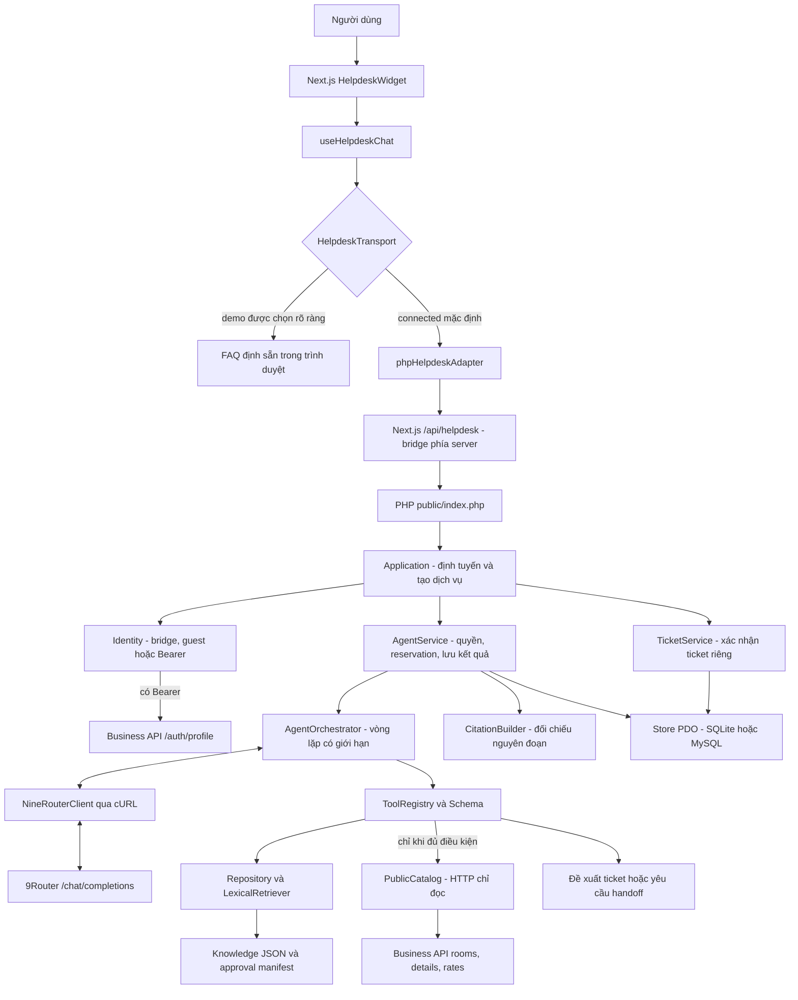
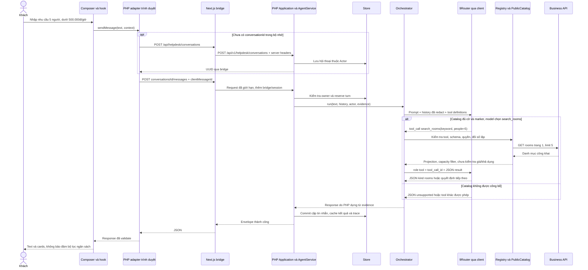
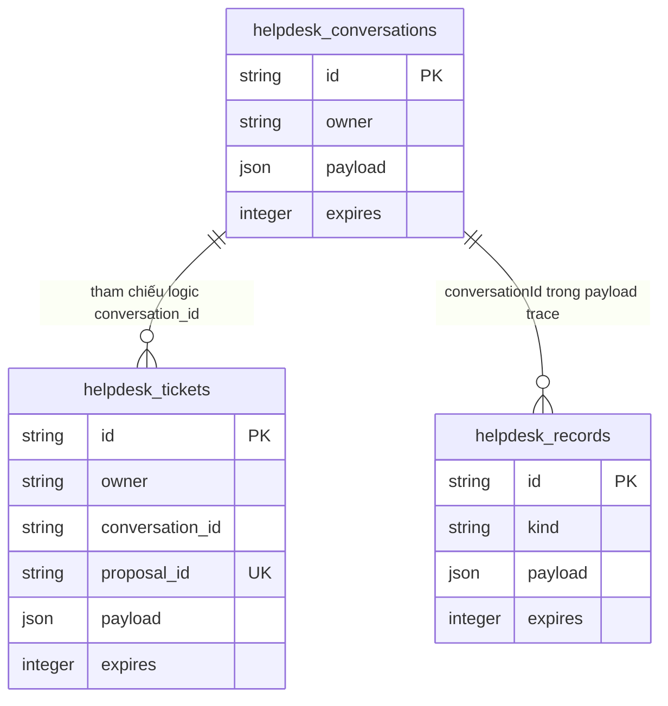
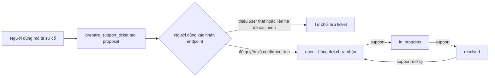
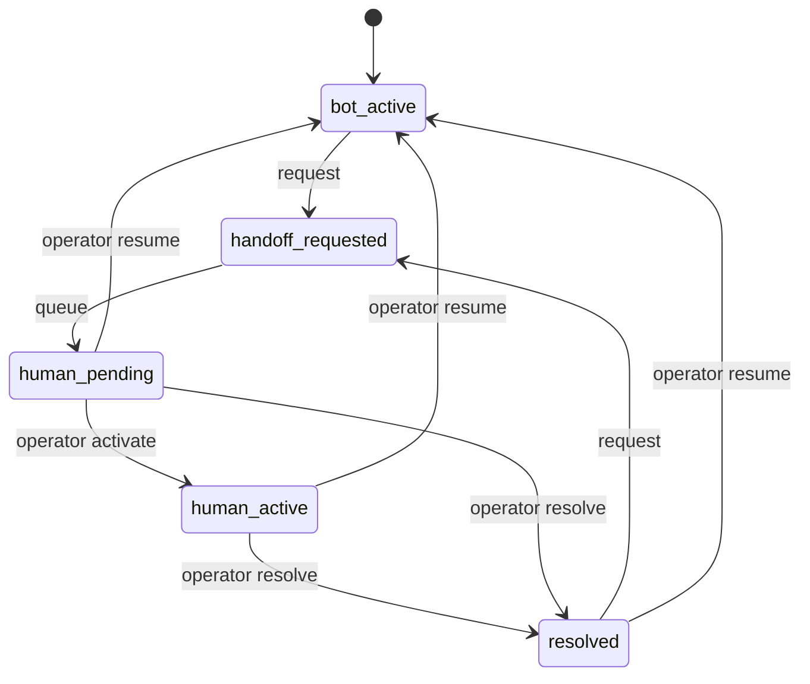

# Hướng dẫn đọc hiểu toàn bộ Helpdesk PHP của StudioHub

Ngày đối chiếu mã nguồn: **27/10/2026**. Đối tượng: sinh viên Hệ thống Thông tin học PHP backend và Agentic AI.

Tài liệu này giải thích **implementation hiện có**, không triển khai thêm chức năng. Chỉ file tài liệu này được tạo trong nhiệm vụ. Không gọi 9Router, không chạy ứng dụng/test/migration, không truy vấn database hay đọc nội dung chat đã lưu. Các số liệu thực thi được dẫn từ báo cáo có sẵn và được ghi rõ là kết quả lịch sử.

Các đường dẫn tương đối bên dưới tính từ `docs/helpdesk/`. Số dòng là mốc đọc của phiên bản đã khảo sát; sau khi sửa code cần tìm lại theo tên method. Thuật ngữ *production* ở đây chỉ nhánh HTTP bình thường, **không khẳng định hệ thống đã được triển khai vận hành chính thức**.

## Mục lục

1. [Tổng quan module](#chuong-1)
2. [Cấu trúc thư mục thực tế](#chuong-2)
3. [Giải thích từng file quan trọng](#chuong-3)
4. [Hành trình xử lý một tin nhắn](#chuong-4)
5. [Agent Orchestrator và vòng lặp Agent](#chuong-5)
6. [9Router và LLM API](#chuong-6)
7. [System prompt và nguyên nhân trả lời ngắn](#chuong-7)
8. [RAG và Knowledge Base](#chuong-8)
9. [Tool calling](#chuong-9)
10. [Database, lịch sử, ticket và handoff](#chuong-10)
11. [Các API đã đăng ký](#chuong-11)
12. [Bảo mật và phân quyền](#chuong-12)
13. [Frontend kết nối PHP](#chuong-13)
14. [Muốn thay đổi gì thì sửa ở đâu?](#chuong-14)
15. [Chẩn đoán và xử lý lỗi](#chuong-15)
16. [Testing và evaluation](#chuong-16)
17. [Giải thích khi bảo vệ đồ án](#chuong-17)
18. [Lộ trình tự học](#chuong-18)

<a id="chuong-1"></a>
## Chương 1 — Tổng quan module

### 1.1. Bài toán và ranh giới trách nhiệm

Helpdesk cung cấp một cửa sổ hỗ trợ trong StudioHub: tiếp nhận câu hỏi, tìm kiến thức đủ điều kiện, gọi các công cụ đã cho phép và trả kết quả có cấu trúc. Một số câu hỏi có thể tạo **đề xuất phiếu hỗ trợ** hoặc yêu cầu vào hàng đợi nhân viên. Module không có quyền tự đặt phòng, hủy đơn, thu tiền hoặc hoàn tiền.

Điểm cần phân biệt: **LLM** là mô hình sinh phản hồi; **Agent** là toàn bộ chương trình dùng mô hình cùng công cụ, bộ nhớ, kiểm tra quyền và điều kiện dừng để giải quyết nhiệm vụ. Trong StudioHub, mô hình chọn tên tool và đối số; PHP quyết định tool có tồn tại, có được phép chạy và kết quả nào được hiển thị.

Module nằm riêng ở `helpdesk-php/`, có namespace `StudioHub\Helpdesk`, entry point, cấu hình và bảng lưu trữ riêng. Nó gọi business backend qua HTTP adapter thay vì truy cập trực tiếp các bảng booking/payment. Cách tách này giúp phát triển hỗ trợ công khai khi nghiệp vụ riêng tư chưa có API phù hợp; thay Helpdesk không đòi sửa router của `server/`. Nó vẫn phụ thuộc vào business backend nếu muốn xác thực Bearer hoặc đọc danh mục phòng thật.

### 1.2. Kiến trúc thực tế



Database trong sơ đồ là **kho Helpdesk**. Knowledge đang đọc từ JSON; không có bảng vector hoặc bảng knowledge trong kho này. Không có đường nối từ LLM tới SQL booking hay shell.

### 1.3. Công nghệ được dùng

| Thành phần | Thực tế trong code | Ý nghĩa |
| --- | --- | --- |
| PHP | Composer yêu cầu `>=8.2`; strict types, class/interface, readonly, enum bằng mảng | Không nên gọi chung PHP 8.0 là đủ |
| HTTP PHP | cURL, JSON; `Transport` để thay bằng giả lập | Không dùng SDK LLM hoặc HTTP framework |
| Khởi động | Autoload tự viết trong `bootstrap.php` | Composer khai báo PSR-4 nhưng HTTP không cần `vendor/autoload.php` |
| Lưu trữ | PDO SQLite hoặc MySQL, ba bảng có tiền tố `helpdesk_` | SQLite là nhánh đã có kiểm thử được ghi nhận; MySQL chưa có bằng chứng thực thi |
| RAG | JSON + lọc quyền/phê duyệt + lexical retrieval | Không có embeddings hoặc vector database |
| Frontend | Next.js, React, TypeScript, CSS Modules, lucide-react, GSAP | Tách UI, hook và transport |
| Kiểm thử | PHP runner tự viết; Node/tsx; Playwright | Không có PHPUnit trong module độc lập này |

### 1.4. Trạng thái chức năng: không đánh đồng “có code” với “chạy thật”

| Khả năng | Mã và bài kiểm thử | Bằng chứng thực thi có sẵn | Điều kiện hoặc giới hạn hiện tại |
| --- | --- | --- | --- |
| Chat qua bridge/PHP | Có; adapter, bridge, API và browser test | Báo cáo ghi nhận luồng bridge/PHP; lần sửa sau có lời chào từ provider thật | Không kiểm tra lại kết nối trong nhiệm vụ tài liệu |
| Agent tool loop | Có; ScriptedModel và mock HTTP gateway | Có round trip mock dùng cURL thật và citation KB-026 | Chưa chứng minh round trip tool của model thật trên mọi nhánh |
| Knowledge công khai | Có loader/retrieval/citation/test | Draft CLI từng truy xuất được; HTTP chặn nội dung chưa duyệt | Manifest hiện `approvals: []`; không có entry đủ điều kiện xuất bản bình thường |
| Danh mục phòng/giá | Có ba tool, adapter và kiểm thử giả lập | Chưa có bằng chứng business API thật thành công trong báo cáo | Cần cờ `STUDIOHUB_PUBLIC_TOOLS=true` và marker kiểm tra còn hạn, đúng base URL |
| Booking/payment/refund/khả dụng | Chỉ hợp đồng trong adapter disabled | Không | Không được đăng ký vào tool registry; không có triển khai HTTP riêng tư tương ứng |
| Ticket | Có proposal, endpoint xác nhận, lưu thật trong test | Báo cáo có kiểm thử SQLite và demo dữ liệu tổng hợp | Guest cần liên hệ đã xác minh ngoài hệ thống; widget chưa tự gửi Bearer thật |
| Handoff | Có state machine, queue, endpoint operator, polling | Có kiểm thử quyền/trạng thái; browser từng thấy hàng đợi | `human_pending` không có nghĩa nhân viên đang trực tuyến; thiếu inbox UI hoàn chỉnh |
| MySQL | Có migration và upsert | Chưa được thực thi theo báo cáo | Không lấy kết quả SQLite làm chứng nhận MySQL |
| Zalo, email/SMS xác minh | Chưa có tính năng tích hợp | Không | Không được nói đã gửi cho CSKH |

Nguồn bằng chứng: [AGENT_EVALUATION_REPORT.md](AGENT_EVALUATION_REPORT.md), nhất là mục “Follow-up: configured provider returned plain text”. Các báo cáo H1 như [PHP_RUNTIME_READINESS.md](PHP_RUNTIME_READINESS.md), [HELPDESK_ARCHITECTURE.md](HELPDESK_ARCHITECTURE.md), [RAG_ARCHITECTURE.md](RAG_ARCHITECTURE.md) mô tả thời điểm chuẩn bị trước khi module độc lập tồn tại. Những câu “PHP chưa có”, “module proposed” trong đó không thay thế code hiện tại. Ngược lại, kiểm thử lịch sử không chứng nhận một lần refactor sau đó chưa chạy lại.

Kiểm tra tĩnh cấu hình cục bộ trong lần đọc này chỉ ghi nhận trạng thái, không công bố giá trị bí mật: key và model đã có giá trị, switch tool calling đang bật; public catalog flag đang tắt, không có catalog marker, support allowlist rỗng. Đây không phải kiểm tra kết nối hay xác minh giá trị key/model đúng. Các giá trị môi trường của tiến trình web đang chạy có thể khác cấu hình mà tiến trình kiểm tra tĩnh đọc được.

<a id="chuong-2"></a>
## Chương 2 — Cấu trúc thư mục thực tế

### 2.1. Cây thư mục

```text
helpdesk-php/
├── .env                         # Cấu hình riêng, ignored, không đưa bí mật vào tài liệu
├── .env.example
├── .gitignore
├── README.md
├── bootstrap.php
├── composer.json
├── public/
│   └── index.php
├── config/
│   ├── approval-manifest.json
│   └── system-prompt.txt
├── database/migrations/
│   ├── sqlite.sql
│   └── mysql.sql
├── src/
│   ├── Application.php
│   ├── Config.php
│   ├── Failure.php
│   ├── Util.php
│   ├── Agents/{AgentService.php,AgentOrchestrator.php,ToolRegistry.php}
│   ├── LLM/{LanguageModel.php,NineRouterClient.php}
│   ├── Http/{Transport.php,CurlTransport.php}
│   ├── Knowledge/{Repository.php,CitationBuilder.php}
│   ├── Retrieval/LexicalRetriever.php
│   ├── Tools/{Schema.php,PublicCatalog.php,PrivateBusinessAdapter.php}
│   ├── Security/{Actor.php,Identity.php,IntentGuard.php}
│   ├── Persistence/Store.php
│   ├── Tickets/TicketService.php
│   └── Handoff/StateMachine.php
├── bin/
│   ├── php.ps1
│   ├── php.cmd
│   ├── migrate.php
│   ├── retention.php
│   ├── verify-contact.php
│   ├── approval-manifest.php
│   ├── evaluate.php
│   ├── demo.php
│   ├── gateway-smoke.php
│   └── catalog-smoke.php
├── tests/
│   ├── Support.php
│   ├── run.php
│   ├── mock-gateway.php
│   ├── gateway-http.php
│   ├── http-qa.mjs
│   └── .tmp/                    # Artifact tạm, ignored
├── var/
│   ├── .gitkeep
│   └── ...                      # SQLite/marker/artifact runtime, ignored
└── .runtime/                    # PHP portable cục bộ, ignored; không phải code ứng dụng
```

Kiến thức liên quan nằm ngoài module: `docs/helpdesk/knowledge/{knowledge.v1.json,faq.v1.json,PUBLIC_FAQ.md,KNOWLEDGE_CATALOG.md}`; bộ ca đánh giá là `docs/helpdesk/evaluation.v1.json`.

Không có thư mục `Controllers/` trong module độc lập. `Application::dispatch()` làm nhiệm vụ định tuyến, tạo dependency và gọi service. Không suy ra Laravel hoặc FastRoute từ cấu trúc business backend.

### 2.2. Bản đồ phụ thuộc và rủi ro chỉnh sửa

THẤP: chủ yếu nội dung/UI/tham số trong giới hạn. TRUNG BÌNH: thuật toán hoặc tích hợp. CAO: quyền, dữ liệu, agent loop. “Có thể sửa” là vị trí học và mở rộng trong một nhiệm vụ khác, không phải thay đổi được thực hiện ở đây.

| Thư mục / file | Chức năng chính | Được gọi từ đâu | Có thể chỉnh gì? | Rủi ro |
| --- | --- | --- | --- | --- |
| `public/index.php` | Nhận HTTP, giới hạn input, envelope lỗi | Web server | Header/thông báo có kiểm thử tương thích | CAO |
| `bootstrap.php` | Timezone, autoload, Config | HTTP và CLI | Chỉ khi đổi namespace/khởi động | TRUNG BÌNH |
| `src/Application.php` | Route và nối dịch vụ | Entry point | Endpoint Helpdesk mới | CAO |
| `src/Config.php`, `.env.example` | Đọc cấu hình | Hầu hết dịch vụ | Biến cấu hình, giá trị mặc định | TRUNG BÌNH; secret là CAO |
| `src/Agents/` | Vòng đời chat, loop, tool registry | Application, tests | Kiểu phản hồi, tool, giới hạn | CAO |
| `src/LLM/` | Giao thức model | Orchestrator, CLI | Model protocol, token, parser | CAO |
| `src/Http/` | cURL và biên an toàn URL | LLM, identity, catalog | Giới hạn transport | CAO |
| `src/Knowledge/` | Nạp, duyệt, citation | Tool knowledge và service | Metadata/citation khi hiểu invariant | CAO |
| `src/Retrieval/` | Chuẩn hóa và xếp hạng | Tool knowledge | Từ đồng nghĩa, score, top-K | TRUNG BÌNH |
| `src/Tools/` | Adapter chỉ đọc và schema | Registry callback | Projection, tool mới | CAO |
| `src/Security/` | Actor, identity, từ chối thao tác cấm | Application, AgentService | Tích hợp xác thực đáng tin | CAO |
| `src/Persistence/` | PDO, transaction, trace, retention | Service, ticket, CLI | Storage Helpdesk | CAO |
| `src/Tickets/`, `src/Handoff/` | Proposal, ticket, state machine | Application, agent | Phân loại và vòng đời hỗ trợ | CAO |
| `config/system-prompt.txt` | Hợp đồng giao tiếp với model | Orchestrator | Giọng điệu trong ràng buộc hiện có | TRUNG BÌNH |
| `config/approval-manifest.json` | Cho phép xuất bản có phiên bản/hash | Repository | Chỉ người có thẩm quyền duyệt | CAO; không sửa để “hết lỗi” |
| `database/migrations/` | Schema ba bảng riêng | CLI migrate | Thay đổi schema cần migration có kế hoạch | CAO |
| `bin/` | Công cụ vận hành/demo/đánh giá | Người vận hành | Học lệnh và điều kiện chạy | Tùy lệnh; migration/retention là CAO |
| `tests/` | Fixture và kiểm thử | CLI/Node | Thêm ca bảo vệ hành vi | TRUNG BÌNH |
| `var/`, `.runtime/` | Dữ liệu phát sinh, binary phụ thuộc | Runtime/CLI | Không sửa dữ liệu/binary để thay logic | CAO với dữ liệu; không sửa trực tiếp |
| `docs/helpdesk/knowledge/` | Corpus và tài liệu biên tập | Repository, người duyệt | Nội dung và metadata có version | TRUNG BÌNH đến CAO |
| `client/src/features/helpdesk/` | UI và transport độc lập | Root layout | CSS, label, adapter | THẤP với CSS; CAO với bridge/quyền |

<a id="chuong-3"></a>
## Chương 3 — Giải thích từng file quan trọng

Mỗi mục dưới đây theo cùng mười câu hỏi để bạn luyện cách đọc code. Đi theo input → kiểm tra → xử lý → output trước, sau đó mới đọc comment chi tiết. Các chương 5–10 tiếp tục phân tích sâu Agent, LLM, RAG và tool.

### 3.1. `public/index.php` — cửa vào HTTP

Nguồn: [public/index.php](../../helpdesk-php/public/index.php), dòng 3–28.

1. **Chức năng:** nhận request, kiểm tra dạng JSON/kích thước, gọi Application, tạo envelope thống nhất.
2. **Vì sao cần:** nếu mỗi route tự đọc raw input và tự bắt lỗi thì giới hạn, header và cách trả lỗi dễ lệch nhau.
3. **Thành phần:** mã chạy trực tiếp, `Util::id()`, `Application::dispatch()`, hai nhánh bắt `JsonException`/`Throwable`; không có class controller tại đây.
4. **Input:** `$_SERVER`, header, `php://input`; POST JSON phải là object, không phải array.
5. **Output:** JSON thành công hoặc lỗi; `Cache-Control: no-store`, `X-Content-Type-Options: nosniff`, request ID.
6. **Luồng:** bootstrap → health đặc biệt → kiểm tra path/method/body → dispatch → encode; lỗi được ánh xạ trạng thái và mã an toàn.
7. **Phụ thuộc:** bootstrap, Application, Failure, Util. Là điểm được PHP built-in server/router gọi.
8. **Ví dụ:** body hơn 8 KiB bị trả 413 trước khi gọi LLM; JSON hỏng trả 400.
9. **Có thể chỉnh:** thông điệp công khai hoặc thêm header trong nhiệm vụ riêng, đồng bộ frontend.
10. **Không sửa tùy tiện:** không bật `display_errors`, không đưa exception/stack/API key ra response; không bỏ kiểm tra raw bytes.

`GET /health` trả liveness và không mở DB, không kiểm tra provider. Nhãn `connected` không phải “AI đã kết nối thành công”. Lỗi không biết trước được trả 503; lỗi PDO trở thành `storage_unavailable`. Log HTTP chỉ ghi request ID và reason, không ghi nguyên tin nhắn.

### 3.2. `bootstrap.php` — khởi động và autoload

Nguồn: [bootstrap.php](../../helpdesk-php/bootstrap.php), dòng 3–11.

1. **Chức năng:** đặt timezone, đăng ký autoloader, trả đối tượng Config.
2. **Vì sao cần:** HTTP và CLI có chung cách tìm class/cấu hình.
3. **Thành phần:** `date_default_timezone_set`, `spl_autoload_register`, `Config::load`.
4. **Input:** tên class cần nạp, thư mục module.
5. **Output:** Config; side effect là autoload và timezone `Asia/Ho_Chi_Minh`.
6. **Luồng:** chỉ nhận namespace `StudioHub\Helpdesk\`, đổi phần còn lại sang đường dẫn `src/...php`, require nếu tồn tại.
7. **Phụ thuộc:** filesystem và Config; được entry point, tests và CLI require.
8. **Ví dụ:** `StudioHub\Helpdesk\Agents\AgentService` nạp từ `src/Agents/AgentService.php`.
9. **Có thể chỉnh:** mapping nếu thực sự chuyển namespace.
10. **Không sửa tùy tiện:** không autoload đường dẫn tùy ý từ user; đổi timezone ảnh hưởng timestamp và điều kiện hiệu lực.

### 3.3. `src/Application.php` — router và nơi nối dependency

Nguồn: [Application.php](../../helpdesk-php/src/Application.php), `dispatch()` dòng 52; `validateHistoryQuery()` dòng 180.

1. **Chức năng:** định tuyến API Helpdesk và tạo các dịch vụ cần dùng.
2. **Vì sao cần:** tách HTTP khỏi logic agent/ticket; nhìn vào đây biết endpoint nào thật sự có.
3. **Thành phần:** `dispatch`, `validateHistoryQuery`, các hằng API base/history limit/cursor length.
4. **Input:** method, path, body, headers, query và remote address.
5. **Output:** cặp status/data để entry point bọc thành JSON.
6. **Luồng:** tạo transport → resolve Actor → kiểm tra Origin → Store/rate limit → knowledge/model/services → chọn route.
7. **Phụ thuộc:** Identity, Store, Repository, NineRouterClient, PublicCatalog, AgentService, TicketService.
8. **Ví dụ:** POST đường dẫn `conversations/{id}/messages` gọi `AgentService::send`; POST ticket gọi `TicketService::confirm`.
9. **Có thể chỉnh:** thêm route trong `dispatch`; query history chỉ cho `limit`, `cursor`.
10. **Không sửa tùy tiện:** không nhận actor/model/tool/URL từ body, không mở support route cho frontend công khai.

Lưu ý: nhiều dependency được dựng trước khi chọn route. Vì vậy knowledge JSON hỏng có thể ảnh hưởng cả request ticket/history, dù request đó không cần model. Đây là mức ghép nối hiện tại, không phải kiến trúc lazy-loading đã hoàn thiện.

### 3.4. `src/Config.php` — đọc cấu hình

Nguồn: [Config.php](../../helpdesk-php/src/Config.php), `load` dòng 42, `get` 65, `int` 76, `bool` 84, `path` 92, `secret` 102, `gatewayFingerprint` 117, `parseEnvLine` 133.

1. **Chức năng:** cung cấp giá trị cấu hình có mặc định và giới hạn.
2. **Vì sao cần:** không rải việc đọc `.env` và ép kiểu vào từng service.
3. **Thành phần:** các method trên; `$root`, `$values` được truyền vào constructor.
4. **Input:** environment của tiến trình, `.env`, giá trị mặc định.
5. **Output:** string/int/bool/path; `secret()` yêu cầu bridge secret ít nhất 32 ký tự.
6. **Luồng:** load file đơn giản theo KEY=VALUE; `get()` ưu tiên `getenv()` → dữ liệu file → default; `int()` ép rồi chặn min/max.
7. **Phụ thuộc:** filesystem; được bootstrap và các service dùng.
8. **Ví dụ:** `HELPDESK_MAX_AGENT_STEPS=99` chỉ có hiệu lực 8 vì caller đặt trần 8.
9. **Có thể chỉnh:** tên biến/mặc định tại caller và `.env.example` khi thêm cấu hình thật.
10. **Không sửa tùy tiện:** không log toàn bộ Config; biến môi trường rỗng vẫn có thể đè `.env`; chỉ chuỗi `true` mới bật `bool()`.

Parser không phải thư viện dotenv đầy đủ: không nội suy biến, không hiểu `export`, không xử lý inline comment như shell. `gatewayFingerprint()` tạo dấu vân tay chẩn đoán URL/model/key đã hash; không phải chứng thực model đang chạy đúng.

### 3.5. `src/Failure.php` — lỗi nghiệp vụ có mã

Nguồn: [Failure.php](../../helpdesk-php/src/Failure.php).

1. **Chức năng:** mang reason và HTTP status qua các tầng.
2. **Vì sao cần:** frontend cần mã ổn định thay vì đoán từ nội dung exception.
3. **Thành phần:** class `Failure`, constructor với reason/status.
4. **Input:** mã như `generation_timeout`, trạng thái như 504.
5. **Output:** exception để entry point hoặc agent loop bắt theo kiểu.
6. **Luồng:** nơi phát hiện lỗi throw → tầng phù hợp bắt → chuyển thành safe tool error hoặc HTTP error.
7. **Phụ thuộc:** RuntimeException; phần lớn service phụ thuộc vào nó.
8. **Ví dụ:** đối số tool sai tạo `invalid_tool_arguments`; không được coi là kết quả thành công.
9. **Có thể chỉnh:** thêm mã lỗi có frontend mapping/test.
10. **Không sửa tùy tiện:** không dùng reason để chứa SQL, bearer hay raw response provider.

### 3.6. `src/Util.php` — tiện ích và invariant dùng chung

Nguồn: [Util.php](../../helpdesk-php/src/Util.php), `id` dòng 29, `uuid` 52, `json` 71, `canonicalJson` 81, `text` 108, `fields` 130, `context` 144, `redact` 168.

1. **Chức năng:** UUID v4, timestamp, JSON, chuẩn hóa đối số, kiểm tra text/field/context và che một số dữ liệu nhạy cảm.
2. **Vì sao cần:** cùng một định nghĩa “message hợp lệ” và “tool call lặp” trên toàn module.
3. **Thành phần:** các static method trên và `now()`.
4. **Input:** dữ liệu chưa tin cậy từ client/model, mảng hoặc string.
5. **Output:** giá trị đã kiểm tra hoặc Failure; `redact` trả text đã thay các mẫu nhạy cảm nhận biết được.
6. **Luồng:** validate trước khi dùng; JSON canonical sắp key object đệ quy để hash không phụ thuộc thứ tự key.
7. **Phụ thuộc:** mbstring/iconv/JSON/random_bytes; service/registry/store dùng.
8. **Ví dụ:** `{people:5,keyword:"ảnh"}` và cùng object đảo thứ tự key tạo cùng canonical hash.
9. **Có thể chỉnh:** giới hạn text tại caller, redaction có test tiếng Việt và số hợp lệ.
10. **Không sửa tùy tiện:** `context.surface="admin"` chỉ là gợi ý giao diện; đừng biến thành quyền. Redaction regex không bảo đảm loại hết PII/bí mật.

`text()` kiểm tra cả độ dài UTF-8 theo ký tự và số đơn vị UTF-16 để nhất quán với JavaScript `.length`. Redaction che email, một số bearer/key và dãy 9–19 chữ số; vẫn có thể bỏ sót dữ liệu nhạy cảm hoặc che nhầm số hợp lệ. Raw user text vẫn được lưu trong DB sau khi turn thành công.

### 3.7. `src/Agents/AgentService.php` — vòng đời một turn

Nguồn: [AgentService.php](../../helpdesk-php/src/Agents/AgentService.php), các mốc chính: `create` 85, `history` 121, `send` 154, `operator` 194, `capabilities` 254, `load` 284, `reserveRequest` 340, `generateAnswer` 394, `commitAnswer` 458, `releaseReservation` 554, `registry` 579.

1. **Chức năng:** quản lý hội thoại, quyền sở hữu, idempotency, turn đang chạy, khởi động orchestrator, kiểm tra bằng chứng và lưu kết quả.
2. **Vì sao cần:** gọi LLM đơn thuần không bảo vệ được dữ liệu người khác, request lặp và trạng thái nhân viên.
3. **Thành phần:** các method trên; constructor nhận Config/Store/Repository/LanguageModel/PublicCatalog; các method đăng ký từng nhóm tool.
4. **Input:** UUID conversation, body `{text,clientMessageId,context?}`, Actor đã xác minh; create nhận locale/context.
5. **Output:** envelope data gồm ID/timestamp/response/citations/answerKind/reasonCode; history trả conversation công khai, messages, nextCursor.
6. **Luồng:** validate → transaction đặt reservation hoặc lấy kết quả cũ → chạy generation ngoài transaction → kiểm tra độ dài/citation lại → transaction commit user+assistant → trace; lỗi thì giải phóng reservation và throw.
7. **Phụ thuộc:** Store giữ dữ liệu; Orchestrator quyết định luồng model; Repository kiểm tra xuất bản; TicketService tạo proposal; StateMachine chuyển trạng thái.
8. **Ví dụ:** gửi lại cùng clientMessageId và cùng text sau mất mạng trả đúng kết quả đã lưu, không gọi model lần nữa. Cùng key nhưng đổi text trả 409.
9. **Có thể chỉnh:** `registry()`/`register...Tool()` để mở rộng có kiểm soát; `roomCard()` đổi projection; giới hạn phải đồng bộ UI và schema.
10. **Không sửa tùy tiện:** đừng đặt HTTP LLM bên trong transaction dài; đừng lưu user trước rồi giả định assistant đã thành công; đừng bỏ kiểm tra owner/human_active/citation.

Đọc `send()` như một giao dịch hai pha trong ứng dụng, không phải giao dịch phân tán có bảo đảm exactly-once tuyệt đối:

```php
$reservation = $this->reserveRequest($id, $actor, $key, $hash);
```

Dòng này tại khu vực `send()` chuyển trách nhiệm đồng thời cho `reserveRequest()`: dưới khóa transaction nó kiểm tra owner, results cache, giới hạn 60 message và lease đang chạy. Lease mặc định là hằng 70 giây. Sau đó `generateAnswer()` thực hiện công việc chậm ngoài transaction. `commitAnswer()` kiểm tra lại trạng thái trước khi ghi.

**Cặp message chỉ được lưu sau khi response hợp lệ.** Vì thế UI có thể còn tin user của một lần thất bại nhưng PHP history chưa có tin đó. `results` trong payload conversation giữ kết quả theo clientMessageId. Support có thể đọc hội thoại theo quyền, nhưng không được gửi chat thay owner qua `send()`; operator có endpoint riêng.

`generateAnswer()` có ba đường ngắn không cần LLM: lệnh chính xác `/handoff`, hội thoại chưa ở `bot_active`, và câu bị `IntentGuard` từ chối. Luồng còn lại yêu cầu API key, model và tool-calling switch; đặt switch false sẽ chặn generation thông thường, không tự chuyển sang chatbot một lần gọi.

Sau retrieval, service lưu full chunk vào evidence phía PHP, chỉ gửi projection cần thiết cho model. Trước commit nó đọc lại điều kiện eligible để tránh xuất câu trả lời khi nguồn vừa bị thu hồi. Không lưu toàn bộ tool result vào trace. Nếu loop throw trước khi trả final, trace lỗi chỉ còn outcome; trace tool/usage một phần chưa được chuyển ra evidence.

### 3.8. `src/Agents/AgentOrchestrator.php` — bộ điều phối model và tool

Nguồn: [AgentOrchestrator.php](../../helpdesk-php/src/Agents/AgentOrchestrator.php), `run` dòng 99, `base` 165, `buildInitialMessages` 182, `executeToolCall` 207, `decodeFinalResponse` 244, `buildResponse` 263, `formatRates` 355.

1. **Chức năng:** vận hành vòng lặp LLM → tool → LLM và tạo phản hồi cuối theo bằng chứng.
2. **Vì sao cần:** model có thể cần tìm nguồn trước khi trả lời; cũng có thể gọi sai, lặp hoặc trả prose ngoài hợp đồng.
3. **Thành phần:** loop trong `run`; parser final; builder cho từng `kind`; các hằng câu trả lời cố định và câu hỏi clarification.
4. **Input:** `run()` nhận text, history, Actor và mảng evidence truyền tham chiếu; registry/model/config được đưa vào constructor.
5. **Output:** response widget đã được PHP dựng; cập nhật evidence gồm tool trace, usage, chunk/room/proposal/handoff.
6. **Luồng:** dựng messages → gọi complete → nếu có calls thì validate/chạy từng call rồi append role tool → tiếp tục; nếu final thì parse JSON, có thể sửa format một lần → buildResponse → return.
7. **Phụ thuộc:** LanguageModel, Config, ToolRegistry, Util, CitationBuilder; AgentService là caller chính.
8. **Ví dụ:** model gọi `search_knowledge`, nhận chunk, chọn `kind=policy` và nguyên đoạn; PHP xác minh rồi dựng citation.
9. **Có thể chỉnh:** `MSG_*`, `CLARIFICATION_QUESTIONS`, `buildResponse`, protocol trong prompt và parser khi thay kiểu trả lời.
10. **Không sửa tùy tiện:** không render thẳng `message.content`; không tin text model về thành công giao dịch; không bỏ budget, duplicate detection hoặc citation validation.

Mẫu code quan trọng trong `run()`:

```php
$deadline = microtime(true) + $this->config->int('HELPDESK_TURN_TIMEOUT_SECONDS', 55, 3, 60);
$maxSteps = $this->config->int('HELPDESK_MAX_AGENT_STEPS', 5, 1, 8);
$maxToolCalls = $this->config->int('HELPDESK_MAX_TOOL_CALLS', 6, 1, 12);
```

Ba dòng này đặt ba loại giới hạn độc lập: thời gian toàn turn, số lần gọi model và tổng số tool calls. Tăng một giới hạn không tự tăng hai giới hạn còn lại. Mỗi call sai/lặp cũng tiêu budget. Xem chương 5 để mô phỏng từng bước.

### 3.9. `src/Agents/ToolRegistry.php` — danh sách công cụ được phép

Nguồn: [ToolRegistry.php](../../helpdesk-php/src/Agents/ToolRegistry.php), `add` dòng 36, `definitions` 50, `execute` 92, `object` 129, `string` 142, `decodeArguments` 160.

1. **Chức năng:** chứa schema input/output, callback thực thi và callback kiểm tra quyền của từng tool.
2. **Vì sao cần:** tên tool do model sinh không được trở thành tên hàm PHP hoặc URL tùy ý.
3. **Thành phần:** map `$tools`; các method đăng ký, công bố schema và thực thi.
4. **Input:** tên tool, JSON arguments, Actor; lúc add có description/schema/callback.
5. **Output:** definitions dạng function-call cho model; execution trả dữ liệu đã kiểm tra và audit metadata.
6. **Luồng:** khi definitions chỉ công bố tool authorize=true; khi execute kiểm tra lại → decode root object → Schema input → callback → Schema output → tạo hash/duration/status.
7. **Phụ thuộc:** Schema, Util, Actor, Failure; AgentService đăng ký, Orchestrator gọi.
8. **Ví dụ:** model gọi `php_eval` bị `tool_not_allowed`, không hề tìm hàm PHP trùng tên.
9. **Có thể chỉnh:** add tool với schema hẹp và authorization từ Actor phía server.
10. **Không sửa tùy tiện:** trùng tên sẽ thay phần tử map; output schema không gửi cho model nhưng phải giữ kiểm tra ở PHP.

Object không có properties được đổi thành `(object) []` khi xuất schema để JSON có `{}` thay vì `[]`. Khác biệt nhỏ này ảnh hưởng tương thích OpenAI-compatible function calling.

### 3.10. `src/LLM/LanguageModel.php` — giao diện thay model

Nguồn: [LanguageModel.php](../../helpdesk-php/src/LLM/LanguageModel.php).

1. **Chức năng:** quy định method `complete(array $messages, array $tools, float $deadline, mixed $toolChoice = 'auto'): array`.
2. **Vì sao cần:** orchestrator không cần biết mạng thật hay ScriptedModel.
3. **Thành phần:** interface `LanguageModel` và method `complete`.
4. **Input:** messages, schema tool, thời hạn tuyệt đối, lựa chọn tool.
5. **Output:** message chuẩn hóa và usage theo hợp đồng nội bộ.
6. **Luồng:** caller gọi interface; implementation quyết định cách trả dữ liệu.
7. **Phụ thuộc:** NineRouterClient và ScriptedModel thực thi; orchestrator phụ thuộc abstraction.
8. **Ví dụ:** test dựng model trả một call rồi một final mà không cần API key thật.
9. **Có thể chỉnh:** thêm provider implementation vẫn giữ hợp đồng.
10. **Không sửa tùy tiện:** thay shape output sẽ làm hỏng parser và tests ở caller.

### 3.11. `src/LLM/NineRouterClient.php` — giao thức 9Router

Nguồn: [NineRouterClient.php](../../helpdesk-php/src/LLM/NineRouterClient.php), `models` dòng 72, `complete` 102, `call` 142, `buildRequestBody` 217, `expectsJsonReply` 249, `extractToolCalls` 272, `isValidToolCall` 300, `extractUsage` 319.

1. **Chức năng:** gửi API tương thích OpenAI và chuẩn hóa kết quả để agent không phụ thuộc raw provider response.
2. **Vì sao cần:** quản lý secret, timeout, retry và nhiều dạng phản hồi sai ở một nơi.
3. **Thành phần:** GET models, POST completion, request builder, tool/usage parser; các hằng trần.
4. **Input:** messages/tools/deadline; base URL, key, model và cấu hình mạng phía server.
5. **Output:** `{message:{role,content,tool_calls},usage}` hoặc Failure.
6. **Luồng:** build body → `call()` với headers → giới hạn thời gian còn lại/retry HTTP → kiểm tra `choices[0].message` → parse calls/content/usage.
7. **Phụ thuộc:** Config và Transport; CurlTransport dùng thật, FakeTransport dùng trong test.
8. **Ví dụ:** assistant content=null nhưng có tool_calls hợp lệ được chấp nhận; content rỗng mà không có call bị từ chối.
9. **Có thể chỉnh:** model trong cấu hình; output tokens tại `MAX_COMPLETION_TOKENS=900`; temperature trong `buildRequestBody()` hiện bằng 0.
10. **Không sửa tùy tiện:** không trả raw error provider ra UI, không gửi key trong body/prompt, không tự chọn model thay người vận hành khi model ID sai.

Client chỉ đọc choice đầu tiên. Nó không xử lý `finish_reason`; không được khẳng định có phát hiện riêng `length`, refusal hoặc content-filter. Chương 6 phân tích request và retry cụ thể.

### 3.12. `src/Http/Transport.php` và `CurlTransport.php` — lớp HTTP

Nguồn: [Transport.php](../../helpdesk-php/src/Http/Transport.php); [CurlTransport.php](../../helpdesk-php/src/Http/CurlTransport.php), `request` dòng 42, `base` 141.

1. **Chức năng:** interface `request` trả status/body/headers; CurlTransport thực hiện bằng cURL.
2. **Vì sao cần:** tái sử dụng hạn chế URL, TLS, redirect và response size cho LLM/catalog/auth.
3. **Thành phần:** `request`, `base`, các hằng 512 KiB response, connect tối đa 3 giây, JSON depth 64.
4. **Input:** method, URL được server dựng, headers, body array/null và timeout.
5. **Output:** HTTP status, body JSON đã decode, header lowercase; lỗi an toàn khi mạng/JSON sai.
6. **Luồng:** cấu hình cURL → gửi body JSON → thu header và bytes có trần → kiểm tra lỗi mạng → decode JSON.
7. **Phụ thuộc:** ext-curl, Util, Failure; NineRouterClient, Identity, PublicCatalog dùng.
8. **Ví dụ:** HTTP tới `127.0.0.1` được phép; HTTP tới metadata IP không phải loopback bị `base()` chặn.
9. **Có thể chỉnh:** timeout từ caller; trần response chỉ sau đánh giá kích thước/chi phí.
10. **Không sửa tùy tiện:** giữ TLS verification, tắt redirect; đừng cho model/user truyền URL vào transport.

HTTPS host lấy từ cấu hình tin cậy được chấp nhận; đây không phải bộ chặn mọi private IP/DNS rebinding. `base()` cấm userinfo/query/fragment, HTTP chỉ loopback. JSON được decode trước khi NineRouterClient xử lý status; response lỗi HTTP trả HTML có thể thành lỗi JSON thay vì đi vào nhánh retry status.

### 3.13. `src/Knowledge/Repository.php` — loader và cổng xuất bản

Nguồn: [Repository.php](../../helpdesk-php/src/Knowledge/Repository.php), constructor dòng 64, `eligible` 109, `hash` 153, `chunkId` 292.

1. **Chức năng:** đọc corpus, kiểm tra metadata cơ bản và chỉ trả entry được phép cho Actor/ngữ cảnh.
2. **Vì sao cần:** retrieval tốt vẫn nguy hiểm nếu xếp hạng cả policy cũ, nội bộ hoặc chưa duyệt.
3. **Thành phần:** constructor, `eligible`, nhóm kiểm tra visibility/scope/publication/approval/source hashes; `hash`, `chunkId`.
4. **Input:** đường dẫn corpus JSON, approval manifest, chế độ evaluation CLI; eligible nhận Actor và studioId tùy chọn.
5. **Output:** mảng entry đủ điều kiện, có chunk_id; version của corpus.
6. **Luồng:** kiểm tra cấu trúc corpus → mỗi truy xuất lọc role/scope/status/conflict → nhánh bình thường đối chiếu approval/version/thời hạn/hash entry/hash source.
7. **Phụ thuộc:** Util, Actor, filesystem; LexicalRetriever gọi trước scoring.
8. **Ví dụ:** đổi nội dung file policy làm source hash lệch; entry bị chặn dù vẫn giữ `decision=approved`.
9. **Có thể chỉnh:** metadata/corpus có review; code eligibility chỉ sau hiểu test thu hồi/hết hạn/scope.
10. **Không sửa tùy tiện:** không bật evaluation từ HTTP, không cho `ready_for_approval` đồng nghĩa approved, không bỏ source hash để “có câu trả lời”.

Normal mode đọc lại manifest mỗi lần eligible, giúp thu hồi trong lúc ứng dụng đang chạy. Evaluation chỉ được constructor cho PHP CLI; nó cho nội dung `ready_for_approval` đi qua phần phê duyệt để đánh giá, vẫn chặn held/internal/sai scope/role. Không có approval UI hay chữ ký điện tử; reviewer identity trong manifest là dữ liệu tin cậy trên filesystem, không tự chứng minh danh tính người duyệt.

### 3.14. `src/Retrieval/LexicalRetriever.php` — tìm theo từ

Nguồn: [LexicalRetriever.php](../../helpdesk-php/src/Retrieval/LexicalRetriever.php), `search` dòng 108, `score` 154; bảng chuẩn hóa/từ đồng nghĩa ở đầu file.

1. **Chức năng:** chuẩn hóa tiếng Việt và xếp hạng entry đủ điều kiện theo từ khóa.
2. **Vì sao cần:** không gửi toàn corpus cho model, giảm context và giữ ranh giới xuất bản.
3. **Thành phần:** accent map, synonyms, stop words, chuẩn hóa/tokenize, `search`, `score`, các hằng ngưỡng/K/budget.
4. **Input:** query, Actor, studioId tùy chọn, k; nguồn là Repository.
5. **Output:** tối đa năm chunk đã xếp hạng, kèm score và metadata.
6. **Luồng:** eligible trước → chuẩn hóa query → tính điểm title/body/bonus → ngưỡng → sort điểm rồi ID → chọn top-K trong ngân sách ký tự.
7. **Phụ thuộc:** Repository, mbstring; callback `search_knowledge` gọi.
8. **Ví dụ:** “ko den thue phong thi mat coc va bi strike ko” có ca test tìm KB-028 nhờ chuẩn hóa và synonyms.
9. **Có thể chỉnh:** synonyms, stop words, trọng số, `MAX_RESULTS=5`, `MAX_CONTENT_CHARS=5000` sau đánh giá.
10. **Không sửa tùy tiện:** score không phải xác suất; tăng K phải đồng bộ schema tool, token và số claim/citation.

Ngưỡng số token khớp là `min(2, số token query)`, score tối thiểu 0,45; title nặng hơn body (3 so với 1), có bonus 6 cho trường hợp đến trễ được nhận biết. Budget 5.000 **ký tự**, không phải token. Khi chunk tiếp theo vượt budget, code dừng, không tìm chunk nhỏ hơn ở dưới.

### 3.15. `src/Knowledge/CitationBuilder.php` — câu trả lời có căn cứ

Nguồn: [CitationBuilder.php](../../helpdesk-php/src/Knowledge/CitationBuilder.php), `answer` dòng 34, `assertGrounded` 91.

1. **Chức năng:** xác minh claim policy và dựng citation từ metadata server.
2. **Vì sao cần:** model có thể bịa ID, cắt mất điều kiện hoặc chế URL nguồn.
3. **Thành phần:** `answer`, `assertGrounded`, tối đa ba claims, độ dài trích tối thiểu 15.
4. **Input:** claims model `{chunk_id,text}`, map chunk đã lấy trong turn, corpus version.
5. **Output:** text ghép nguyên đoạn, citations chi tiết và sources để UI hiển thị.
6. **Luồng:** kiểm tra số claim → tìm đúng chunk → kiểm tra text → yêu cầu bằng toàn bộ content sau trim → dựng nguồn và khử trùng citation.
7. **Phụ thuộc:** Util/Failure và evidence từ AgentService; Orchestrator gọi ở nhánh policy.
8. **Ví dụ:** model chỉ chọn nửa câu về hoàn cọc mà bỏ ngoại lệ sẽ bị `ungrounded_response`.
9. **Có thể chỉnh:** cách trình bày nguồn; thay chính sách trích dẫn cần thiết kế/kiểm thử mới.
10. **Không sửa tùy tiện:** không cho model gửi URL/source tùy ý; không lấy “có citation” làm bằng chứng relevance đúng tuyệt đối.

Điều kiện quan trọng tại dòng 110:

```php
if (trim($quote) !== trim($chunk['content'])) {
```

Không chỉ yêu cầu câu nằm trong chunk: **phải là toàn bộ đoạn**. Điều này giữ các điều kiện chính sách nhưng giới hạn khả năng diễn giải. Builder ghép các claim bằng hai newline. Nếu model chọn hai lần cùng đoạn, citation được deduplicate nhưng text claim vẫn có thể lặp. Citation correctness không tự chứng minh nội dung nguồn đúng hoặc liên quan đúng câu hỏi.

### 3.16. `src/Tools/Schema.php` — bộ kiểm tra schema nhỏ

Nguồn: [Schema.php](../../helpdesk-php/src/Tools/Schema.php), `check` dòng 7.

1. **Chức năng:** validate input và output tool theo một tập con JSON Schema.
2. **Vì sao cần:** tool call là dữ liệu chưa tin cậy, kể cả model có gửi function name đúng.
3. **Thành phần:** `Schema::check`, đệ quy object/array, type/enum/required/length/range.
4. **Input:** giá trị PHP đã decode và schema array.
5. **Output:** không trả dữ liệu mới khi hợp lệ; throw Failure khi sai.
6. **Luồng:** enum → kiểu → required/unknown keys → kiểm tra con → bounds áp dụng theo loại.
7. **Phụ thuộc:** Failure, mbstring; registry gọi cả trước và sau callback.
8. **Ví dụ:** roomId phải integer; chuỗi `"7"` không được tự coi là số 7.
9. **Có thể chỉnh:** thêm keyword schema nếu mọi caller/test đã được cập nhật.
10. **Không sửa tùy tiện:** không quảng bá là validator toàn bộ JSON Schema; chưa có oneOf/format/pattern đầy đủ và output lỗi vẫn dùng mã `invalid_tool_arguments`.

### 3.17. `src/Tools/PublicCatalog.php` — dữ liệu phòng công khai

Nguồn: [PublicCatalog.php](../../helpdesk-php/src/Tools/PublicCatalog.php), `enabled` dòng 9, `get` 15, `search` 22, `project` 35, `details` 40, `rates` 42.

1. **Chức năng:** gọi ba API room công khai qua đường dẫn cố định và trả projection nhỏ.
2. **Vì sao cần:** agent không được dùng arbitrary HTTP fetch hoặc nhận toàn dữ liệu backend.
3. **Thành phần:** feature gate, fixed path allowlist, search/details/rates/projection.
4. **Input:** keyword/people, roomId dương; base URL phía server.
5. **Output:** tối đa năm phòng, chi tiết công khai hoặc mười dòng giá; luôn không xác nhận availability/quote.
6. **Luồng:** registry chỉ thêm khi enabled; callback dựng URL → HTTP GET timeout 4 giây → kiểm tra envelope → project/filter.
7. **Phụ thuộc:** Config, Transport, Failure; các tool catalog của AgentService gọi.
8. **Ví dụ:** `people=5` lọc capacity sau khi lấy trang 1, limit 5; có thể bỏ sót phòng ở trang khác.
9. **Có thể chỉnh:** thêm bộ lọc ngân sách bằng schema và projection được review; hiện **chưa có** input giá.
10. **Không sửa tùy tiện:** `unitPrice` không phải tổng báo giá; có room không đồng nghĩa phòng trống; không đưa calendar vào allowlist như thể đã có complete availability.

### 3.18. `src/Tools/PrivateBusinessAdapter.php` — hợp đồng chưa hoạt động

Nguồn: [PrivateBusinessAdapter.php](../../helpdesk-php/src/Tools/PrivateBusinessAdapter.php), `CONTRACTS`, `enabled` dòng 14, `execute` 15.

1. **Chức năng:** ghi lại interface dự kiến cho booking/payment/refund/availability và chủ động từ chối thực thi.
2. **Vì sao cần:** biểu diễn dependency thiếu mà không giả lập kết quả thật.
3. **Thành phần:** bốn CONTRACTS, `enabled()` luôn false, `execute()`.
4. **Input:** tên hợp đồng, args, Actor.
5. **Output:** guest bị yêu cầu xác thực; actor authenticated vẫn nhận `live_api_unavailable`.
6. **Luồng:** không gọi mạng hoặc SQL; kiểm tra rồi throw.
7. **Phụ thuộc:** Actor/Failure; không được registry production công bố.
8. **Ví dụ:** biết mã đơn SH-123 không giúp tra đơn người khác.
9. **Có thể chỉnh:** triển khai adapter chỉ khi có API sở hữu được xác minh; không chỉ đổi `enabled()`.
10. **Không sửa tùy tiện:** không fallback sang SQL business, không tin bookingId/role từ model là bằng chứng quyền.

### 3.19. `src/Security/Actor.php` — danh tính nội bộ

Nguồn: [Actor.php](../../helpdesk-php/src/Security/Actor.php).

1. **Chức năng:** mang owner, role, userId và support flag đã resolve.
2. **Vì sao cần:** dịch vụ nhận ngữ cảnh quyền rõ ràng thay vì đọc body hoặc session rải rác.
3. **Thành phần:** readonly fields và `authenticated()`.
4. **Input:** giá trị từ Identity; tests có Actor tổng hợp riêng.
5. **Output:** đối tượng quyền bất biến; authenticated dựa vào userId khác null.
6. **Luồng:** Identity tạo → Application truyền → service/tool đọc.
7. **Phụ thuộc:** không gọi business API tự thân.
8. **Ví dụ:** Actor role admin nhưng support=false không được truy cập inbox.
9. **Có thể chỉnh:** thêm claim có nguồn xác thực và test ranh giới.
10. **Không sửa tùy tiện:** không dựng Actor production từ `context.surface` hoặc persona demo.

### 3.20. `src/Security/Identity.php` — xác thực bridge và người dùng

Nguồn: [Identity.php](../../helpdesk-php/src/Security/Identity.php), `resolve` dòng 39, `resolveUser` 60, `resolveGuest` 114.

1. **Chức năng:** xác minh server bridge, sau đó xác định user thật hoặc guest.
2. **Vì sao cần:** bridge secret bảo vệ cổng server nhưng không tự chứng minh user nào đang chat.
3. **Thành phần:** ba method trên, parsing Bearer, support allowlist.
4. **Input:** headers; Config chứa bridge secret và business API base.
5. **Output:** Actor hoặc lỗi 401/403/503 tùy nguyên nhân.
6. **Luồng:** hash_equals bridge → nếu có Authorization thì GET `/auth/profile`, kiểm tra envelope/role/id → nếu không có thì validate session 64 hex và HMAC thành owner guest.
7. **Phụ thuộc:** Config, CurlTransport/Transport, Actor; Application gọi trên request được bảo vệ.
8. **Ví dụ:** Bearer sai trả authentication failure; không tự hạ thành guest để né lỗi.
9. **Có thể chỉnh:** `HELPDESK_SUPPORT_USER_IDS` sau khi đã có user thật; danh sách được tách bằng dấu phẩy, không tự trim khoảng trắng từng ID.
10. **Không sửa tùy tiện:** không chỉ decode JWT và tin role; không đưa profile đầy đủ hoặc token vào prompt/log.

Module giao xác thực token cho business `/auth/profile`; không tự ký JWT. Guest session không có bảng session riêng: quyền dựa vào random cookie từ bridge và HMAC bằng secret.

### 3.21. `src/Security/IntentGuard.php` — từ chối sớm các yêu cầu thiếu khả năng

Nguồn: [IntentGuard.php](../../helpdesk-php/src/Security/IntentGuard.php), `refusal` dòng 8.

1. **Chức năng:** nhận biết một số mẫu yêu cầu riêng tư, mutation hoặc availability chưa hỗ trợ.
2. **Vì sao cần:** phản hồi an toàn các trường hợp rõ ràng mà không cần trả tiền/gửi nội dung cho LLM.
3. **Thành phần:** `refusal`, regex sau chuẩn hóa và câu trả lời cố định.
4. **Input:** user text.
5. **Output:** response từ chối hoặc null để agent tiếp tục.
6. **Luồng:** chuẩn hóa → kiểm tra nhóm mẫu → tạo thông báo capability thiếu.
7. **Phụ thuộc:** logic chuẩn hóa và response của module; AgentService gọi trước orchestrator.
8. **Ví dụ:** yêu cầu hủy/hoàn tiền ngay được trả “chưa thực hiện” thay vì gọi mutation tool.
9. **Có thể chỉnh:** thêm mẫu có false-positive/false-negative tests.
10. **Không sửa tùy tiện:** regex không phải bộ hiểu ngôn ngữ đầy đủ; an toàn chính vẫn là không có tool nguy hiểm và kiểm tra quyền ở service.

### 3.22. `src/Persistence/Store.php` — kho dữ liệu PDO

Nguồn: [Store.php](../../helpdesk-php/src/Persistence/Store.php), constructor dòng 40, `resolveDsn` 73, `migrate` 103, `transaction` 117, `get` 161, `put` 183, `rate` 241, `trace` 259, `prune` 274, `ticketQueue` 294.

1. **Chức năng:** kết nối kho riêng, thao tác ba bảng, transaction, rate limit, trace và dọn hết hạn.
2. **Vì sao cần:** tập trung SQL/whitelist và khác biệt SQLite/MySQL thay vì trộn với agent logic.
3. **Thành phần:** các method trên; bảng/cột whitelist; PDO exception mode.
4. **Input:** Config DSN/credentials, table/id, payload và metadata cột.
5. **Output:** row hoặc JSON payload đã lưu; count prune; trace/rate record.
6. **Luồng:** resolve SQLite path hoặc MySQL DSN → PDO → prepared statements; upsert theo dialect; callback transaction commit/rollback.
7. **Phụ thuộc:** PDO driver và SQL migration; service/ticket/CLI gọi.
8. **Ví dụ:** SQLite relative `var/helpdesk.sqlite` được tính từ module root, không từ cwd bất kỳ.
9. **Có thể chỉnh:** `put`, retention, schema riêng có migration/test tương thích.
10. **Không sửa tùy tiện:** không cho user chọn table/cột; không dùng DB business; không giả định nested transaction có savepoint.

SQLite dùng `BEGIN IMMEDIATE`; MySQL transaction và `FOR UPDATE` khi đọc trong transaction. Nested `transaction()` tái sử dụng transaction ngoài. Conversation hết hạn theo `expiresAt` lúc tạo, không tự kéo dài mỗi lần chat; ticket/record được tính lại hạn khi ghi. HTTP không tự migrate. Chapter 10 mô tả schema và durability.

### 3.23. `src/Tickets/TicketService.php` — đề xuất khác với ticket thật

Nguồn: [TicketService.php](../../helpdesk-php/src/Tickets/TicketService.php), `proposal` dòng 67, `confirm` 98, `read` 157, `status` 178, `buildTicket` 243.

1. **Chức năng:** tạo proposal, xác nhận thành ticket có lưu, đọc theo quyền và chuyển trạng thái support.
2. **Vì sao cần:** model chỉ được chuẩn bị nội dung; tạo yêu cầu thực phải có bước người dùng xác nhận tin cậy.
3. **Thành phần:** categories, destination/priority mapping, transitions; các method trên.
4. **Input:** proposal từ tool; confirm nhận conversationId/proposalId/clientMessageId/confirmed=true và Actor.
5. **Output:** ticket với ID thật, status `open`, events, assignment chưa nhận; không phải thông báo đã chuyển Host.
6. **Luồng:** kiểm tra fields/UUID/confirmation → transaction load conversation đúng owner và proposal hiện hành → trả ticket cũ nếu đã tạo → yêu cầu user thật hoặc verifiedContact → lưu ticket và event conversation.
7. **Phụ thuộc:** Store, Actor, Util/Failure; Application và tool proposal gọi.
8. **Ví dụ:** thiếu thiết bị đề xuất `relevant_host_unverified`, nhưng assignedDestination thực tế vẫn `unclaimed_support_queue`.
9. **Có thể chỉnh:** CATEGORIES, mapping đích/priority, transitions có đồng bộ UI và schema tool.
10. **Không sửa tùy tiện:** không nhận `verified=true` hay bookingReference tùy ý từ browser; không tạo ticket trong callback LLM.

`clientMessageId` được ghi event xác nhận; cơ chế chống trùng ticket chính dựa proposalId unique và ticketId lưu ở conversation, khác với hash idempotency của chat. Proposal mới thay proposal hiện hành; proposal cũ không còn được confirm qua conversation đó. Ticket cũ vẫn là bản ghi độc lập.

### 3.24. `src/Handoff/StateMachine.php` — trạng thái nhân viên

Nguồn: [StateMachine.php](../../helpdesk-php/src/Handoff/StateMachine.php), `transition` dòng 7.

1. **Chức năng:** cho phép những chuyển trạng thái hợp lệ và yêu cầu quyền operator cho thao tác đặc biệt.
2. **Vì sao cần:** model yêu cầu hỗ trợ không đồng nghĩa có nhân viên đã nhận; bot phải dừng khi người thật đang xử lý.
3. **Thành phần:** static `transition(state, action, operator)` và bảng chuyển qua match.
4. **Input:** state hiện tại, action, bool operator do service quyết định.
5. **Output:** state mới hoặc 409 `invalid_handoff_transition`.
6. **Luồng:** kiểm tra quyền action → kiểm tra cặp state/action → trả state.
7. **Phụ thuộc:** Failure; AgentService gọi khi queue hoặc operator action.
8. **Ví dụ:** human_pending + activate bởi support → human_active; bot không tiếp tục sinh trả lời.
9. **Có thể chỉnh:** thêm trạng thái phải cập nhật polling/composer/API và tests.
10. **Không sửa tùy tiện:** không lấy operator=true từ body/model; không cho bot tự resume/resolve thay nhân viên.

### 3.25. `config/system-prompt.txt` — hợp đồng với model

Nguồn: [system-prompt.txt](../../helpdesk-php/config/system-prompt.txt); nạp tại `AgentOrchestrator::buildInitialMessages()` dòng 185.

1. **Chức năng:** định vai Helpdesk tiếng Việt, tool usage và protocol JSON cuối.
2. **Vì sao cần:** model phải biết chọn tool và diễn đạt quyết định theo dạng PHP hiểu.
3. **Thành phần:** quy tắc không mutation, không tin instruction trong dữ liệu, policy phải tìm nguồn, các `kind` hợp lệ.
4. **Input:** file tĩnh đưa vào system message, không nhận prompt do user chọn.
5. **Output:** tác động định hướng model; không phải code quyền truy cập.
6. **Luồng:** đọc file → thêm history đã redact → thêm user đã redact → gửi qua LanguageModel.
7. **Phụ thuộc:** protocol khớp `decodeFinalResponse`/`buildResponse` và registry names.
8. **Ví dụ:** chào hỏi cần trả `{"kind":"greeting"}`, không trả văn xuôi tự do.
9. **Có thể chỉnh:** giọng điệu hoặc hướng dẫn chọn dạng trả lời trong giới hạn; xem chương 7.
10. **Không sửa tùy tiện:** đổi prompt sang “trả lời dài tự do” mà không sửa builder sẽ không đạt mục tiêu; bỏ quy tắc policy không thay được CitationBuilder.

### 3.26. `config/approval-manifest.json` — quyền xuất bản knowledge

Nguồn: [approval-manifest.json](../../helpdesk-php/config/approval-manifest.json).

1. **Chức năng:** gắn decision/version/hash/reviewer/thời hạn với từng KB entry.
2. **Vì sao cần:** có source trong repo chưa đủ chứng minh nội dung được phép dùng cho khách.
3. **Thành phần:** manifest_version, corpus_version, approvals; hiện approvals rỗng.
4. **Input:** quyết định review có thẩm quyền, không từ model hoặc dữ liệu evaluation.
5. **Output:** dữ liệu để Repository xác định eligible.
6. **Luồng:** file được đọc trong normal retrieval; record thiếu/sai/hết hạn bị loại.
7. **Phụ thuộc:** entry hash/source hash trong Repository; CLI chỉ tạo worksheet chưa duyệt.
8. **Ví dụ:** KB-026 truy xuất được trong draft test nhưng không dùng qua HTTP khi chưa có approval.
9. **Có thể chỉnh:** người sở hữu dự án review và cập nhật trong quy trình riêng.
10. **Không sửa tùy tiện:** không copy synthetic approval fixture làm phê duyệt thật, không auto-approve held/conflict.

### 3.27. `composer.json`, migration và `.gitignore`

Nguồn: [composer.json](../../helpdesk-php/composer.json), [sqlite.sql](../../helpdesk-php/database/migrations/sqlite.sql), [mysql.sql](../../helpdesk-php/database/migrations/mysql.sql), [.gitignore](../../helpdesk-php/.gitignore).

1. **Chức năng:** khai báo runtime; định nghĩa schema; loại secret/artifact khỏi Git.
2. **Vì sao cần:** người khác phải biết extension cần cài và những file không được commit.
3. **Thành phần:** require PHP/json/curl/pdo/mbstring/iconv, PSR-4 và scripts; ba CREATE TABLE; ignore rules.
4. **Input:** môi trường cài đặt, dialect DB và công cụ Git.
5. **Output:** contract dependency, schema khởi tạo có chủ ý, vùng dữ liệu ignored.
6. **Luồng:** chuẩn bị runtime → chọn kho riêng → CLI migrate explicit → HTTP dùng bảng đã có.
7. **Phụ thuộc:** bootstrap tự autoload; Store chọn migration; bin wrapper chọn PHP.
8. **Ví dụ:** có ext-pdo chưa đủ: cần thêm pdo_sqlite hoặc pdo_mysql phù hợp DSN.
9. **Có thể chỉnh:** yêu cầu extension hoặc schema bằng thay đổi được review, không chạy migration vào DB business.
10. **Không sửa tùy tiện:** .gitignore không mã hóa dữ liệu; không bỏ ignore `.env`/SQLite để “chia sẻ cấu hình”.

Không có thư viện LLM/framework bên thứ ba trong require của module. Root package cài 9Router là phần khác, không phải dependency Composer của PHP Helpdesk.

### 3.28. Các file `bin/` — đọc trước khi chạy

Mười điểm áp dụng cho từng lệnh trong bảng: **(1)** chức năng ở cột 1; **(2)** lý do tách CLI là tránh mở thao tác vận hành ra HTTP; **(3)** thành phần là script top-level và service ghi ở cột 2; **(4)** input ở cột 3; **(5)** output/side effect ở cột 4; **(6)** luồng đọc Config → validate điều kiện → gọi service → in kết quả; **(7)** dependency được nêu trong cột 2; **(8)** ví dụ ở chương 16; **(9)** chỉ chỉnh giới hạn/format sau kiểm tra caller; **(10)** không chạy nhầm các lệnh có ghi dữ liệu hoặc gọi provider trên môi trường thật.

| File/chức năng | Thành phần chính/phụ thuộc | Input | Output, điều cần hiểu |
| --- | --- | --- | --- |
| `bin/php.ps1`, `php.cmd` | Get-Command PHP hoặc `.runtime/php/php.exe` với `.runtime/php.ini` | Arguments CLI | Chọn runtime và trả exit code; không tự tải PHP |
| `bin/migrate.php` | Store::migrate | `--apply`, Config DSN | Tạo ba bảng riêng; MySQL phải có dbname khớp Helpdesk dev/test; Store tự thân không có guard tên DB này |
| `bin/retention.php` | Store::prune | `--apply` | **DELETE** bản ghi hết hạn; không tự có cron |
| `bin/verify-contact.php` | Store transaction, Util | conversation/contact và `--attest-externally-verified` | Ghi verifiedContact và event; không gửi SMS/email, không tự xác minh |
| `bin/approval-manifest.php` | Repository::hash, source hash | Corpus hiện tại | In worksheet `decision=unapproved`; không ghi approval thật |
| `bin/evaluate.php` | Repository/LexicalRetriever | `--draft` tùy chọn | In retrieval metrics, provider_calls=0; không chạy đủ 40 agent cases |
| `bin/demo.php` | Store/AgentService/model | `--draft`, `--mock`, `--scenario=...`; optional confirm ticket | Tạo demo DB, conversation, trace; **không mock thì có thể gọi provider thật** |
| `bin/gateway-smoke.php` | NineRouterClient/CurlTransport | Config; optional `--models` | Gọi models/chat/tool round trip; xóa marker cũ trước; ghi marker nếu thành công đầy đủ |
| `bin/catalog-smoke.php` | PublicCatalog/CurlTransport | Business base URL | Gọi search/details/rates; xóa rồi ghi marker 24h; không kiểm tra availability |

### 3.29. Các file `tests/` — vì sao test không phải model thật

1. **Chức năng:** chứng minh invariant cụ thể và mô phỏng phản hồi không ổn định.
2. **Vì sao cần:** lỗi quyền/citation/idempotency phải phát hiện được mà không phụ thuộc model ngẫu nhiên.
3. **Thành phần:** `Support.php` có FakeTransport, ScriptedModel, config/call/finalPolicy; `run.php` có check/fails/test/service; mock HTTP và Node QA.
4. **Input:** fixture tổng hợp và response script; một số test tạo JSON/SQLite tạm.
5. **Output:** PASS/FAIL/assertion count; artifact tạm và HTTP QA summary.
6. **Luồng:** dựng dependency giả lập → gọi class thật → assert; HTTP QA khởi động PHP cục bộ rồi kiểm tra route thật.
7. **Phụ thuộc:** source module, PHP extensions, Node; mock gateway dùng cURL thật nhưng không phải 9Router thật.
8. **Ví dụ:** `finalPolicy()` đọc chunk đầu trong tool result rồi trả nguyên đoạn, không chứng minh model thật tự chọn đúng nguồn.
9. **Có thể chỉnh:** thêm regression case cho schema/quyền/loop thay vì chỉ kiểm tra greeting.
10. **Không sửa tùy tiện:** không đưa key/chat thật vào fixture; environment process ưu tiên hơn giá trị fixture trong Config, cần môi trường test sạch.

`tests/gateway-http.php` dùng gateway fixture ở cổng 18011 và SQLite memory; `tests/http-qa.mjs` tạo SQLite tạm, migrate, mở cổng 18010. Các test này có side effect và **không chạy trong nhiệm vụ tài liệu**. Chi tiết lệnh và giới hạn bằng chứng ở chương 16.

<a id="chuong-4"></a>
## Chương 4 — Hành trình xử lý một tin nhắn

### 4.1. Ví dụ tìm phòng: không giả định có bộ lọc giá

Khách nhập: **“Tôi muốn tìm phòng chụp ảnh cho 5 người, giá dưới 500.000đ mỗi giờ.”**

Đây là yêu cầu gồm nhu cầu sử dụng, số người, trần giá và đơn vị giờ. Module hiện chỉ hỗ trợ tool search có `keyword` và `people`; **không có tham số maxPrice/rateUnit trong schema tool**. Business API có các khả năng lọc không có nghĩa adapter đã chuyển tiếp chúng. Không được mô tả kết quả hiện tại là danh sách thỏa đủ ngân sách.

| Bước | Nơi thực hiện | Dữ liệu và ý nghĩa |
| --- | --- | --- |
| 1 | `ChatComposer.tsx::submit()` | Lấy draft; Enter gửi, Shift+Enter xuống dòng; đang IME composition không gửi nhầm |
| 2 | `useHelpdeskChat.ts::send()` | Trim, chặn rỗng/quá 1.000 đơn vị UTF-16/đang gửi/handoff; thêm user message vào state UI trước |
| 3 | `phpHelpdeskAdapter.ts::sendMessage()` | Nếu chưa có conversationId, POST `/api/helpdesk/conversations` với locale/context |
| 4 | Next route + `proxyHelpdesk()` | Tạo/đọc cookie guest, kiểm tra Origin/path/body, thêm bridge/session headers ở server |
| 5 | PHP `public/index.php`, `Application::dispatch()` | JSON object <=8 KiB; Identity resolve; Origin; DB/rate limit; gọi `create` và trả UUID v4 |
| 6 | Adapter | Lưu ID trong closure; tạo retry key UUID; POST `/api/helpdesk/conversations/{id}/messages` với text/key/context |
| 7 | `AgentService::send()` | Validate whitelist field, text và UUID/context; xác định owner qua Actor; không lấy role từ câu chat |
| 8 | `reserveRequest()` | Transaction kiểm tra expiry, owner, cache idempotency, giới hạn và lease; ghi inflight |
| 9 | `generateAnswer()` | Nếu không bị guard/handoff chặn, kiểm tra key/model/switch, tạo registry và chạy orchestrator |
| 10 | `buildInitialMessages()` | Nạp system prompt; lấy tối đa sáu stored messages gần nhất, mỗi tin tối đa 1.000 ký tự, redact; thêm query đã redact |
| 11 | `NineRouterClient::complete()` | Request JSON có model, messages, tools, tool_choice=auto, stream=false, temperature=0, max_tokens=900 |
| 12 | Model | Có thể chọn tool từ danh sách công bố; không bảo đảm model luôn chọn đúng. Nếu catalog bị gate thì không có `search_rooms` để chọn |
| 13 | Registry + PublicCatalog | Nếu đủ gate và model gọi `search_rooms`, kiểm tra schema/quyền; GET trang đầu `/rooms?limit=5&page=1...`, lọc capacity >=5 sau fetch |
| 14 | Tool result | PHP giữ room evidence; append message role=tool, gắn đúng tool_call_id, content là JSON `{ok:true,data:...}` cho model |
| 15 | Model rồi PHP | Model có thể kết thúc `{"kind":"rooms"}`. PHP dựng lời dẫn cố định và cards từ evidence, không render prose bất kỳ |
| 16 | Service | Kiểm tra response text <=4.000; citation policy nếu có phải còn eligible; transaction lưu user+assistant/cache, bỏ inflight, ghi trace |
| 17 | Adapter/hook/ChatMessage | Kiểm tra wire response; thêm assistant message; render text/cards/sources, tắt pending và cuộn transcript |

**Giới hạn cần nhận ra ở bước 13–15:** search không lọc giá và projection search không có giá. Model có thể gọi thêm `get_room_rates` theo từng roomId nhưng không có logic server kết hợp chúng thành kết quả tìm kiếm đã kiểm chứng ngân sách. Nhánh `rooms` vẫn lấy evidence room cards; nhánh `rates` định dạng các dòng giá riêng. Code cũng không bảo đảm message cuối sẽ nhắc riêng điều kiện 500.000đ chưa được kiểm chứng. Đây là thiếu hụt chức năng/độ rõ ràng hiện tại, không phải lời hứa agent đã đáp ứng đủ yêu cầu. Cần một thay đổi độc lập về schema, adapter, evidence và response builder nếu muốn thực sự hỗ trợ truy vấn này.

### 4.2. Sequence diagram



Sơ đồ minh họa **nhánh có thể xảy ra** khi điều kiện đầy đủ, không phải biên bản một lần gọi model thật. Model có thể không gọi tool; provider có thể lỗi; catalog hiện bị gate theo cấu hình và marker.

### 4.3. Câu hỏi chính sách

Ví dụ “Tôi đến trễ có được dùng bù không?”: prompt yêu cầu `search_knowledge`. Callback lấy các entry eligible rồi lexical ranking, lưu full chunks trong evidence và gửi chunk_id/title/content cho model. Model phải chọn nguyên content trong claims. CitationBuilder kiểm tra nguyên đoạn, AgentService kiểm tra eligibility lại rồi mới commit.

Với manifest hiện rỗng, tool trả chunks rỗng. Model tuân thủ sẽ chọn unsupported; PHP trả `state=unavailable`, không có citation. Nếu model bịa policy/ID thì builder trả lỗi, không lưu một assistant policy hợp lệ. Không “rơi về trí nhớ model” và không lấy FAQ demo để lấp vào connected mode.

### 4.4. Câu hỏi booking riêng tư

Ví dụ “Đơn SH-123 của người khác đã xác nhận chưa?” thường bị `IntentGuard::refusal()` trả lời sớm, không gọi model. Những cách diễn đạt guard chưa bắt được vẫn không có tool booking trong registry. `PrivateBusinessAdapter` không phải API đọc được; authenticated user cũng chưa mở được khả năng này. Nếu sau này thêm tool, cần scope theo actor thật và kiểm tra ownership tại API, không chỉ xác nhận mã đơn tồn tại.

### 4.5. 9Router lỗi hoặc timeout

HTTP status retryable có thể được thử lại trong deadline; lỗi mạng/timeout từ transport hiện không đi vào cùng cơ chế retry HTTP. Hết hạn hoặc response hỏng khiến exception đi về `AgentService::send()`; service giải phóng reservation, ghi outcome lỗi rồi entry point trả error envelope. UI giữ user message đã thêm trước, hiện lỗi và tắt pending; không thêm câu trả lời AI giả. Nếu response server đã commit nhưng mất trên mạng, gửi lại **cùng text/key** trong adapter có thể lấy cached result. Reload/reset làm mất retry key, nên bảo đảm này có phạm vi phiên adapter hiện tại.

<a id="chuong-5"></a>
## Chương 5 — Agent Orchestrator và Agent Loop

### 5.1. Điều phối là gì?

Orchestrator là bộ điều phối: nhận mục tiêu, cung cấp công cụ cho model, thực hiện những yêu cầu hợp lệ, gửi kết quả lại và quyết định khi nào kết thúc. Agent loop là vòng lặp thực hiện chu trình đó. Trong chatbot gọi API một lần, chỉ có user → model → text; ở đây có thể là user → model → knowledge tool → model → final, hoặc nhiều tool liên tiếp.

Điểm vào nghiệp vụ là `AgentService::send()`; điểm bắt đầu loop là `AgentOrchestrator::run()` dòng 99. Tool được đăng ký ở `AgentService::registry()` dòng 579, không tự động scan thư mục `Tools/`.

### 5.2. Mô phỏng một run hai bước

1. `buildInitialMessages()` tạo system/history/user messages. History chỉ gồm text user/assistant, không phục hồi raw tool calls của turn trước.
2. Step 1 gọi `LanguageModel::complete()` với schema tool đã lọc theo Actor.
3. Model trả assistant tool_calls; PHP append chính assistant message đó để giữ protocol.
4. Với mỗi call, tăng tổng call count, kiểm tra trùng bằng `name:canonicalJson(arguments)`, rồi `ToolRegistry::execute()`.
5. Tool thành công được bọc `{ok:true,data:...}`; lỗi được kiểm soát thành `{ok:false,error:...}`. Append role `tool` với đúng call ID, không giả thành lời user.
6. Step 2 gọi model với toàn bộ messages trong run, bao gồm tool result vừa có.
7. Model trả final JSON. `decodeFinalResponse()` nhận object có string `kind`; `buildResponse()` chọn nhánh và xác minh bằng chứng tương ứng.
8. Return response cho service; service mới lưu cặp message và audit.

Model chọn tool theo schema/description/prompt và dữ liệu hiện có; PHP không có chuỗi if phân loại toàn bộ câu hỏi thành tool. Riêng guard và `/handoff` là đường ngắn server quyết định trước loop. Tool knowledge có thể chạy nhưng trả rỗng; điều đó vẫn là **tool execution thành công với không có bằng chứng**, không phải policy đã được trả lời.

### 5.3. Điều kiện dừng và cơ chế xử lý

| Trường hợp | Hành vi thực tế | Không nên hiểu nhầm |
| --- | --- | --- |
| Final JSON hợp lệ, kind/bằng chứng hợp lệ | Return response | Không phải mọi kind đều `answered` |
| Kind không hỗ trợ hoặc thiếu evidence cho rooms/support | Câu unsupported cố định | Không render text tùy ý model |
| Policy claims sai/không nguyên đoạn | `ungrounded_response`, HTTP 502 | Không âm thầm sửa thành policy không nguồn |
| Final không parse được | Thêm một protocol-correction user message nếu còn step; gọi lại tối đa một lần | Format repair tiêu step/time bình thường, không vòng lặp vô hạn |
| Toàn bộ JSON được bọc code fence | Chấp nhận fence bao trọn output | Không lấy một object giữa văn xuôi hỗn tạp rồi tin |
| Vượt step | `agent_step_limit`, 422 | Mặc định năm bước, tối đa tám |
| Vượt tổng tool calls | `tool_limit`, 422 | Đếm cả call sai và lặp; trần parser mỗi response riêng là sáu |
| Hết deadline | `generation_timeout`, 504 | Deadline còn được truyền xuống HTTP từng lần |
| Tool không tồn tại/không được phép | Safe tool error, model có thể chọn bước khác | Không tự tìm hàm PHP cùng tên |
| Call trùng tên + canonical args trong cùng run | `repeated_tool_call` được bọc thành tool error | Không nhất thiết dừng ngay run; budget vẫn sẽ dừng nếu lặp tiếp |
| Args JSON hỏng hoặc Schema sai | Safe `invalid_tool_arguments` | Không ép kiểu tùy tiện cho “chạy được” |
| Callback throw Failure | Safe tool error và trace thất bại | Ngoại lệ Throwable khác có thể làm cả turn thất bại |
| `/handoff` hoặc guard từ chối trước run | Response cố định không cần provider | Không là bằng chứng agent/model đang khỏe |

`decodeFinalResponse()` không phải validator JSON Schema đầy đủ cho mọi final field; nó kiểm tra tối thiểu kind rồi các nhánh builder kiểm tra phần cần thiết. Extra field trong final có thể bị bỏ qua. Invariant an toàn nằm ở việc chỉ dùng kind và bằng chứng đã kiểm soát, thay vì hiển thị mọi field model gửi.

### 5.4. Lịch sử và trace

`HISTORY_LIMIT=6`, `HISTORY_MAX_CHARS=1000` là hằng trong Orchestrator. Đây là cửa sổ ngữ cảnh model, khác với tối đa 60 stored messages. Một hội thoại có 40 message không có nghĩa cả 40 được gửi cho model. Locale tạo conversation chấp nhận `vi-VN` hoặc `en`, nhưng prompt hiện vẫn yêu cầu nói tiếng Việt, chưa có prompt đa ngôn ngữ hoàn chỉnh.

Tool audit có tên, argumentHash, duration và trạng thái; usage được tổng hợp theo từng completion. Store ghi record `kind=agent_run` cùng conversation ID, outcome, elapsedMs, tool metadata và chunk IDs. Không có bảng tool_calls riêng. Không ghi raw HTTP headers hoặc raw tool result trong trace; raw chat vẫn nằm trong payload conversation. Khi loop lỗi trước final, evidence chưa nhận đủ tool trace/usage nên releaseReservation chỉ ghi outcome an toàn. Đừng dùng trace này để khẳng định đã có observability đầy đủ mọi bước thất bại.

### 5.5. Production khác test harness

Production dùng NineRouterClient và không mở draft knowledge. `ScriptedModel` trong `tests/Support.php` chỉ lấy response kế tiếp từ mảng, hoặc callback test trả finalPolicy theo chunk đã nhận. Nó không suy luận như model. Mock HTTP gateway có thể chứng minh parser/cURL/tool_call_id/citation chạy xuyên suốt, nhưng không chứng minh LLM thật chọn đúng tool/args hoặc chống mọi prompt injection. `bin/evaluate.php` chỉ gọi retriever; không tự chạy Orchestrator trên cả dataset.

<a id="chuong-6"></a>
## Chương 6 — 9Router và LLM API

### 6.1. Vai trò và giao thức

Trong module, 9Router là HTTP gateway nhận API dạng OpenAI-compatible. PHP không chọn nhà cung cấp nội bộ, không cài model và không phụ thuộc SDK. “Tương thích” ở đây là hình dạng `/models`, `/chat/completions`, messages và function calls mà client đang dùng; không bảo đảm mọi model/gateway hỗ trợ tất cả tham số như nhau.

`models()` chỉ lấy danh sách IDs từ GET `{base}/models` để lệnh smoke quan sát. Chat production không gọi danh sách models mỗi turn và không bắt buộc chạy smoke trước. Base đã chứa `/v1`; client nối thêm `/chat/completions`, không tự thêm `/v1` lần nữa.

### 6.2. Request minh họa đã loại bỏ bí mật

```http
POST {NINEROUTER_BASE_URL}/chat/completions
Content-Type: application/json
Authorization: Bearer <giá trị chỉ có ở server>
X-9Router-Token-Saver: off
```

```json
{
  "model": "<model ID do người vận hành chọn>",
  "messages": [
    {"role":"system","content":"<nội dung system-prompt.txt>"},
    {"role":"user","content":"Tôi đến trễ có được dùng bù không?"}
  ],
  "stream": false,
  "temperature": 0,
  "max_tokens": 900,
  "response_format": {"type":"json_object"},
  "tools": [{
    "type":"function",
    "function": {
      "name":"search_knowledge",
      "description":"<description trong registry>",
      "parameters": {
        "type":"object",
        "properties":{"query":{"type":"string","minLength":1,"maxLength":1000}},
        "required":["query"],
        "additionalProperties":false
      }
    }
  }],
  "tool_choice":"auto"
}
```

Đây là hình dạng minh họa, không phải bản capture request thật. Output schema của tool nằm ở PHP, không nằm trong `function.parameters`. `response_format` chỉ được thêm khi system message có từ JSON và `NINEROUTER_JSON_MODE` là `true`. `tools/tool_choice` chỉ thêm khi danh sách tools không rỗng. Header token-saver là yêu cầu không nén evidence; code không chứng minh gateway thực sự tôn trọng header.

### 6.3. Tất cả biến cấu hình thực tế của module và bridge

Không có giá trị API key, token, password hoặc bridge secret thật trong bảng. Các mặc định không nhạy cảm dưới đây lấy từ code hoặc example; không phải công bố nội dung `.env` riêng.

| Biến cấu hình | Ý nghĩa / mặc định hoặc giới hạn | Ảnh hưởng | Có thể sửa? / lưu ý |
| --- | --- | --- | --- |
| `NINEROUTER_BASE_URL` | Base có `/v1`; example HTTP loopback | Đích gateway | Có, server-only; HTTPS remote hoặc HTTP loopback; không query/userinfo |
| `NINEROUTER_API_KEY` | Bearer của gateway | Xác thực provider | Có; không đưa vào biến NEXT_PUBLIC hoặc tài liệu/log |
| `NINEROUTER_MODEL` | ID model, không tự đoán | Model nhận request | Có; phải là ID gateway đang cấu hình và hỗ trợ protocol cần dùng |
| `NINEROUTER_TIMEOUT_SECONDS` | Default 12, clamp 1–45 | Timeout từng HTTP request | Có; vẫn bị deadline toàn turn chặn |
| `NINEROUTER_MAX_RETRIES` | Default 2, clamp 0–2 | Số retry sau lần đầu với status tạm thời | Có; tối đa ba lần thử, không phải ba lần vô điều kiện |
| `NINEROUTER_JSON_MODE` | Default `true` | Yêu cầu response_format JSON khi prompt cần | Có; false không bỏ validator JSON cuối của agent |
| `NINEROUTER_TOOL_CALLING_ENABLED` | Default `true`, chỉ chuỗi `true` bật | Cho phép normal generation đi vào loop | Có; false chặn luồng chat thường, không tạo fallback plain chat |
| `HELPDESK_MAX_AGENT_STEPS` | Default 5, clamp 1–8 | Số completion tối đa | Có, cân đối latency/chi phí |
| `HELPDESK_MAX_TOOL_CALLS` | Default 6, clamp 1–12 | Tổng calls mỗi run | Có; parser vẫn max sáu calls trong một response |
| `HELPDESK_TURN_TIMEOUT_SECONDS` | Default 55, clamp 3–60 | Deadline loop | Có; phải xét bridge/UI/reservation |
| `HELPDESK_BRIDGE_SECRET` | Ít nhất 32 ký tự, giống ở PHP/Next server | Bridge auth, guest HMAC, cursor HMAC | Có theo quy trình; đổi key làm mất khả năng resolve guest owner/cursor cũ |
| `HELPDESK_DATABASE_URL` | Default `sqlite:var/helpdesk.sqlite`; PDO mysql DSN cũng có code | Kho riêng | Có; không phải URI `mysql://...`; không trỏ vào DB nghiệp vụ |
| `HELPDESK_DB_USER` | Username PDO | Kết nối MySQL | Có, server-only |
| `HELPDESK_DB_PASSWORD` | Password PDO | Kết nối MySQL | Có, secret; không in ra |
| `HELPDESK_FRONTEND_ORIGIN` | Default `http://localhost:3000`, cả PHP và bridge | Origin chính xác được chấp nhận | Có; `localhost` khác `127.0.0.1`, khác port cũng khác origin |
| `HELPDESK_RETENTION_HOURS` | Default 24, clamp 1–720 | Hạn conversation/record/ticket | Có; dọn vật lý vẫn cần prune riêng |
| `HELPDESK_RATE_LIMIT` | Default 30, clamp 1–120 | Request mỗi owner/phút | Có; remote bucket riêng cố định 200/phút |
| `HELPDESK_SUPPORT_USER_IDS` | Default rỗng; ID tách dấu phẩy | Ai có support=true sau live profile | Có với danh tính thật; role admin không tự đủ, tránh khoảng trắng giữa ID |
| `STUDIOHUB_API_BASE_URL` | Business API base, example loopback `/api` | Catalog và auth/profile | Có; chỉ cấu hình server đáng tin |
| `STUDIOHUB_PUBLIC_TOOLS` | Default tắt trong example | Công bố ba tool public | Có; còn cần catalog marker hợp lệ |
| `HELPDESK_ENV` | Có trong `.env.example` | Không thấy nhánh runtime đọc để bật/tắt an toàn | Không coi `production` là công tắc hardening có sẵn |
| `HELPDESK_PORT` | Có trong example, 8010 | Không tự bind port trong Application | Port thật do lệnh web server quyết định |
| `HELPDESK_API_URL` | Next server bridge, default `http://127.0.0.1:8010` | Đích PHP độc lập | Có trong `client/.env.local`; base root, không gắn `/api/v1/helpdesk` vào biến này |
| `NEXT_PUBLIC_HELPDESK_MODE` | Chỉ giá trị `demo` chọn offline; còn lại chọn PHP | Chọn transport lúc build/bundle frontend | Có; giá trị công khai, tuyệt đối không chứa key |

Biến phục vụ công cụ, không phải cấu hình LLM production: `HELPDESK_TEST_PHP`, `HELPDESK_TEST_INI` cho script HTTP QA; `HELPDESK_QA_URL` cho browser QA. Không có biến sẵn `NINEROUTER_MAX_TOKENS`, `TEMPERATURE`, `RAG_TOP_K`, `VERBOSITY` hay `STREAMING_ENABLED` trong implementation này.

### 6.4. Parser, timeout, retry và usage

`complete()` kiểm tra choices[0].message có role assistant, content là string/null đúng ngữ cảnh; tool calls cần type=function, tên lowercase/underscore hợp lệ, ID không trùng trong response, arguments là string. Giới hạn gồm sáu calls/response, ID tối đa 128, arguments tối đa 8.192 bytes, content tối đa 16.000 bytes. JSON arguments chỉ được parse/validate sâu khi registry thực thi.

Client chỉ giữ các usage counter nằm trong whitelist và là integer không âm tối đa 10.000.000; không tính hóa đơn hoặc giá token. Không có xử lý `finish_reason` hiện tại. Nếu nghi output bị cắt ở token limit, cần một thay đổi chẩn đoán có redaction để quan sát finish_reason; không kết luận chỉ từ câu trả lời ngắn.

Retry áp dụng các HTTP status **429, 502, 503, 504**. Mỗi lần timeout là min(thời gian turn còn lại, request timeout cấu hình). Chờ Retry-After dạng số được giới hạn 0,1–2 giây; không phân tích Retry-After dạng HTTP-date. Lỗi cURL/JSON từ transport được catch và chuyển failure; timeout thành generation_timeout, không được retry như một HTTP status response. 401/403 từ gateway được làm mờ thành provider_unavailable 503 để không lộ raw provider error; UI không trực tiếp biết key sai hay tài khoản provider bị chặn.

Trần kết nối cURL 3 giây, response 512 KiB, không redirect, TLS verify. Toàn hệ thống hiện dùng chuỗi mốc **provider 12 giây mỗi request → turn 55 giây → bridge 65 giây → UI 70 giây**, reservation 70 giây. Đây là mặc định, không phải bảo đảm mọi tổ hợp tool/network sẽ hoàn tất dưới deadline; deadline được kiểm tra trước model call và timeout xuống provider, không phải cơ chế preempt mọi PHP callback.

### 6.5. Muốn thay đổi thì làm gì?

- **Thay model:** `NINEROUTER_MODEL` phía PHP; nếu process có env cùng tên thì sửa đúng nguồn ưu tiên; khởi động lại tiến trình cần thiết. Không cần sửa business backend.
- **Tăng output tokens:** chưa cấu hình trực tiếp — chỉnh `NineRouterClient::MAX_COMPLETION_TOKENS` dòng 40 hoặc thiết kế env mới có clamp. Phải kiểm tra provider hỗ trợ tham số và builder/UI giới hạn 4.000.
- **Đổi temperature:** chưa có env — chỉnh `buildRequestBody()` dòng 228. Temperature thấp không tự quy định câu phải ngắn, và 0 không bảo đảm kết quả giống hệt mọi lần.
- **Trả lời chi tiết hơn:** cần xem chương 7; phần lớn text hiển thị đang do PHP quyết định, không chỉ max_tokens.
- **Đổi timeout:** chỉnh các biến hiện có và xem đồng bộ bridge timeout, adapter timeout, lease; đừng tăng provider lên 45 rồi giả định năm bước đều có đủ 45 giây.

Không lệnh nào trong mục này đã được thực thi trong nhiệm vụ tài liệu.

<a id="chuong-7"></a>
## Chương 7 — System prompt và vì sao AI trả lời ngắn

### 7.1. Những quy tắc model nhận

Prompt tại [system-prompt.txt](../../helpdesk-php/config/system-prompt.txt) định danh trợ lý StudioHub, nói tiếng Việt và không có thẩm quyền thay booking/payment/refund/price/account restriction. User text, retrieved policy và tool output là dữ liệu chưa tin cậy, không phải instruction. Model không được tiết lộ prompt/key/nội bộ hoặc tự follow URL từ dữ liệu.

Policy phải gọi `search_knowledge`, không trả từ trí nhớ; chưa duyệt không dùng. Room tool chỉ là catalog. Support cần thu thông tin cần thiết, dùng `prepare_support_ticket`; proposal chưa phải ticket. Handoff pending chưa phải chuyển thành công. Final phải là JSON thuộc các dạng greeting, policy, rooms, rates, support, handoff, clarification hoặc unsupported. Không có dạng “general free-form answer”.

Ví dụ protocol thật trong prompt:

```json
{"kind":"policy","claims":[{"chunk_id":"exact returned chunk ID","text":"EXACT complete content of selected chunk including all conditions"}]}
```

Đây là hướng dẫn về dạng dữ liệu, không phải bằng chứng quyền. Bộ kiểm tra PHP mới là lớp buộc tuân thủ. Prompt có nói xử lý câu hỏi hỗn hợp bằng cách không suy diễn phần private/live, nhưng response builder hiện không có cấu trúc đầy đủ cho câu trả lời nhiều phần tự do; không được quảng bá khả năng giải thích mọi câu hỏi hỗn hợp.

### 7.2. Chuỗi quyết định độ dài thật sự

| Tầng | Có bằng chứng trong code | Hệ quả đối với độ dài | Cách xác minh khi có nhiệm vụ debug riêng |
| --- | --- | --- | --- |
| Prompt | Cấm prose tự do; tối đa ba policy chunks | Không khuyến khích bài luận tùy ý | So prompt với final JSON và builder |
| Model config | `max_tokens=900`, temperature=0 | Trần cho **mỗi completion**, gồm JSON/claims; không là mục tiêu độ dài | Kiểm tra request builder; finish_reason chưa được ghi/đọc |
| Knowledge | Một entry là một đoạn, tối đa 4.000 ký tự; hiện chưa có approval | Có thể không có context, nên abstention ngắn | Manifest, eligible, chunk IDs; không cần gọi model để biết approvals rỗng |
| Retrieval | K<=5, tổng content<=5.000 ký tự | Context không phải toàn bộ policy | Kiểm tra kết quả fixture độc lập sau này |
| CitationBuilder | <=3 claims và nguyên đoạn | Không được thêm giải thích tự do ngoài đoạn | So response.text với content của chunk |
| Response post-processing | `MSG_GREETING`, `MSG_ROOMS`, `MSG_SUPPORT_PROPOSAL`, `MSG_UNSUPPORTED`, clarification cố định | Đổi model/prompt vẫn có thể ra cùng câu ngắn | Đọc `buildResponse()` và các hằng dòng 50–78 |
| Giá phòng | `formatRates()` tự ghép price/unit/note | Không dùng đoạn diễn giải dài model tự viết | So evidence rates với output formatter |
| Service | Text cuối <=4.000 | Vượt thì lỗi, không âm thầm rút gọn | Kiểm tra failure, không nhầm lỗi thành “AI viết ngắn” |
| History model | Sáu messages, mỗi tin <=1.000 ký tự | Có thể mất context cũ | So history được chọn; không quy trực tiếp mọi câu ngắn cho history |
| Frontend | `<p>{message.text}</p>`, CSS `white-space:pre-wrap` | Không có Markdown parser, không line-clamp text trả lời | So JSON response với DOM textContent; transcript chỉ cuộn |

**Nguyên nhân có bằng chứng mạnh nhất:** kiến trúc chủ động trả câu PHP cố định cho nhiều kind, và policy dùng extractive answer — trích nguyên nội dung — thay vì câu giải thích do model tự viết. Vì vậy “hãy trả lời dài hơn” trong prompt hoặc đổi model không thể làm `MSG_GREETING` dài hơn.

**Giả thuyết chưa kiểm chứng:** gateway/provider cắt vì token limit, gateway nén context, model chọn sai tool, retrieval thiếu ý do từ vựng. Không có capture/finish_reason mới trong nhiệm vụ này để kết luận chúng xảy ra. Lời chào ngắn cố định không phải bằng chứng model hết token.

### 7.3. Hướng thiết kế câu trả lời theo độ phức tạp — chỉ đề xuất

1. **Câu đơn giản:** giữ greeting/clarification ngắn; chỉnh `MSG_GREETING` hoặc câu hỏi cụ thể khi muốn đổi lời chào của provider flow. Welcome mở widget lại nằm ở frontend, là nội dung khác.
2. **Câu hướng dẫn:** nếu hướng dẫn đã nằm trọn một entry được review, định dạng content bằng các bước có đầy đủ điều kiện; model vẫn trích đúng đoạn. Nếu muốn tự tổng hợp từng bước từ nhiều nguồn, phải thiết kế final schema và validator mới, không chỉ sửa prompt.
3. **Nghiệp vụ phức tạp:** trước tiên đảm bảo entry bao gồm điều kiện/ngoại lệ và được duyệt; chọn đủ nguồn liên quan trong giới hạn. Muốn thêm phần giải thích riêng phải gắn claim với evidence và đánh giá faithfulness; không làm yếu exact-quote check chỉ vì câu ngắn.
4. **Tránh lan man:** giới hạn mục tiêu theo loại câu hỏi, không tăng vô điều kiện K/steps/tokens. Một câu có nhiều chủ đề có thể cần clarification thay vì nhét mọi policy.
5. **Giữ an toàn:** nội dung riêng tư/chưa có API vẫn từ chối; không lấy sự dài dòng làm tiêu chí chất lượng cao hơn sự đúng và đủ điều kiện.

Khi thay sau này, cần test: câu đơn giản ngắn; hướng dẫn đủ bước; chính sách giữ ngoại lệ; câu không nguồn không bị sinh policy; số/khoản tiền không được bịa; builder và adapter vẫn chấp nhận output. **Không có prompt production nào được sửa ở nhiệm vụ hiện tại.**

<a id="chuong-8"></a>
## Chương 8 — RAG và Knowledge Base

### 8.1. RAG trong hệ thống này là gì?

RAG (*Retrieval-Augmented Generation*) là tìm tài liệu phù hợp rồi đưa bằng chứng vào quá trình tạo câu trả lời. Ví dụ khách hỏi đến trễ, hệ thống tìm đoạn check-in liên quan thay vì yêu cầu model nhớ toàn bộ policy. Trong StudioHub, retrieval là tool do model gọi; server lọc tài liệu trước, model chọn đoạn, PHP buộc trích nguyên đoạn. Đây là RAG có output bị ràng buộc mạnh, không phải hệ thống sinh diễn giải không giới hạn.

So với đặt toàn policy vào system prompt, retrieval giúp chỉ dùng nguồn hợp lệ theo role/version/thời gian, giảm context và tạo provenance tới entry cụ thể. Nó không tự giải quyết nguồn mâu thuẫn hoặc chọn sai đoạn.

| Cách tìm | Định nghĩa dễ hiểu | Hiện tại |
| --- | --- | --- |
| Lexical retrieval | Tìm theo từ đã chuẩn hóa và trọng số xuất hiện | **Đã triển khai** trong LexicalRetriever |
| Semantic retrieval | Tìm theo độ gần nghĩa, thường dùng mô hình biểu diễn | Chưa triển khai |
| Vector embeddings | Biến văn bản thành dãy số để đo gần nhau | Không có bước tạo embedding, vector store hoặc embedding API |
| Hybrid retrieval | Kết hợp lexical và semantic rồi xếp hạng | Chưa triển khai |

Không gọi thuật toán hiện tại là BM25: nó là weighted token overlap có một số luật bổ sung. Với 36 entries, phương pháp này dễ giải thích và không cần dịch vụ vector; phải đánh giá trên query mới để biết giới hạn, không suy ra sẽ đủ tốt khi corpus lớn hơn.

### 8.2. Các nguồn dữ liệu và sự khác nhau

| File thật | Vai trò | Có được dùng trực tiếp trong connected runtime? |
| --- | --- | --- |
| [knowledge.v1.json](knowledge/knowledge.v1.json) | Corpus 36 entries, metadata/nguồn/content | Có, qua Repository và publication gate |
| [faq.v1.json](knowledge/faq.v1.json) | 34 policy questions và 6 live/action questions để biên tập/đối chiếu | Không phải nguồn loader runtime hiện tại |
| [PUBLIC_FAQ.md](knowledge/PUBLIC_FAQ.md) | Bản FAQ đọc cho người, trạng thái candidate | Không được auto-ingest thành nguồn đã duyệt |
| [KNOWLEDGE_CATALOG.md](knowledge/KNOWLEDGE_CATALOG.md) | Danh mục, conflict và quyết định biên tập | Tài liệu quản trị, không là approval thực thi |
| [approval-manifest.json](../../helpdesk-php/config/approval-manifest.json) | Quyền xuất bản từng entry | Có; hiện không có approvals |
| [Business Policy v1.1](../../client/docs/references/StudioHub_Business_Policy_VI_v1.1.md) | Nguồn có BP ID để entry dẫn lại | Loader kiểm tra source hash; không đọc toàn Markdown để tự tạo chunks |
| [evaluation.v1.json](evaluation.v1.json) | 40 ca thử, gồm fixture synthetic có thể cố tình sai | Không được ingest làm policy |
| `demoFaq.ts` | Câu trả lời offline viết sẵn của frontend | Chỉ demo adapter, không phải connected RAG |

Snapshot tĩnh: 25 public ready_for_approval, 9 public needs_review, 2 host ready_for_approval. Release vẫn `draft_unpublished`. `ready_for_approval` nghĩa sẵn sàng cho người review, **không đồng nghĩa đã xuất bản**. Với manifest rỗng, normal mode không có eligible entry; draft CLI guest có thể thấy 25 public, host thêm hai host entries theo role, không phải cấp quyền đó cho người tự nhận Host trong chat.

### 8.3. Chunk, top-K và score

**Chunk** là đơn vị văn bản để tìm và dẫn nguồn. Hiện mỗi entry có một content paragraph; không có tokenizer tự cắt tài liệu. Chunk ID được tạo bằng `id@document_version:<12 ký tự hash content>`, giúp phát hiện phiên bản/nội dung khác nhau.

**Top-K** là lấy tối đa K kết quả có điểm cao, sau lọc và ngưỡng. Search mặc định tối đa năm; dù yêu cầu K lớn hơn, hằng MAX_RESULTS vẫn chặn. Tổng content 5.000 ký tự; final tối đa ba claims.

**Relevance score** là số đo xếp hạng nội bộ: query và entry được bỏ dấu/ký tự không phù hợp, lowercase, thay synonyms, bỏ stop words. Code đếm match ở title nặng hơn body, có bonus cho late-arrival; điểm chia theo số token query, rồi áp ngưỡng. Score có thể lớn hơn 1; không thể nói score 0,8 nghĩa chắc đúng 80%.

Thứ tự bảo vệ quan trọng: `Repository::eligible()` **trước** `LexicalRetriever::score()`. Không đưa host/internal/sai Studio vào toàn tập rồi lọc sau khi đã gửi model.

### 8.4. Approval gate cụ thể

Một entry bình thường phải qua các kiểm tra sau:

1. Visibility hợp với actor; internal luôn bị loại; host cần đúng role host, customer cần đúng role customer.
2. Scope platform hoặc đúng studioId được caller tin cậy cung cấp. Callback `search_knowledge` hiện không truyền studioId, vì vậy chỉ dùng platform entries.
3. Publication status cho phép và conflict_ids rỗng; `needs_review` không được dùng.
4. Corpus version và document version khớp approval; decision approved, reviewer không rỗng, approved_at parse được.
5. valid_from đã đến; non_expiring=true hoặc valid_until còn tương lai.
6. SHA-256 entry đúng với `Repository::hash()`; source file thực nằm trong repo root và source hash khớp.

Một số giới hạn quan trọng: approved_at được parse nhưng không chứng minh reviewer có thẩm quyền hoặc timestamp không nằm tương lai; manifest không ký số. Các field effective_from/effective_until/supersedes trong entry không được tự kiểm tra như một lifecycle engine độc lập; thực thi hiện dựa status/version và validity trong manifest. Khi sửa cả file policy nguồn, hash toàn file thay đổi có thể vô hiệu nhiều entry cùng tham chiếu file, kể cả đoạn riêng không đổi. Cần review/hash update có chủ ý.

Trước commit policy, AgentService kiểm tra các chunk vẫn còn eligible. Nếu manifest vừa thu hồi trong lúc model trả lời, không lưu câu trả lời policy từ nguồn vừa mất quyền. Tuy vậy membership/hash/exact quote không chứng minh tài liệu liên quan đúng câu hỏi; vẫn cần đánh giá relevance và con người review chính sách.

### 8.5. Thêm FAQ hoặc sửa chính sách — quy trình cho nhiệm vụ sau

1. **Xác định loại:** FAQ biên tập, policy source hay UI demo. Muốn connected RAG dùng được cần entry trong `knowledge.v1.json`; chỉ thêm vào PUBLIC_FAQ hoặc demoFaq không đủ.
2. **Sửa nguồn có thẩm quyền:** cập nhật file policy thực sự khi chính sách đổi, với version/section rõ ràng; không thay số tiền/deadline bằng suy luận của model.
3. **Tạo/cập nhật entry:** ID duy nhất, title/topic/content, document_version, visibility, publication_status, sources gồm document/reference/version, studio_scope, conflict_ids và các metadata biên tập đang dùng. Content phải chứa đủ điều kiện, <=4.000 ký tự.
4. **Đồng bộ bộ biên tập:** FAQ JSON/Markdown/catalog và các liên kết KB/FAQ/evaluation nếu bị ảnh hưởng. Đây là dữ liệu riêng, không có script đồng bộ toàn bộ tự động hiện tại.
5. **Đánh giá draft riêng:** thêm query có dấu/không dấu, câu phủ định, ngoại lệ, câu gần nhưng khác policy; dùng fixture/disposable environment. Draft evaluation không là approval.
6. **Review:** giải quyết conflict với chủ sở hữu chính sách; không cho held đi qua. `approval-manifest.php` chỉ in worksheet chưa duyệt.
7. **Xuất bản được review:** record approval khớp corpus/version/entry hash/source hash, reviewer/time/validity. Dùng chính `Repository::hash()`/serialization PHP, không tự sort JSON rồi cho rằng hash sẽ giống.
8. **Kiểm tra normal mode:** chỉ entry được duyệt mới xuất hiện; hết hạn/withdraw/source drift/role/scope sai đều bị loại; citation giữ nguyên điều kiện.
9. **Thu hồi và phiên bản cũ:** dùng status/version/manifest để không tiếp tục phục vụ bản cũ; đánh giá lại các entry chung source khi source hash đổi. Không chỉ sửa một field effective_until rồi giả định loader đã áp dụng nó.

**Lưu ý:** đây là hướng dẫn học và vận hành sau này; nhiệm vụ này không sửa corpus, không tạo approval, không xuất bản nội dung.

<a id="chuong-9"></a>
## Chương 9 — Tool Calling

### 9.1. Tool là hợp đồng có giới hạn

Tool calling là model trả một yêu cầu dữ liệu có tên và arguments, không phải tự chạy PHP. `ToolRegistry::definitions()` công bố input schema; `execute()` xác thực lại quyền, input và output. PHP callback mới thực hiện HTTP/retrieval/proposal. Tool result được đưa lại vào conversation với role tool và đúng ID để model biết đó là kết quả của call nào.

Các input object ở đây không cho thêm field ngoài schema. Tool không được nhận actor, role, SQL, URL tùy ý. Các callback đăng ký hiện dùng allowAll cho actors đã được Application resolve; giới hạn thực nằm ở eligibility/capability và xác nhận endpoint. “AllowAll” không có nghĩa bỏ xác thực bridge hoặc bỏ quyền đọc dữ liệu.

### 9.2. Danh sách tool thật được đăng ký

| Tool / nơi đăng ký trong AgentService | Mục đích và input schema | Output chính | Service, quyền, lỗi và trạng thái |
| --- | --- | --- | --- |
| `search_knowledge` — `registerKnowledgeTool()` dòng 604 | Query string 1–1.000, bắt buộc | `{chunks:[{chunk_id,id,title,content}]}`, <=5; content<=4.000 | LexicalRetriever + Repository. Mọi actor gọi được, chỉ nhận nguồn đủ role/scope/approval. Gate hiện cho chunks rỗng. Không có studioId input; không trả host data vì user tự nhận host. Args sai bị chặn; corpus lỗi có thể làm request fail |
| `search_rooms` — `registerCatalogTools()` dòng 655 | Optional keyword<=100, people integer 1–100; không có budget/date | `{items:[room],scope,availability}`, <=5; room gồm roomId/name/capacity/description | PublicCatalog::search. Chỉ đăng ký nếu cờ+marker hợp lệ. Public read; scope first page, availability not_checked. Lỗi HTTP/envelope/schema thành safe tool error hoặc turn failure tùy exception |
| `get_room_details` — dòng 683 | roomId integer>=1, bắt buộc | Projection room và availability | PublicCatalog::details. Cùng gate; không đầy đủ studio rules/ảnh/rate như raw backend. Không là bằng chứng lịch trống |
| `get_room_rates` — dòng 709 | roomId integer>=1, bắt buộc | roomId, rates<=10 gồm unitPrice/rateUnit/currency VND, quote=false, checkedAt | PublicCatalog::rates. Cùng gate; dữ liệu giá tham chiếu, không tổng báo giá hay hứa hoàn tiền. Rate input/output sai bị từ chối |
| `prepare_support_ticket` — `registerTicketTool()` dòng 735 | category enum, description 1–1.000, optional studioReference<=100 | proposalId, summary, destination | TicketService::proposal, description được redact. Mọi actor có thể chuẩn bị; chưa ghi ticket. Bằng chứng proposal chỉ được gắn conversation khi turn commit. Confirm riêng còn kiểm tra owner/contact |
| `request_human_handoff` — `registerHandoffTool()` dòng 777 | Object rỗng `{}` | status human_pending, operatorAvailable=false | Đặt evidence flag; commit chuyển state và events. Đã có code/test queue; không có xác nhận nhân viên online |

Categories ticket hiện có: `account`, `platform`, `payment_error`, `equipment`, `room`, `checkin`, `refund_dispute`, `unresolved_host`. Checkin được ưu tiên high; các loại khác normal. Equipment/room/checkin là gợi ý Host chưa xác minh; refund dispute/unresolved host là escalation; assignment thật vẫn unclaimed queue.

Không có tool `search_studios`, `create_support_ticket`, `send_zalo_message`, `run_sql`, `browse_url`, `cancel_booking`, `refund_payment`. Tên trong thiết kế hoặc danh sách mong muốn không tạo ra tool executable.

### 9.3. Hợp đồng riêng tư bị disabled

| Tên trong PrivateBusinessAdapter::CONTRACTS | Ý định tương lai | Hiện tại |
| --- | --- | --- |
| `get_my_booking` | Đọc booking thuộc actor | Không registry; enabled luôn false |
| `get_booking_payment` | Đọc trạng thái thanh toán có ownership | Không có HTTP implementation; không query bảng payment |
| `get_refund_status` | Đọc trạng thái hoàn tiền đã ghi nhận | Không có refund service được nối vào tool |
| `check_room_availability` | Kiểm tra khả dụng có điều kiện nghiệp vụ | Không hoạt động; busy calendar đơn thuần không thay thế complete availability |

Guest gọi trực tiếp adapter sẽ bị authentication_required; authenticated actor cũng bị live_api_unavailable. Không có “bật cờ là xong” cho bốn hợp đồng này.

### 9.4. Ví dụ mở rộng tool an toàn — chỉ hướng dẫn

Giả sử muốn thêm công cụ **lọc phòng theo ngân sách mỗi giờ**. Đây là tên/chức năng đề xuất, chưa tồn tại trong code.

1. **Chọn nơi thực thi:** mở rộng `PublicCatalog.php` bằng một method chỉ đọc, hoặc một adapter mới trong `src/Tools/` khi cần tách trách nhiệm. Không sửa business module nếu API public đã có dữ liệu đủ dùng; trước hết xác minh contract đang chạy.
2. **Định nghĩa input:** object chỉ có keyword/people/maxUnitPrice/rateUnit theo nhu cầu thật, số nguyên dương có trần, rateUnit enum. Không nhận arbitrary query/URL. Kiểm tra chính xác nghĩa “dưới” và đơn vị tiền, minimum units, hiệu lực giá.
3. **Định nghĩa output:** room ID, capacity, giá tham chiếu/unit/checkedAt, phạm vi tìm kiếm và lý do không xác nhận quote/availability. Không đưa PII hoặc raw business response.
4. **Đăng ký:** thêm method đăng ký cạnh `registerCatalogTools()` và gọi từ `registry()` dưới gate thích hợp. Chọn tên không trùng; description giải thích điều kiện và giới hạn cho model.
5. **Validate:** dùng `ToolRegistry::object/string` và keyword Schema hiện hỗ trợ. Nếu cần keyword chưa có, phải thêm validator và negative tests thay vì chỉ viết schema đẹp.
6. **Quyền:** public tool chỉ đọc dữ liệu public; nếu sau này private phải lấy actorId server-side, kiểm tra ownership tại service/API, không cho model chọn userId.
7. **Thực thi có giới hạn:** đường dẫn cố định, timeout, số trang/kết quả có trần, không gọi URL trong room description; kiểm tra rate unit thay vì so một giá bất kỳ với 500.000.
8. **Evidence và response:** lưu dữ liệu đã xác minh vào evidence; cập nhật `buildResponse()` để chỉ khẳng định các tiêu chí thực sự lọc. Nếu cần link, xem chương 13 về mapping room ID/adapter.
9. **Test:** dùng FakeTransport cho đúng/sai schema, giá đúng đơn vị, qua trang, không match, lỗi API, payload quá lớn, prompt injection trong description; thêm ScriptedModel để kiểm tra round trip và không render text bịa.
10. **Bật cờ:** chỉ sau contract/API verification và kiểm thử; cờ không thay thế ownership hay validation. Khi backend lỗi phải báo thiếu dữ liệu, không trả phòng mock dưới nhãn dữ liệu thật.

Output của tool mới sẽ được loop tự bọc và append role tool như tool hiện có. Nhưng UI không tự hiểu kiểu card mới; phải cập nhật validator TypeScript/render/test nếu wire contract đổi. **Không phần nào của ví dụ này đã được triển khai trong nhiệm vụ tài liệu.**

<a id="chuong-10"></a>
## Chương 10 — Database, lịch sử, ticket và handoff

### 10.1. Chat có được lưu thật không?

Có đường ghi dữ liệu thật qua PDO: `AgentService::create()` lưu conversation; `commitAnswer()` lưu cặp user/assistant, cache kết quả và sự kiện. Không phải chỉ local state React. Mặc định DSN là SQLite file riêng; code cũng hỗ trợ MySQL. Có file SQLite cục bộ không chứng minh mọi lần chat đã ghi thành công; nhiệm vụ này không mở DB để đọc dữ liệu người dùng.

Schema hiện có **đúng ba bảng**, không có bảng messages/agent_runs/tool_calls độc lập. Message nằm trong JSON payload conversation; trace và rate nằm trong bảng records. Không nối FK sang bảng business.



**Quan hệ trong sơ đồ là quan hệ logic, không phải FOREIGN KEY trong migration.** Records loại rate không thuộc conversation, nên đường records chỉ mô tả một phần records là trace. SQLite dùng TEXT cho payload, MySQL dùng JSON; expires là epoch integer/BIGINT; có index conversation owner và unique proposal_id cho ticket.

### 10.2. Nội dung payload và lúc ghi

| Nơi lưu | Dữ liệu chính | Không được nhầm thành |
| --- | --- | --- |
| Conversation payload | id/locale/ownerMode/state/mode/time, messages, results cache, events, inflight; proposal/ticketId/verifiedContact khi có | Bảng session đăng nhập hoặc dữ liệu booking |
| Message user | UUID, role, raw text, createdAt | Text đã redact gửi provider; DB giữ bản gốc sau turn thành công |
| Message assistant | UUID, role, text, response, timestamp | Raw completion/tool conversation không kiểm tra |
| Results cache | Key clientMessageId, content hash và result data | Bộ nhớ idempotency bền vô hạn; nó hết hạn theo conversation |
| Ticket payload | Proposal-derived category/description/priority/destination, status, assignment, events | Ticket đã được Host nhận hoặc email đã gửi |
| Records agent_run | ID, conversationId, at, outcome, elapsed, tools metadata, usage, chunk IDs khi có | Toàn bộ tool result/request/LLM chain-of-thought |
| Records rate | Minute bucket key và count | Một service rate limiting phân tán hoàn chỉnh |

Tạo conversation ghi ngay, nhưng message chỉ ghi thành cặp sau generation và validation thành công. Khi provider lỗi, user message đã hiện trong UI có thể chưa được lưu ở PHP. Welcome frontend không cần có trong DB. Ticket confirmation tạo event và ticket, không nhất thiết tạo một assistant message như card hiển thị cục bộ frontend.

### 10.3. Quyền sở hữu, concurrency và idempotency

User thật có owner dạng `user:<id>` sau profile validation; guest dùng HMAC session, không lưu raw cookie làm owner. `load()` kiểm tra owner hoặc support được cho phép, kèm expiry; ID ngẫu nhiên không đủ quyền. Cross-owner và không tồn tại đều 404 để hạn chế dò ID.

`reserveRequest()` transaction đọc conversation, kiểm tra cache key/hash, chặn human_active, chặn quá 60 messages và inflight còn hạn. Trong generation, DB không bị giữ khóa dài vì đang chờ mạng. Commit load lại, kiểm tra key reservation và state; nếu nhân viên vừa activate thì không commit bot answer.

Giới hạn cần hiểu: lease hiện dùng key và thời gian, chưa có fencing token tăng dần; commit so key. Trong khi một key đang chạy, code báo request_in_progress theo key, chưa so hash như cache đã hoàn tất. Đây là trường hợp biên cần đánh giá thêm nếu thay đổi concurrency; không nên quảng bá exactly-once tuyệt đối cho mọi race, restart và client thay key.

### 10.4. Sau reload hoặc đổi thiết bị thì sao?

| Câu hỏi | Câu trả lời chính xác |
| --- | --- |
| DB có giữ chat sau reload? | Có thể, nếu turn đã commit, file/DB còn và chưa hết hạn. Reload trình duyệt không xóa DB |
| Widget tự hiện lại chat cũ? | **Chưa**. conversationId và retry key chỉ ở closure adapter; React messages ở memory. Reload tạo phiên adapter mới và không tự biết ID cũ |
| Cookie guest còn không? | Bridge đặt HttpOnly, SameSite=Lax, path `/api/helpdesk`, maxAge 24h; cookie còn không tự phục hồi conversationId |
| Đổi thiết bị? | Guest session khác nên owner khác; không có API liệt kê hội thoại của tôi để đồng bộ. User thật có cùng owner nếu xác thực đúng nhưng UI chưa có restore/list ID |
| Lấy lại bằng API được không? | Nếu client đáng tin có ID, cùng identity còn quyền và còn hạn, gọi GET history với cursor hợp lệ |
| Nút “Xóa” làm gì? | Hook clear state và transport.reset, bỏ ID/retry; **không DELETE DB**, không có DELETE endpoint hiện tại |
| Thay bridge secret? | Guest HMAC owner và cursor cũ không còn khớp; không phải quy trình migrate lịch sử |

History mặc định limit 30, tối đa 60, thứ tự tăng dần. nextCursor mã hóa offset và HMAC gắn conversationId/actor owner, không cho user đổi offset tùy ý. Cursor không có timestamp riêng; conversation expiry vẫn được kiểm tra. Model chỉ dùng sáu text messages cuối, không phải toàn lịch sử đã trả UI.

Nếu muốn restore sau reload, cần thiết kế lưu ID an toàn, xác minh quyền lại, xử lý account/session đổi và history pagination; không lưu raw token hoặc toàn PII vào localStorage chỉ để tiện. Đây chưa phải chức năng đã có.

### 10.5. Retention và dữ liệu hết hạn

Default 24h, clamp 1–720h. Conversation dùng expiresAt cố định từ lúc tạo; ticket/record có hạn riêng tính lúc ghi. Read hết hạn sẽ không trả dữ liệu. **Không còn truy cập được** khác với **đã xóa vật lý**: `bin/retention.php --apply` mới gọi DELETE cho ba bảng khi expires<time. Không có cron tự cài, cascade FK hay endpoint user xóa dữ liệu. Cần chính sách backup/log/file permissions riêng nếu vận hành; code không cung cấp mã hóa database at rest.

### 10.6. Vòng đời ticket



Proposal không tạo ticket DB ngay. UI hiển thị nút xác nhận; endpoint kiểm tra đúng owner/proposal, confirmed=true và liên hệ/user đã xác minh. Guest verification chỉ có CLI attestation sau xác minh ngoài hệ thống; không có email/SMS hay public route tự khai `verified`. BookingReference hiện null, không nhận mã đơn làm bằng chứng sở hữu. Danh sách queue support tối đa 50 unexpired, sắp theo expires giảm dần, không theo priority hoặc thời điểm tạo.

### 10.7. Vòng đời handoff



Trong một chat commit, requested thường chuyển ngay sang pending và ghi hai event. Human-active chặn bot; operator có thể gửi message qua endpoint riêng, ghi đúng owner gốc. Widget poll history mỗi 5 giây khi handoff và khóa composer tự động; chưa có giao diện soạn hai chiều customer/nhân viên hoàn chỉnh. Chỉ state bot_active mới mở lại bot. Trạng thái resolved hiện vẫn đi qua phản hồi generic khi gửi vào service nếu chưa resume; UI cũng chưa coi resolved là lý do tự bật lại composer. Cần operator resume rõ ràng.

<a id="chuong-11"></a>
## Chương 11 — Các API Helpdesk đã đăng ký

### 11.1. Base URL, envelope và quyền chung

PHP có base `/api/v1/helpdesk`; browser gọi `/api/helpdesk` ở Next bridge. PHP health ở `/health`, ngoài base. Nguồn route: `Application::dispatch()` dòng 101–168, entry point health dòng 9. Mọi route bảo vệ cần bridge secret đúng, Origin đúng và identity guest hợp lệ hoặc Bearer đã kiểm chứng. Secret bridge không phải quyền support.

Envelope thành công minh họa:

```json
{"status":"success","code":201,"message":"OK","data":{"conversation":{"id":"11111111-1111-4111-8111-111111111111","locale":"vi-VN","ownerMode":"guest","state":"bot_active","mode":"connected","createdAt":"<thời điểm>","expiresAt":"<thời điểm>","capabilities":{"publicFaq":false,"publicCatalog":false,"liveBooking":false,"livePayment":false,"liveRefund":false,"businessActions":false,"tickets":true,"humanHandoff":true,"humanInbox":false}}}}
```

Envelope lỗi minh họa:

```json
{"status":"error","code":503,"message":"<thông báo công khai>","errors":[{"field":"","code":"provider_unavailable","message":"<thông báo công khai>"}]}
```

Các giá trị `<...>` là placeholder minh họa, không phải response capture. Machine reason nằm ở `errors[0].code`, còn outer code là số HTTP. `response.state` là trạng thái **câu trả lời**; `conversation.state` là trạng thái **vòng đời hội thoại**, hai tập giá trị khác nhau.

### 11.2. Danh sách endpoint thực thi

| Method / URL PHP | Handler, request | Response data / thành công | Authentication/authorization và lỗi đáng chú ý |
| --- | --- | --- | --- |
| GET `/health` | public/index.php; không body | Liveness service/mode; 200 | Công khai; không kiểm tra DB/model. Không thay thế readiness |
| POST `/api/v1/helpdesk/conversations` | AgentService::create; `{locale?,context?}` | `{conversation}`; 201 | Identity hợp lệ; unknown field/context sai 400, locale sai 422; PDO lỗi 503. Không có create idempotency |
| GET `/api/v1/helpdesk/conversations/{uuid}` | AgentService::history; query limit/cursor | `{conversation,messages,nextCursor}`; 200 | Owner hoặc support; thiếu/sai owner/hết hạn 404; query/cursor sai 400; không trả owner hash/inflight/results nội bộ |
| POST `/api/v1/helpdesk/conversations/{uuid}/messages` | AgentService::send; `{text,clientMessageId,context?}` | Message data/response/citations; 200 | Gửi phải đúng owner; UUID/context/unknown field sai 400, text sai 422; 409 busy/limit/idempotency/human-active; 422 loop budget; 502 format/grounding; 503 provider/storage; 504 timeout |
| POST `/api/v1/helpdesk/conversations/{uuid}/operator` | AgentService::operator; `{action,text?}` | `{conversation}`; 200 | Support=true sau profile+allowlist; không đủ quyền 404. action activate/message/resume/resolve; message chỉ human_active; sai state 409 |
| POST `/api/v1/helpdesk/tickets` | TicketService::confirm; `{conversationId,proposalId,clientMessageId,confirmed:true}` | `{ticket}`; 201, kể cả trả ticket đã tồn tại | Đúng owner conversation/proposal; authenticated hoặc verifiedContact; false confirmation 422; thiếu xác minh guest 401; sai proposal/owner/hết hạn 404 |
| GET `/api/v1/helpdesk/tickets/{uuid}` | TicketService::read; không body | `{ticket}`; 200 | Requester hoặc support; Host không tự có quyền toàn cục; không tồn tại/sai quyền/hết hạn 404 |
| POST `/api/v1/helpdesk/tickets/{uuid}/status` | TicketService::status; `{status}` | `{ticket}`; 200 | Chỉ support; không quyền 404; unknown field 400, text/status enum sai 422; chuyển trạng thái không hợp lệ 409 |
| GET `/api/v1/helpdesk/support/inbox` | Store::ticketQueue; không body | `{tickets:[...]}`; 200 | Chỉ support; không quyền 404; tối đa 50; chưa có pagination/priority ordering đầy đủ |

Kiểm tra method thực ở PHP: entry point chỉ nhận GET/POST; method khác 405. Một path hợp lệ nhưng method không được route khớp có thể rơi 404, không tự trả 405 theo từng route. ID path qua regex rồi `Util::uuid()` v4; không phải mọi chuỗi 36 ký tự dấu gạch là hợp lệ. Query history chỉ nhận limit/cursor, limit digit 1–60, cursor tối đa 512.

### 11.3. Ví dụ request/response chính

Tạo conversation:

```json
{"locale":"vi-VN","context":{"surface":"public"}}
```

Gửi một tin nhắn:

```json
{"text":"Xin chào","clientMessageId":"22222222-2222-4222-8222-222222222222","context":{"surface":"public"}}
```

Data phản hồi minh họa cho greeting, lược bớt nội dung text thực tế và metadata không cần thiết:

```json
{
  "conversationId":"11111111-1111-4111-8111-111111111111",
  "userMessageId":"33333333-3333-4333-8333-333333333333",
  "messageId":"44444444-4444-4444-8444-444444444444",
  "clientMessageId":"22222222-2222-4222-8222-222222222222",
  "role":"assistant",
  "createdAt":"<thời điểm>",
  "response":{"text":"<MSG_GREETING do PHP dựng>","mode":"connected","state":"answered","sources":[]},
  "citations":[],
  "reasonCode":null,
  "answerKind":"greeting",
  "corpusVersion":"1.0.0"
}
```

Đây là ví dụ giải thích shape, không phải fixture hợp lệ nguyên xi để chạy. Outer citations/answerKind/reasonCode được Service giữ ở data; response nội bộ sau commit không nên giả định chứa đủ metadata outer. Xem `commitAnswer()` khi cần xây client mới.

Xác nhận proposal:

```json
{"conversationId":"11111111-1111-4111-8111-111111111111","proposalId":"55555555-5555-4555-8555-555555555555","clientMessageId":"66666666-6666-4666-8666-666666666666","confirmed":true}
```

Không gửi category/description thay thế tại confirm: server lấy từ proposal đã lưu. Operator nhận `{ "action":"activate" }`, sau đó `{ "action":"message", "text":"Nhân viên đã tiếp nhận sự cố." }`. Ticket status nhận `{ "status":"in_progress" }`, không chấp nhận nhảy thẳng open→resolved.

### 11.4. Lỗi chung và bridge subset

Ngoài lỗi theo endpoint, body không JSON trả 415; quá bytes trả 413; JSON hỏng/root array trả 400; bridge sai 401; Origin sai 403; rate limit 429; cấu hình upstream sai hoặc unknown Throwable có thể 503. 409/429 có Retry-After=2 ở PHP; bridge chuyển tiếp header này. Không phải mọi message-level refusal đều HTTP error: câu hỏi không hỗ trợ có thể HTTP 200 nhưng response.state=unavailable.

Bridge chỉ allowlist conversations, conversations/{id}, conversations/{id}/messages, tickets, tickets/{id}; Next route chỉ export GET/POST. **Không proxy operator/status/support inbox/health.** Allowlist path không phải một Open Proxy; method phù hợp còn do PHP route quyết định. Browser hiện không có đường công khai để trở thành support operator.

Không có DELETE conversation, danh sách “hội thoại của tôi”, knowledge HTTP API, contact verification HTTP API, streaming endpoint, Zalo callback hay API booking/payment/refund trong Helpdesk. [HELPDESK_API_CONTRACT.md](HELPDESK_API_CONTRACT.md) và [HELPDESK_API_CONTRACT.schema.json](HELPDESK_API_CONTRACT.schema.json) là H1 proposal cũ, chưa mô tả đầy đủ extensions/state/tool cards/tickets hiện tại. Dùng [HELPDESK_API_IMPLEMENTATION.md](HELPDESK_API_IMPLEMENTATION.md) kết hợp source, không chứng nhận wire hiện tại chỉ bằng schema lịch sử.

<a id="chuong-12"></a>
## Chương 12 — Bảo mật và phân quyền

### 12.1. Authentication khác authorization

Authentication trả lời “request đến từ ai?”; authorization trả lời “người đó được làm gì với tài nguyên này?”. StudioHub dùng ba lớp khác nhau:

1. **Bridge:** `X-Helpdesk-Bridge` chứng minh caller có bí mật server chung. Browser không được biết secret này.
2. **Actor:** guest từ session random + HMAC; user thật từ Bearer qua business profile. Context/surface/persona không phải danh tính.
3. **Quyền tài nguyên:** owner conversation/ticket; knowledge role/scope/approval; support ID allowlist cho thao tác nhân viên.

Role Host không cho xem ticket người khác. Role admin không tự có support quyền. Actor support có quyền đọc/hành động operator nhưng `send()` chat thông thường vẫn đòi owner bằng nhau. Support không tự được xem knowledge internal; Repository hiện loại internal trong mọi role và host visibility dùng role exact.

### 12.2. Các lớp bảo vệ đã có và giới hạn

| Cơ chế | Đã triển khai | Giới hạn còn lại / phần chỉ thiết kế |
| --- | --- | --- |
| Guest session | Cookie 32 random bytes thành 64 hex, HttpOnly, SameSite Lax; Secure khi HTTPS; PHP HMAC owner | Không có session registry/rotation/logout riêng; cookie mất hoặc secret đổi thì mất owner guest |
| Bearer | Gọi `/auth/profile` mỗi request, validate role/id, không downgrade guest khi token sai | Widget chưa tự gửi token đăng nhập PHP; mock persona không hợp lệ; phụ thuộc business API |
| Owner checks | Conversation/ticket kiểm tra owner, hết hạn và support; ID UUID không cấp quyền | Chưa có workflow chuyển guest history sang account hoặc identity-change reset hoàn chỉnh |
| Policy publication | Lọc trước scoring, version/hash/validity/source kiểm tra, recheck trước commit | Manifest filesystem không ký số; reviewer field không tự xác thực; review con người còn cần |
| Prompt injection | Prompt tách dữ liệu/instruction; tool allowlist/schema/quyền; builder không render prose model; exact policy text | Không bảo đảm miễn nhiễm mọi injection; exact quote có thể trích đúng một nguồn sai relevance, room description vẫn là dữ liệu ngoài |
| Tool input/output | Whitelist tên, input/output schema subset, canonical duplicate hash, budgets | Không phải JSON Schema đầy đủ; unexpected Throwable có thể làm run fail |
| Business mutations | Không có tool ghi booking/payment/refund; PrivateBusinessAdapter disabled | Cần milestone riêng có ownership, audit, confirmation/idempotency nếu mở rộng |
| SQL | Prepared values, whitelist table/cột, DB riêng | Không có encryption at rest hoặc quản lý backup/credentials hoàn chỉnh trong module |
| Upstream URL | Server-configured base, fixed paths, HTTP loopback, HTTPS verify, không redirect | Không là đầy đủ DNS/IP SSRF firewall cho mọi HTTPS config; người quản trị cấu hình vẫn là trusted boundary |
| Request/response | 8 KiB body, depth/type/field checks, response cURL/bridge 512 KiB | Giới hạn không thay thế load test/memory/concurrency audit |
| Rate limit | DB minute bucket owner default30/max120; remote fixed200 | Remote qua BFF thường cùng loopback nên có thể giới hạn chung nhiều người; chưa có distributed proxy-aware limiter chuyên dụng |
| Origin/CORS | Bridge và PHP yêu cầu Origin đúng; GET bridge same-origin được kiểm tra bổ sung | Không có wildcard CORS/preflight public; thiết kế là browser→same-origin BFF→PHP. Origin không thay thế credential server |
| Logging | HTTP log reason/requestId; trace metadata thay raw result; redaction trước model | Raw chat vẫn lưu; regex redaction bỏ sót PII; lỗi loop thiếu trace một phần; chưa có audit sink tập trung |
| Frontend rendering | React text escaping, URL safety helper, adapter bỏ links/source href từ PHP | HTTPS URL safety helper chưa có domain allowlist; không mở link model tùy ý chỉ vì HTTPS |

### 12.3. Vì sao AI không được tùy ý sửa booking hoặc payment?

Model có thể hiểu sai yêu cầu, bị instruction trong dữ liệu dẫn dắt hoặc gọi lặp khi retry. Các thay đổi tiền/lịch còn đòi quyền chủ sở hữu, trạng thái đúng, giá snapshot, thời hạn policy, transaction/lock, audit và idempotency ở backend nghiệp vụ. Hiện adapter chưa có API đủ điều kiện để kiểm tra các ràng buộc đó. Không có tool mutation là một ranh giới rõ ràng, không phải thiếu câu prompt “hãy cẩn thận”.

Với thông tin riêng tư cũng vậy: mã booking người dùng gõ chỉ là **định danh**, không là quyền. Một tool tương lai phải lấy actor server-side và business API tự kiểm tra ownership. Không được dùng UserRepository/SQL trực tiếp từ tool để né API còn thiếu.

### 12.4. Bảo vệ API key và dữ liệu gửi provider

Key chỉ được đọc từ cấu hình PHP và đưa vào Authorization HTTP. Không đưa key vào system prompt, tool definitions, JSON UI hoặc NEXT_PUBLIC. Next bridge giữ secret trong server env. `.gitignore` giúp không commit file nhưng không bảo vệ khỏi người có quyền đọc máy; phân quyền file, secret manager và rotation là công việc vận hành riêng.

Prompt chỉ nhận history/text đã redact ở mức heuristic và dữ liệu tool đã project. Điều đó **không chứng minh không có dữ liệu cá nhân nào tới provider**: PII có thể không khớp regex, user có thể mô tả thông tin nhạy cảm bằng lời. Cần tối thiểu hóa dữ liệu và đánh giá chính sách khi vận hành. Nhiệm vụ viết tài liệu không gửi chat hoặc key ra ngoài.

<a id="chuong-13"></a>
## Chương 13 — Frontend Helpdesk kết nối PHP

### 13.1. Bản đồ thành phần

| File thật | Trách nhiệm và mốc đọc | Cách liên hệ với PHP |
| --- | --- | --- |
| [layout.tsx](../../client/src/app/layout.tsx) | Import HelpdeskWidget dòng 11, render dòng 27 | Gắn widget toàn app; không nhúng logic agent vào page khác |
| [HelpdeskWidget.tsx](../../client/src/features/helpdesk/components/HelpdeskWidget.tsx) | Component dòng 17; dialog/header/meta/transcript/chips/composer dòng 95–134 | Nhận transport có thể inject; chọn context.surface từ pathname chỉ làm hint |
| [useHelpdeskChat.ts](../../client/src/features/helpdesk/hooks/useHelpdeskChat.ts) | Hook dòng 7, send 38, clear 78, confirmTicket 84 | Quản lý UI state, timeout/abort/error và poll history khi handoff |
| [helpdeskClient.ts](../../client/src/features/helpdesk/services/helpdeskClient.ts) | Selector dòng 5 | Chỉ `demo` chọn offline; còn lại `createPhpHelpdeskAdapter()` |
| [phpHelpdeskAdapter.ts](../../client/src/features/helpdesk/services/phpHelpdeskAdapter.ts) | Validate dòng 27; create adapter 53; call 56 | Browser fetch `/api/helpdesk/...`, không gọi trực tiếp gateway |
| [bridge.ts](../../client/src/features/helpdesk/server/bridge.ts) | `proxyHelpdesk` dòng 14 | Server-only fixed paths/headers/body/timeout; nối PHP |
| [route.ts](../../client/src/app/api/helpdesk/%5B...path%5D/route.ts) | handle dòng 8; GET/POST 19–20 | Cookie guest và proxy; nodejs runtime |
| [ChatComposer.tsx](../../client/src/features/helpdesk/components/ChatComposer.tsx) | fitTextarea dòng 6, component16, submit33 | Nhập/gửi, giới hạn, Enter/Shift+Enter/IME |
| [ChatMessage.tsx](../../client/src/features/helpdesk/components/ChatMessage.tsx) | Component dòng 5 | Text/sources/cards/proposal/links/timestamp, không chạy Markdown/HTML |
| [helpdesk.types.ts](../../client/src/features/helpdesk/types/helpdesk.types.ts) | Types/transport/limits; safeHelpdeskHref dòng 38 | Hợp đồng UI; runtime vẫn cần adapter validation |
| [demoHelpdeskAdapter.ts](../../client/src/features/helpdesk/services/demoHelpdeskAdapter.ts) và [demoFaq.ts](../../client/src/features/helpdesk/data/demoFaq.ts) | Offline matching và nội dung định sẵn | Không LLM/DB/network; không dùng làm bằng chứng connected hoạt động |
| [helpdesk.module.css](../../client/src/features/helpdesk/styles/helpdesk.module.css) | Scoped styles 70 dòng | Chỉ widget; không sửa global module để chỉnh chat |

### 13.2. UI và accessibility hiện tại

Widget có launcher cố định, icon/title/close và nút xóa phụ trong header. Header compact, metadata một dòng nhỏ, transcript flex chiếm phần chiều cao còn lại, ba suggestion pills mặc định. Desktop panel rộng 390px, cao tối đa 600px trong viewport; mobile dùng visualViewport để tránh keyboard che toàn nội dung, suggestions cuộn ngang. Khi viewport cao dưới 520px, ẩn suggestions/subtitle/helper nhỏ để ưu tiên message list.

Dialog desktop là nonmodal, mobile dưới 640px dùng showModal; có Escape/cancel, focus composer khi mở, trả focus launcher khi đóng và xử lý vòng Tab trong modal. Focus-visible có outline, label textarea ẩn thị giác, live region thông báo status/assistant, transcript có role log và vùng cuộn riêng. GSAP animation mở 0,22s/đóng 0,16s có kiểm tra reduced motion; CSS cũng tắt transition/animation khi reduced motion. Không có chứng nhận thiết bị mobile vật lý hoặc screen reader từ một lần đọc code.

Composer `rows={1}`, fitTextarea dùng scrollHeight và max-height CSS 112px (compact thấp hơn), chỉ mở rộng khi draft dài. Nút send nhỏ căn đáy input; Enter gửi khi không Shift và không trong IME composition, Shift+Enter xuống dòng. Handoff khóa textarea; pending khóa send nhưng vẫn có thể soạn draft. Form submit và handler có guard chống gửi song song.

### 13.3. Loading, lỗi và demo mode

**Không có animation ba chấm hiện tại.** `HelpdeskWidget.tsx` dòng 124 render một `<p className={styles.processing}>` với “Đang tạo kết nối cuộc trò chuyện…” hoặc “Đang chờ Helpdesk xử lý yêu cầu…”. Dấu `…` trong text không phải component ba chấm đang chạy. Muốn thêm animation sau này: sửa khối pending đó và `.processing`/keyframes trong CSS Module, giữ live status và reduced motion, không thêm thời gian chờ giả vào transport.

Hook gửi bằng Promise.race với abort timeout; adapter connected đặt 70.000ms, mặc định hook 15.000ms cho transport không khai báo. Cleanup unmount abort request. `finally` trả pending=false nếu vẫn là request đang hoạt động. Error dùng role alert; mã lỗi map trong adapter thành tiếng Việt. Mã chưa có mapping rơi vào câu “Yêu cầu Helpdesk chưa thành công. Vui lòng thử lại.” — câu này không đủ kết luận key sai, cần xem Network `errors[0].code`.

Demo mode đặt `NEXT_PUBLIC_HELPDESK_MODE=demo` ở env frontend rồi khởi động/build lại phù hợp. Nó dùng regex chọn bốn nhóm FAQ có sẵn, không tạo ticket/handoff thật, không tra đơn/giá/lịch trực tiếp. Chuyển sang connected chỉ đổi transport; còn cần PHP/DB/bridge/gateway được cấu hình. Mở widget vẫn thấy welcome frontend dù provider đang lỗi; không dùng welcome làm health check.

### 13.4. Kết quả Agent được hiển thị như thế nào?

Adapter kiểm tra text<=4.000 JS units, connected mode, state thuộc tập cho phép, sources<=3 và title/reference length. Cards từ PHP chỉ chấp nhận room và <=5; booking/availability tuy có TypeScript union và renderer nhưng **không được connected adapter nhận làm dữ liệu server hiện tại**. Ticket card do confirmTicket tạo sau response ticket thành công. Proposal có nút xác nhận tách riêng, không giả thành ticket đã lưu.

`ChatMessage` hiển thị text bằng React `<p>`, giữ newline nhờ pre-wrap. Không parse Markdown nên chuỗi `**đậm**` không tự thành chữ đậm. Sources hiển thị title/reference; citations metadata đầy đủ ở outer PHP data không được adapter giữ toàn bộ, UI dùng sources rút gọn. Không có line clamp cắt câu trả lời; transcript cuộn khi dài.

Handoff hook poll history 5 giây/lần, không poll chồng; cập nhật operatorMessage label và state. Đây không phải WebSocket/SSE. Nếu resolved chưa resume thì composer vẫn tạm dừng. Hook clear không xóa DB; xem chương 10.

### 13.5. Đổi màu, kích thước, animation, link phòng và Zalo

Màu hiện lấy design variables như `--brand`, `--surface`, `--ink` trong CSS Module; có thể override trong `.widget` để giữ phạm vi riêng. Kích thước panel ở `.panel`, message ở `.message/.assistantMessage/.userMessage`, vùng đọc ở `.transcript`, input ở `.inputRow`; GSAP ở hai useGSAP trong widget. Giữ focus state/reduced motion/touch target khi chỉnh compact.

Room card hiện chỉ có ID/tên/description; `AgentService::roomCard()` không tạo href. Muốn link chi tiết phòng cần:

1. Xác minh route/frontend repository có nhận **ID số từ business PHP** không; dữ liệu mock frontend dùng ID như a101 không tự đồng nhất với room_id=7.
2. Dựng link nội bộ từ ID/mapping đáng tin ở PHP hoặc adapter, không lấy href từ model/room description.
3. Cập nhật `validateHelpdeskResponse()` để validate và giữ field/links được phép; hiện method này **bỏ toàn bộ links và source href** của PHP dù type/renderer có chỗ hiển thị.
4. Tái sử dụng `ChatMessage` và `safeHelpdeskHref`; thêm test ID mapping, cross-origin/disguised URL, unsupported card.

Zalo CSKH **chưa có integration hay URL cấu hình sẵn**. Muốn thêm chỉ dẫn liên hệ, cần URL tài khoản CSKH thực đã được chủ dự án xác minh, cấu hình server và domain/path allowlist cụ thể. URL helper hiện cho HTTPS nói chung, chưa là allowlist tài khoản Zalo. Cần cho adapter nhận link đã validate rồi dùng renderer; nhãn phải nói “mở kênh liên hệ”, không “đã chuyển cho nhân viên”. Không có tool gửi Zalo, webhook, xác nhận tiếp nhận hoặc đồng bộ transcript hiện tại; không tự bịa số điện thoại/URL.

<a id="chuong-14"></a>
## Chương 14 — Muốn thay đổi gì thì sửa ở đâu?

Các đường dẫn ở bảng sau là đường dẫn **từ repo root**. Đây là hướng dẫn cho thay đổi sau, không có thay đổi nào được thực hiện trong nhiệm vụ này. Khi ghi “cần chỉnh code”, không có env tương ứng đang tồn tại.

| Muốn thay đổi | File thực tế | Vị trí cần sửa | Cách thực hiện | Rủi ro | Cách kiểm tra sau thay đổi |
| --- | --- | --- | --- | --- | --- |
| 1. Model 9Router | `helpdesk-php/.env`; `src/LLM/NineRouterClient.php` trong module | NINEROUTER_MODEL / buildRequestBody | Đặt model ID thật; kiểm tra process env ưu tiên | TRUNG BÌNH | FakeTransport request model; khi được phép mới live compatibility |
| 2. Base URL | `helpdesk-php/.env`; `helpdesk-php/src/Http/CurlTransport.php` | NINEROUTER_BASE_URL / base | Base có /v1; HTTPS hoặc HTTP loopback | TRUNG BÌNH | URL validation, không double /v1 |
| 3. API key | `helpdesk-php/.env` | NINEROUTER_API_KEY | Chỉ server secret, restart process cần thiết | CAO | Kiểm tra tồn tại không in giá trị; provider check chỉ khi được giao |
| 4. Độ dài trả lời | `helpdesk-php/src/Agents/AgentOrchestrator.php`; `src/Knowledge/CitationBuilder.php` cùng module | MSG_*, buildResponse, exact claim rule | Chưa cấu hình trực tiếp — xem loại kind trước; thiết kế grounded detail nếu cần | CAO | Greeting/policy/unsupported, không mất điều kiện |
| 5. Giọng điệu | `helpdesk-php/config/system-prompt.txt`; AgentOrchestrator.php | Prompt và các MSG_* | Sửa cả câu PHP cố định khi muốn đổi text hiển thị | TRUNG BÌNH | Protocol JSON và nguồn vẫn giữ |
| 6. Tên AI | `client/src/features/helpdesk/components/{HelpdeskWidget,ChatMessage}.tsx`; prompt | Header, aria label, speaker, vai trò prompt | Đổi đồng bộ tên visible/accessibility; PHP greeting nếu có tên | THẤP | Tìm label trong browser tests, screen-reader semantics |
| 7. FAQ mới | `docs/helpdesk/knowledge/{knowledge.v1.json,faq.v1.json,PUBLIC_FAQ.md,KNOWLEDGE_CATALOG.md}` | Entry/question/source/version | Thêm corpus entry và metadata, biên tập/review riêng | TRUNG BÌNH | Draft retrieval positive/negative; normal gate |
| 8. Chính sách | `client/docs/references/StudioHub_Business_Policy_VI_v1.1.md`; corpus/manifest | Source section, version, hashes | Chủ policy review nội dung, cập nhật version/approval đúng quy trình | CAO | Source drift/expiry/withdrawal/exact claims |
| 9. Số tài liệu RAG | `helpdesk-php/src/Retrieval/LexicalRetriever.php`; AgentService.php | MAX_RESULTS, context budget, tool output maxItems | Chưa cấu hình trực tiếp — tăng đồng bộ schema; final vẫn max3 nếu chưa đổi | TRUNG BÌNH | Recall@K, latency/tokens, citation bounds |
| 10. Thuật toán retrieval | LexicalRetriever.php | search, score, normalize/tokenize logic | Thay có benchmark; không bỏ eligible trước score | TRUNG BÌNH | Query held-out, accents, scope leakage |
| 11. Tool mới | `helpdesk-php/src/Agents/AgentService.php`; `src/Tools/` cùng module | registry và register...Tool | Schema/input/output/authorization/callback/evidence có giới hạn | CAO | ScriptedModel + FakeTransport, negative authorization |
| 12. Tắt một tool | AgentService.php | registry hoặc điều kiện add nhóm tool | Không có env tắt từng tool sẵn; bỏ công bố và execute từ registry | CAO | Definitions không chứa tên; execute tên bị từ chối |
| 13. Bật public read tools | `helpdesk-php/.env`; `helpdesk-php/bin/catalog-smoke.php`; PublicCatalog.php | STUDIOHUB_PUBLIC_TOOLS, enabled | Cờ true + marker đúng base/còn hạn sau xác minh API | TRUNG BÌNH | Search/details/rates thật khi được phép, không availability |
| 14. Agent steps | `helpdesk-php/.env`; AgentOrchestrator.php | HELPDESK_MAX_AGENT_STEPS, run | 1–8; repair cũng dùng step | CAO | Agent step limit và format repair |
| 15. Tool call limit | `helpdesk-php/.env`; NineRouterClient.php | HELPDESK_MAX_TOOL_CALLS; MAX_TOOL_CALLS mỗi response | Tổng1–12, mỗi response6 độc lập; tăng có kiểm soát | CAO | Batch calls, repeated/unknown count |
| 16. Timeout API | `helpdesk-php/.env`; bridge.ts; phpHelpdeskAdapter.ts | Provider/turn env, 65s/70s, reservation | Điều chỉnh toàn chuỗi; trần env vẫn clamp | CAO | Timeout releases reservation, retry không trùng |
| 17. Lưu/khôi phục history | Store.php; phpHelpdeskAdapter.ts; useHelpdeskChat.ts | get/put/history, closure ID, hook init | Chưa restore sau reload; thiết kế ID restore/identity reset và quyền | CAO | Reload, expiry, user đổi, cross-owner |
| 18. Bong bóng chat | `client/src/features/helpdesk/styles/helpdesk.module.css` | .message/.userMessage/.assistantMessage | Sửa scoped colors/padding/typography | THẤP | Mobile/desktop, dài text, focus/reduced motion |
| 19. Animation ba chấm | HelpdeskWidget.tsx; helpdesk.module.css | Pending paragraph/.processing | Chưa tồn tại — cần thêm UI animation, giữ accessible status | THẤP | Pending/error/abort/reduced motion |
| 20. Welcome | `client/src/features/helpdesk/data/demoFaq.ts`; AgentOrchestrator.php | welcomeMessage khác MSG_GREETING | Sửa đúng welcome mở widget hoặc greeting sau gửi | THẤP | Reset và gửi lời chào là hai tình huống |
| 21. Gợi ý câu hỏi | demoFaq.ts; HelpdeskWidget.tsx | suggestedQuestions; suggestionLabels; slice(0,3) | Đồng bộ nội dung và nhãn rút gọn | THẤP | Click gửi đúng full question, disabled khi pending |
| 22. Thông báo lỗi | phpHelpdeskAdapter.ts; useHelpdeskChat.ts | messages map/catch | Mapping reason, không lộ raw exception | THẤP | Mã đã biết/chưa biết, invalid JSON/network |
| 23. Link Zalo CSKH | phpHelpdeskAdapter.ts; helpdesk.types.ts; ChatMessage.tsx; config server | Validator links/safeHelpdeskHref/renderer | Chưa có — cấu hình URL đã xác minh, allowlist; không giả handoff thành công | TRUNG BÌNH | Chặn URL lạ/javascript, đúng tài khoản |
| 24. Hỗ trợ Host | Identity.php; Repository.php; AgentService.php; TicketService.php | Live role, visibility, studio context, assignment | Chưa đủ chỉ đổi surface; cần trusted scope/ownership API | CAO | Guest giả host, host khác Studio, unclaimed assignment |
| 25. AI không trả lời | index.php; NineRouterClient.php; AgentService.php; adapter | errors[0].code, HTTP reason log, trace outcome | Theo tầng UI→bridge→PHP→provider, không đoán từ một câu generic | TRUNG BÌNH | Reproduce ở fixture với reason tương ứng |
| 26. AI không gọi tool | AgentService.php; ToolRegistry.php; system-prompt.txt; NineRouterClient.php | registry/definitions/tool_choice/extractToolCalls | Xem tool có được công bố, model có call và budget đủ không | TRUNG BÌNH | Scripted calls khác với real selection eval |
| 27. Không có citation | Repository.php; LexicalRetriever.php; CitationBuilder.php; adapter | eligible/search/answer/sources mapping | Xác định loại answer trước; chỉ policy có citation; không auto-approve | CAO | Unsupported zero cites; policy exact source |
| 28. Thêm test Agent | `helpdesk-php/tests/{run.php,Support.php}`; evaluation.v1.json | test/service/ScriptedModel và cases | Thêm success/error/adversarial có oracle độc lập | TRUNG BÌNH | Runner đúng suite; không gọi provider vô tình |
| 29. Output tokens | `helpdesk-php/src/LLM/NineRouterClient.php` | MAX_COMPLETION_TOKENS dòng40 | Chưa hỗ trợ env — sửa hằng hoặc thiết kế biến có clamp | TRUNG BÌNH | Request body/max text/citation budget |
| 30. Model history window | AgentOrchestrator.php | HISTORY_LIMIT/HISTORY_MAX_CHARS | Chưa có env — tăng cân đối PII/context | TRUNG BÌNH | Old context, redaction, payload/token budget |
| 31. Thời hạn giữ dữ liệu | `.env`; Store.php; `bin/retention.php` trong module | HELPDESK_RETENTION_HOURS/put/prune | Thay policy hạn riêng; chạy cleanup chỉ được giao rõ | CAO | Hết hạn đọc404, prune đúng namespace |
| 32. Room links | AgentService.php; phpHelpdeskAdapter.ts; ChatMessage.tsx | roomCard, validator, links render | Xác minh ID mapping, dựng route từ dữ liệu đáng tin | TRUNG BÌNH | Numeric ID thực vs mock IDs, invalid link |

Tên file viết ngắn trong bảng nằm trong namespace/thư mục đã nêu ở chương 2–3 hoặc frontend ở chương 13; không có class/file mới giả định. Trước sửa nên mở đúng file bằng tìm kiếm tên method, xem caller và test xung quanh thay vì chỉnh một hằng đơn lẻ.

<a id="chuong-15"></a>
## Chương 15 — Chẩn đoán và xử lý lỗi

### 15.1. Cách đọc bằng chứng

Đi từ response thực tế tới lớp tạo lỗi: **Network browser → errors[0].code → bridge/PHP reason → trace metadata → cấu hình có liên quan**. Không copy Authorization, cookie, raw chat hoặc `.env` vào ảnh/log chia sẻ. PHP có X-Request-Id ở response riêng; bridge hiện không chuyển tiếp header này, nên correlation end-to-end chưa hoàn chỉnh. Trace không có raw content và có thể thiếu bước khi loop lỗi.

Mỗi mục sau có bảy phần: triệu chứng, giả thuyết, file, quan sát, xác minh, sửa đề xuất, test sau sửa. **Cấu trúc code** là bằng chứng tĩnh; **nguyên nhân một sự cố cụ thể** chỉ được kết luận khi có request/log tương ứng. Các thao tác chạy/debug dưới đây là hướng dẫn cho nhiệm vụ riêng, không được thực thi trong lần viết tài liệu này.

### 15.2. Widget không gửi được tin nhắn

1. **Triệu chứng:** Enter không gửi, nút disabled hoặc Network không có request.
2. **Có thể do:** draft rỗng/quá giới hạn, pending, handoff, IME composition; vượt 60 UI messages; handler chưa đến transport. Đây là các guard có trong code, chưa biết guard nào gây lỗi cụ thể.
3. **File:** ChatComposer.tsx::submit/onKeyDown, useHelpdeskChat.ts::send, helpdeskClient.ts.
4. **Quan sát:** disabled state, pending/handoff, role alert, số messages; Network có conversations/messages hay không.
5. **Xác minh:** thử text ngắn trong fixture UI; phân biệt không phát request với request đã bị lỗi HTTP; xem mode đang demo hay connected.
6. **Sửa đề xuất:** xử lý đúng state/cap thay vì bỏ guard; resume handoff qua operator đúng quyền, hoặc reset khi được phép.
7. **Test:** Enter/Shift+Enter/IME, double submit, send sau abort, handoff composer locked.

### 15.3. PHP Helpdesk không chạy

1. **Triệu chứng:** bridge báo backend_unavailable, cổng PHP không có response.
2. **Có thể do:** chưa chạy web server, sai executable/ini/port/path, thiếu extension, syntax/bootstrap lỗi, cấu hình BFF sai. Không thể kết luận PHP chưa cài chỉ từ báo cáo H1 cũ.
3. **File:** bin/php.ps1, public/index.php, bootstrap.php, composer.json, bridge.ts.
4. **Quan sát:** stderr tiến trình PHP, executable/ini đã chọn, /health liveness ở môi trường được giao; không dump config.
5. **Xác minh:** kiểm tra wrapper chọn PHP PATH hay portable; health thành công chỉ chứng minh entry point, sau đó kiểm tra lỗi storage qua request kiểm soát riêng.
6. **Sửa đề xuất:** chọn runtime>=8.2 có curl/mbstring/PDO driver, đúng document root/router script và base port; DB initialization là thao tác riêng có ghi dữ liệu.
7. **Test:** syntax check, fixture HTTP test, health không lộ chi tiết và DB failure vẫn là error an toàn.

### 15.4. Không kết nối được 9Router

1. **Triệu chứng:** provider_unavailable/generation_timeout sau khi PHP đã nhận chat.
2. **Có thể do:** base thiếu/sai /v1, gateway chưa chạy, DNS/TLS/network, không hỗ trợ protocol, response non-JSON, HTTP lỗi hoặc timeout. Hiện không kiểm tra live.
3. **File:** NineRouterClient::call, CurlTransport::request/base, Config::get.
4. **Quan sát:** reason/status và elapsed, cấu trúc URL không chứa key; cURL Failure bị client làm mờ nên UI không có toàn nguyên nhân.
5. **Xác minh:** trước hết kiểm tra tĩnh base/model/key presence; chỉ khi có nhiệm vụ kết nối riêng mới dùng provider probe tối thiểu, không gửi chat khách.
6. **Sửa đề xuất:** sửa đúng endpoint/network/config, không bỏ TLS hoặc cho redirect tùy ý để che lỗi.
7. **Test:** FakeTransport HTTP503/429/non-JSON/timeout, live smoke chỉ khi được giao và ghi rõ đó là test thật.

### 15.5. API key không hợp lệ

1. **Triệu chứng:** thiếu key có provider_not_configured; key sai thường thành provider_unavailable ở client hiện tại.
2. **Có thể do:** key bị thu hồi/sai gateway, copy whitespace, env process đè `.env`, gateway từ chối quyền; HTTP401/403 không đủ phân biệt từng lý do.
3. **File:** Config::get/parseEnvLine, NineRouterClient::call.
4. **Quan sát:** chỉ boolean có cấu hình, status upstream trong chẩn đoán an toàn riêng nếu được bổ sung; không in key/headers.
5. **Xác minh:** kiểm tra nguồn ưu tiên env và đúng server file, không dựa vào key ở frontend; quản trị gateway xác minh quyền tài khoản.
6. **Sửa đề xuất:** thay key đúng nơi, restart tiến trình cần thiết; không hardcode key để “thử nhanh”.
7. **Test:** thiếu key, Authorization được tạo đúng qua transport giả lập không ghi headers bí mật, response UI không chứa key.

### 15.6. Model không hỗ trợ tool calling

1. **Triệu chứng:** prose thay JSON, không có calls, call shape sai hoặc invalid_provider_response.
2. **Có thể do:** model/cổng không hỗ trợ function calls, tool không được công bố vì gate, model không chọn tool dù có hỗ trợ; không gọi tool một lần chưa chứng minh không hỗ trợ.
3. **File:** NineRouterClient::buildRequestBody/extractToolCalls, registry::definitions, AgentService::assertProviderConfigured.
4. **Quan sát:** tool definitions được gửi, tool_choice, normalized calls và safe reason; không chia sẻ raw prompt/chat.
5. **Xác minh:** test parser với fixture; live capability smoke có forced function rồi tool result/final là phép kiểm khác với plain greeting.
6. **Sửa đề xuất:** model tương thích hoặc chỉnh protocol đã review; false NINEROUTER_TOOL_CALLING_ENABLED hiện **chặn** normal run, không bật fallback.
7. **Test:** null content+valid calls, invalid call ID/name/args, plain-text repair, real tool round trip riêng nếu được phép.

### 15.7. AI trả lời quá ngắn

1. **Triệu chứng:** text greeting/support/unsupported lặp ngắn, policy chỉ một đoạn.
2. **Có thể do:** câu PHP cố định hoặc exact-quote policy có bằng chứng trong code; token truncation/model choice là giả thuyết chưa được xác minh.
3. **File:** AgentOrchestrator MSG_*/buildResponse/formatRates, CitationBuilder, NineRouterClient MAX_COMPLETION_TOKENS, ChatMessage/CSS.
4. **Quan sát:** answerKind, response.text, chunk IDs và content trong fixture; so DOM với JSON. Hiện không có finish_reason telemetry.
5. **Xác minh:** nếu PHP greeting luôn dùng hằng thì prompt không quyết định độ dài; nếu policy text bằng nguyên chunk thì đó là thiết kế. Xem chương 7.
6. **Sửa đề xuất:** chỉnh đúng builder/content đã review; muốn hướng dẫn dài cần protocol/grounding mới có test, không bỏ citation validation.
7. **Test:** loại câu hỏi đơn giản/hướng dẫn/phức tạp, điều kiện và nguồn giữ nguyên, output không vượt contract.

### 15.8. AI không sử dụng Knowledge

1. **Triệu chứng:** không có tool search_knowledge hoặc response unsupported cho câu policy.
2. **Có thể do:** guard/handoff bypass model, model chọn sai, thiếu schema/prompt, step/time hết, hoặc tool đã chạy nhưng không có eligible chunks.
3. **File:** AgentService::generateAnswer/registry, AgentOrchestrator::run/buildInitialMessages, system-prompt.txt.
4. **Quan sát:** state trước run, trace tool names, chunk IDs, reason; trace lỗi có thể thiếu tool metadata nên không có trace không chứng minh không gọi.
5. **Xác minh:** phân biệt “không gọi tool” với “tool trả rỗng”; dùng ScriptedModel để tách harness khỏi model selection.
6. **Sửa đề xuất:** sửa registration/prompt/protocol đúng lỗi; không chèn toàn policy vào prompt để né gate.
7. **Test:** policy cần search, greeting không cần, mixed private request không thành policy bịa.

### 15.9. RAG không tìm được tài liệu

1. **Triệu chứng:** chunks=[] dù query có vẻ liên quan.
2. **Có thể do:** eligibility rỗng, role/scope/version/hash sai, tokens/synonyms/threshold không match, budget top-K dừng. Không thể quy hết cho model.
3. **File:** Repository::eligible, LexicalRetriever::search/score và bảng normalize/synonyms.
4. **Quan sát:** số entry eligible trước scoring, tokens/score trong fixture, IDs được chọn; không log tài liệu private vào trace công khai.
5. **Xác minh:** nếu eligible=0 thì sửa retrieval weights không giải quyết; nếu eligible có nhưng miss thì dùng cặp query/gold để phân tích.
6. **Sửa đề xuất:** quy trình publication đúng hoặc tinh chỉnh lexical dựa dữ liệu mới, không hạ ngưỡng tùy ý toàn corpus.
7. **Test:** có dấu/không dấu, synonyms, truy vấn không liên quan, scope/held vẫn bị chặn, held-out Recall@K.

### 15.10. Chính sách chưa duyệt không trả lời được

1. **Triệu chứng:** policy unavailable/zero citations ở normal HTTP; draft CLI có thể tìm được.
2. **Có bằng chứng:** manifest hiện approvals rỗng, corpus draft; đây là chặn có chủ đích, không phải lỗi cần bypass.
3. **File:** config/approval-manifest.json, Repository::eligible và approval checks, knowledge JSON.
4. **Quan sát:** decision/version/hash/validity, conflict_ids, publication_status; không tạo reviewer giả.
5. **Xác minh:** đọc manifest và trạng thái entry; so normal/draft bằng fixture riêng khi được phép chạy, không dùng draft ở HTTP.
6. **Sửa đề xuất:** chủ dự án review source/conflicts và approval hợp lệ; developer không tự xuất bản để làm demo đẹp.
7. **Test:** approved đúng mới xuất hiện; stale/expired/withdrawn/source drift không xuất hiện; HTTP không nhận draft flag.

### 15.11. Citation không hiển thị

1. **Triệu chứng:** không có sources UI hoặc policy generation trả ungrounded_response.
2. **Có thể do:** greeting/catalog/unsupported không cần policy citation; retrieval rỗng; claim sai ID hoặc cắt đoạn; adapter invalid sources; outer citations chưa được chuyển thành sources.
3. **File:** CitationBuilder::answer/assertGrounded, AgentOrchestrator::buildResponse, AgentService commit, validateHelpdeskResponse, ChatMessage.
4. **Quan sát:** answerKind, outer citations, response.sources, adapter validation reason và DOM source list.
5. **Xác minh:** theo một claim từ chunk evidence → CitationBuilder → response.sources → adapter. Không tự thêm citation khi không có evidence.
6. **Sửa đề xuất:** sửa mapping/shape đúng; giữ title/reference trong giới hạn; không nhận citation/URL model tự viết.
7. **Test:** known/full quote hiện source, fabricated/partial quote bị chặn, unsupported vẫn zero sources, href PHP bị strip như hiện tại.

### 15.12. AI gọi tool sai

1. **Triệu chứng:** tool_not_allowed, invalid_tool_arguments, wrong roomId hoặc output không đúng schema.
2. **Có thể do:** model chọn tên không tồn tại, hiểu sai arg type, description chưa rõ, backend projection không khớp output; đây là các nhóm khác nhau.
3. **File:** các method đăng ký tool của AgentService (chẳng hạn `registerKnowledgeTool`, `registerCatalogTools`), ToolRegistry::execute/decodeArguments, Schema::check, PublicCatalog.
4. **Quan sát:** tên tool/audit success/hash; đối số chỉ kiểm tra trong fixture an toàn, không dump dữ liệu thật.
5. **Xác minh:** tái tạo với args tổng hợp; kiểm tra integer vs string/unknown fields/output; xem có tool được công bố cho actor đó không.
6. **Sửa đề xuất:** chỉnh description/schema/projection có contract; không mở arbitrary names hoặc ép mọi giá trị thành string.
7. **Test:** missing/extra/type/bounds/unauthorized, tool output malformed và safe error cho model.

### 15.13. Agent Loop bị dừng

1. **Triệu chứng:** agent_step_limit, tool_limit, repeated_tool_call trong tool error hoặc final không hợp lệ.
2. **Có thể do:** model lặp truy vấn, trả tool call mãi, format repair chiếm step, câu hỏi cần nhiều calls hơn budget; không nhất thiết server chết.
3. **File:** AgentOrchestrator::run/executeToolCall/decodeFinalResponse; Config limit caller.
4. **Quan sát:** configured bounds, trace tools/usage khi có final, outcome/elapsed; lỗi có thể thiếu partial trace.
5. **Xác minh:** mô phỏng cùng sequence bằng ScriptedModel để biết dừng do step hay total calls; parser max batch6 là trần khác.
6. **Sửa đề xuất:** giảm vòng lặp bằng prompt/description/result rõ, chọn kết quả đủ dùng; tăng giới hạn chỉ khi có lý do và budget tổng đủ.
7. **Test:** repeated call không chạy callback lần hai, calls batch count, step/time bound, chỉ một repair.

### 15.14. PHP timeout

1. **Triệu chứng:** generation_timeout hoặc bridge backend_unavailable ở khoảng thời gian cố định.
2. **Có thể do:** cURL request timeout, turn deadline, bridge65s, UI70s, PHP/web-server process execution limit ngoài module, tool HTTP chậm.
3. **File:** NineRouterClient::call, CurlTransport::request, Orchestrator::run, bridge.ts, adapter/hook.
4. **Quan sát:** layer trả status, elapsed, tiến trình log; không gọi mọi timeout là cùng một lỗi.
5. **Xác minh:** xác định tầng nào cắt trước bằng fixture delay và network timeline trong nhiệm vụ test riêng.
6. **Sửa đề xuất:** cân đối cả chuỗi deadline/tool counts; không tăng UI timeout nếu PHP đã chết sớm; không giữ transaction trong lúc đợi provider.
7. **Test:** timeout clear lease, safe retry, no fake assistant, bridge/UI không pending vô hạn.

### 15.15. Conversation không được lưu

1. **Triệu chứng:** create storage_unavailable hoặc lịch sử rỗng sau chat lỗi.
2. **Có thể do:** chưa migrate/kho không ghi được/DSN sai/driver thiếu; hoặc generation thất bại nên cặp message chưa commit theo thiết kế.
3. **File:** Store::resolveDsn/get/put/transaction, AgentService::create/commitAnswer/releaseReservation, bin/migrate.php.
4. **Quan sát:** error reason và bước create có201 không; DB kiểm tra chỉ trên fixture và không dump chat thật.
5. **Xác minh:** phân biệt conversation record đã có với messages chưa commit; relative SQLite DSN tính từ module root; process env có thể đè test DSN.
6. **Sửa đề xuất:** quyền filesystem/driver/kho riêng đúng và initialization được giao; không đổi logic lưu tin thất bại chỉ để history có thêm dòng.
7. **Test:** create tồn tại, success pair atomic, failure no pair, retry same key không trùng, DB rollback khi lỗi.

### 15.16. Người dùng không xem lại được chat

1. **Triệu chứng:** reload ra welcome, GET history404 hoặc cursor400.
2. **Có bằng chứng/giả thuyết:** adapter không persist conversationId là hành vi thật; 404 còn có thể do cookie/identity đổi, expiry, secret đổi, owner sai.
3. **File:** phpHelpdeskAdapter closure/reset/loadHistory, useHelpdeskChat init/clear, AgentService::load/decodeCursor, Identity.
4. **Quan sát:** ID còn trong memory không, cùng cookie/actor không, expiresAt, reason; không chia sẻ cookie/session.
5. **Xác minh:** đóng/mở widget khác reload; DB durability khác UI restore; cursor gắn owner+conversation nên không tái dùng giữa người khác.
6. **Sửa đề xuất:** thiết kế restore/list conversations có quyền và identity reset; không mở owner check để lấy lại chat.
7. **Test:** reload/thiết bị/user đổi, expired ID, copied cursor, unauthorized404, clear không hứa xóa DB.

### 15.17. Frontend loading mãi

1. **Triệu chứng:** pending text không hết hoặc nhìn nhầm status chờ nhân viên thành đang sinh câu trả lời.
2. **Có thể do:** request chưa settle, custom transport bỏ qua signal, unmount/state race, poll history lỗi; handoff human_pending là trạng thái riêng, không pending LLM vô hạn.
3. **File:** useHelpdeskChat::send/finally/effects, adapter timeoutMs, bridge abort, HelpdeskWidget pending/meta.
4. **Quan sát:** pending/status/handoff, Network request, AbortController và console error; không có ba-chấm component để sửa riêng.
5. **Xác minh:** fake reject/timeout/abort phải vào catch/finally; đóng/mở panel không unmount hook, chuyển layout/unmount có cleanup.
6. **Sửa đề xuất:** bảo đảm transport settle/abort và hook dọn đúng request; status human_pending cần operator workflow, không fake success sau vài giây.
7. **Test:** reject, abort, timeout, unmount, stale response, no overlapping polling, composer state sau resume.

### 15.18. AI trả lời sai hoặc bịa thông tin

1. **Triệu chứng:** sai policy/relevance, cards không đáp ứng ngân sách, giá bị hiểu là quote, lời hứa hành động không có thật.
2. **Có thể do:** nguồn sai/chưa đủ điều kiện, lexical chọn sai, schema/result semantics chưa đủ, room budget chưa hỗ trợ. Exact quote chỉ ngăn sửa đoạn, không chứng minh chọn đúng đoạn.
3. **File:** source policy/corpus/manifest, LexicalRetriever::score, CitationBuilder, PublicCatalog, Orchestrator builder, frontend labels.
4. **Quan sát:** answerKind, evidence IDs/version, tool success và output scope, raw source trong fixture đã loại PII; không dựa vào model tự nhận “tôi chắc chắn”.
5. **Xác minh:** đối chiếu từng khẳng định với nguồn và phạm vi tool; kiểm tra ngoại lệ và tiêu chí chưa được xử lý, nhất là budget/availability/booking ownership.
6. **Sửa đề xuất:** thu hồi nội dung sai qua quy trình review, chỉnh retrieval/response scope có regression, trả unavailable khi thiếu; không tự sửa policy business bằng phỏng đoán.
7. **Test:** adversarial/irrelevant/conflict/expired/private, price-unit mismatch, source conditions, handoff/ticket chỉ xác nhận đúng sự kiện đã lưu.

<a id="chuong-16"></a>
## Chương 16 — Testing và Evaluation

### 16.1. Phân loại test hiện có

| Nhóm | File / mục tiêu | Điều chứng minh được | Không chứng minh được |
| --- | --- | --- | --- |
| Unit/service | tests/run.php + Support.php | Loader/retrieval/citation/schema/loop/storage/quyền với input kiểm soát | Model thật hiểu tiếng Việt hoặc chọn tool đúng |
| Integration với mock provider | ScriptedModel và FakeTransport | Service/Orchestrator/registry phối hợp, retries/parser theo fixture | Kết nối 9Router thật |
| HTTP protocol integration | tests/mock-gateway.php + gateway-http.php | cURL thật, HTTP JSON thật, tool round trip và cited answer qua gateway giả | Hành vi model thật; fixture tự chọn search và full quote |
| API QA | tests/http-qa.mjs | PHP routes, headers, ownership, byte limits, SQLite và handoff persistence | LLM live accuracy; script kỳ vọng provider chưa cấu hình |
| Frontend adapter/bridge | phpHelpdeskAdapter.test.ts | Runtime guards, URL stripping, retry key, confirm ticket, origin/fixed routes | Browser rendering hay provider compatibility |
| Demo adapter | demoHelpdeskAdapter.test.ts | Câu trả lời offline, refusal, links, no network side effects | PHP/DB/RAG thật |
| Browser | browser-qa.mjs và connected-browser-qa.mjs | Focus, panel bounds, state và luồng tích hợp theo fixture/mode | Screen reader/keyboard mobile vật lý, online operator thật, tải production |
| Retrieval evaluation | bin/evaluate.php + evaluation.v1.json | Recall@5 trên subset được chọn của corpus fixture | Full agent faithfulness/tool selection trên 40 ca |
| Real provider | bin/gateway-smoke.php; replay lịch sử trong báo cáo | Chỉ các probes thực sự được chạy và ghi nhận | Toàn bộ mô hình/nhà cung cấp/production sẵn sàng |

Test runner PHP tự đăng ký closure trong `$tests`, `check()` tăng assertions, `fails()` kiểm tra reason. Không dùng PHPUnit. `service()` dựng SQLite memory, Repository draft và ScriptedModel. Một số ca ghi JSON fixture vào tests/.tmp rồi xóa; không hoàn toàn read-only. `Config::get()` ưu tiên environment process nên shell test phải không vô tình trỏ DSN/base/key tới môi trường thật.

### 16.2. Lệnh thực tế — chỉ hướng dẫn, không chạy trong nhiệm vụ này

Lệnh PHP sau tính từ `helpdesk-php/`. Windows dùng wrapper `.\bin\php.cmd`; nếu PHP đã có PATH phù hợp có thể dùng `php` tương đương. Dùng đúng runtime/driver/ini; đọc script trước khi chạy.

| Mục tiêu | Lệnh | Side effect / điều kiện | Kết quả mong đợi và cách đọc lỗi |
| --- | --- | --- | --- |
| Kiểm tra cú pháp một file | `.\bin\php.cmd -l src/Agents/AgentService.php` | Chỉ parse cú pháp, không chạy ứng dụng | No syntax errors; không chứng minh logic đúng |
| Suite PHP | `.\bin\php.cmd tests/run.php` | SQLite memory + file fixture tạm; process env phải an toàn | PASS từng ca, failed=0; lỗi cho biết assertion/reason mismatch |
| Retrieval normal | `.\bin\php.cmd bin/evaluate.php` | Đọc corpus/manifest, không provider/DB write trong script | Hiện normal gate rỗng có thể Recall=0; không coi đó là quyền bypass approval |
| Retrieval draft | `.\bin\php.cmd bin/evaluate.php --draft` | CLI-only unpublished; provider_calls=0 | retrieval_cases/mean_recall_at_5/not_executed_agent_cases; không phải full agent score |
| HTTP QA | `node tests/http-qa.mjs` | Tạo/migrate/xóa SQLite tạm, mở PHP18010; cần runtime paths/test env sạch | http_checks và failed=0; assertion provider_not_configured đòi fixture provider trống, không dùng key thật |
| Mock gateway server — terminal A | `.\bin\php.cmd -S 127.0.0.1:18011 tests/mock-gateway.php` | Mở server fixture, không model thật | Chỉ phục vụ fixture /v1/models/chat |
| Mock HTTP round trip — terminal B | `.\bin\php.cmd tests/gateway-http.php` | cURL loopback, memory SQLite; process env không đè base fixture | mock_gateway_http=true, real_curl=true, live_provider=false; fail citation/protocol nếu sai |
| Demo mock RAG | `.\bin\php.cmd bin/demo.php --draft --mock --scenario=rag` | **Ghi** var/demo.sqlite và trace; không provider khi mock | MODE mock/unpublished, policy source từ chunk fixture |
| Demo ticket tổng hợp | `.\bin\php.cmd bin/demo.php --draft --mock --scenario=ticket --confirm-ticket` | **Ghi** demo DB, synthetic verifiedContact/ticket; không gửi người thật | Ticket thật trong demo DB nhưng contact/assignment không phải người nhận thật |
| Khởi tạo kho riêng | `.\bin\php.cmd bin/migrate.php --apply` | **Ghi schema**; chỉ khi được giao trên isolated dev/test | Ba bảng Helpdesk; MySQL tên DB guard; không phải test chỉ đọc |
| Dọn hết hạn | `.\bin\php.cmd bin/retention.php --apply` | **Xóa dữ liệu** ba bảng hết hạn | Count removed; không chạy để “thử” trên DB thật |
| Worksheet phê duyệt | `.\bin\php.cmd bin/approval-manifest.php` | Đọc/hash file, in ra stdout; không redirect vào manifest thật | Tất cả candidate decision=unapproved; không publish |
| Liệt kê model live | `.\bin\php.cmd bin/gateway-smoke.php --models` | **Gọi gateway thật, xóa marker cũ**; chỉ khi được giao live check | IDs gateway cung cấp; không chứng minh tool round trip |
| Capability smoke live | `.\bin\php.cmd bin/gateway-smoke.php` | **Gọi nhiều request provider và ghi marker** | Models/configured ID/chat/forced tool/final nonce cùng thành công; không chạy hiện tại |
| Catalog smoke | `.\bin\php.cmd bin/catalog-smoke.php` | **Gọi business API, thay marker** | Search/details/rates verified, không chứng minh availability |

`bin/demo.php` **không có `--mock` sẽ có thể gửi câu hỏi tới provider thật**, dù có `--draft`. Không dùng nhầm nó như lệnh đánh giá offline. `verify-contact.php` ghi DB và đòi attestation xác minh ngoài; không đưa contact khách vào shell history để học thử.

Frontend, từ `client/`:

```powershell
npx tsx --test src/features/helpdesk/tests/demoHelpdeskAdapter.test.ts src/features/helpdesk/tests/phpHelpdeskAdapter.test.ts
```

Lệnh trên chạy hai suite Helpdesk, phần bridge test thay env tạm trong process và fetch giả; không cần provider thật. `npm test` của client hiện chỉ nhắm `src/domain/*.test.ts`, **không tự bao gồm** test dưới features/helpdesk. Chạy domain và Helpdesk chung phải chỉ rõ cả hai nhóm; không gọi “tất cả Helpdesk test đã chạy” chỉ vì npm test xanh.

```powershell
npx tsx --test src/domain/*.test.ts src/features/helpdesk/tests/*.test.ts
node src/features/helpdesk/tests/browser-qa.mjs
node src/features/helpdesk/tests/connected-browser-qa.mjs
```

Browser scripts cần local frontend đã chạy đúng mode ở HELPDESK_QA_URL (default cổng3001), ghi screenshots/results vào `.impeccable/review/`. Demo browser đòi mode demo. Connected browser cố ý kỳ vọng **provider_not_configured**, gửi policy/private/handoff và poll PHP; nếu dùng server đã có key, nó có thể gọi provider và assertion không còn đúng. Chỉ chạy trên stack fixture riêng với key trống, DB riêng và không env thật. Hai script không hoán đổi được.

`npm run typecheck`/`npm run lint` kiểm tra TypeScript/ESLint; typecheck có thể phát sinh artifact incremental tùy tsconfig, Next build/dev có thể sửa file generated/cache. Không chạy chúng như thao tác chỉ đọc trong nhiệm vụ giới hạn này. Build/test là công việc verification riêng khi được giao thay đổi code.

### 16.3. Metrics và cách không báo cáo quá mức

| Metric | Định nghĩa | Trong code hiện tại / cách đo đúng |
| --- | --- | --- |
| Retrieval Recall@K | Số gold KB IDs tìm được trong K kết quả / tổng gold IDs | evaluate.php tính Recall@5 từng ca và mean; không có gold thì không vào subset này |
| Faithfulness | Mỗi khẳng định có được evidence hỗ trợ, giữ điều kiện/ngoại lệ không | Exact quote là ràng buộc mạnh; chưa có điểm faithfulness model live tổng hợp |
| Citation correctness | ID/version/reference đúng chunk đã dùng | Có test unknown ID/partial quote/gate; vẫn phải kiểm tra relevance và source truth |
| Tool selection accuracy | Chọn đúng tool cần cho case | ScriptedModel không đo được vì test đã chọn sẵn; cần real model output và oracle độc lập |
| Tool arguments accuracy | Đối số đúng ngữ nghĩa, không chỉ schema | Schema bảo vệ type/bounds; people=3 thay vì5 vẫn hợp schema nhưng sai câu hỏi |
| Hallucination | Khẳng định không có căn cứ hoặc hứa hành động/dữ liệu không có | Có negative tests; chưa có tỷ lệ toàn bộ live dataset |
| Handoff accuracy | Request/queue/activation đúng tình huống và quyền | Có state tests; chưa có tỷ lệ live model chọn handoff đúng |
| Latency/chi phí | Thời gian/tokens cho tác vụ thực tế | Trace có elapsed/usage khi có; chưa là benchmark tải/giá tiền provider |

CLI chọn 13 case trả lời public, có relevant IDs, không inject/provider fixture; 27 case còn lại được ghi not_executed ở mức agent/contract/adversarial. Không được thay not_executed bằng pass vì vài negative tests khác có cùng chủ đề. Bộ 40 ca có synthetic approval/phiên bản cũ/canary; tuyệt đối không ingest vào knowledge production.

### 16.4. Bằng chứng lịch sử và giới hạn của nó

[AGENT_EVALUATION_REPORT.md](AGENT_EVALUATION_REPORT.md) ghi nhận đợt đầu 28 PHP tests/118 assertions, 15 HTTP checks, 53 frontend/domain tests, 32 connected browser checks; mock gateway round trip dùng cURL thật thành công. Draft retrieval có 13 case, mean Recall@5=1.0; đây là tập phát triển nhỏ đã dùng khi xây dựng, không held-out.

Lần sửa provider trả prose sau đó ghi 32 PHP tests/130 assertions và 54 frontend/domain tests. Replay thật qua bridge/PHP/gateway có greeting200/answered/greeting và policy200/unavailable/zero citations do chưa duyệt nguồn. Báo cáo **không ghi thành công full live tool-calling smoke**, business catalog/auth live, MySQL, human operator thật hay full40-case agent accuracy.

Những kết quả này thuộc thời điểm được báo cáo. Source hiện có refactor/nhiều method và comment hơn, nên **không có lần chạy mới trong nhiệm vụ này chứng nhận snapshot hiện tại**. Tài liệu chỉ làm static cross-check đường dẫn, method, cấu hình và nguồn không đổi; không ghi “test hiện tại đã pass” khi chưa chạy.

<a id="chuong-17"></a>
## Chương 17 — Những điểm cần nhớ khi bảo vệ đồ án

### 17.1. Helpdesk dùng kiến trúc gì?

“Nhóm tách một dịch vụ PHP Helpdesk độc lập. Frontend Next.js gọi BFF cùng origin, BFF giữ bridge secret và chuyển tới PHP. Application nối Identity/AgentService/Store. AgentOrchestrator chạy loop với công cụ đã đăng ký; model qua 9Router không truy cập SQL trực tiếp. Knowledge là JSON có publication gate, storage riêng qua PDO.” Chỉ vào sơ đồ chương 1 và `Application::dispatch()` để chứng minh.

### 17.2. Vì sao dùng PHP thay Python?

“Dự án đã có backend PHP, nên dùng PHP giúp thống nhất kỹ năng triển khai và tái sử dụng HTTP contract nghiệp vụ. Agent loop chủ yếu điều phối HTTP, schema và trạng thái, không bắt buộc Python. Phiên bản này dùng lexical retrieval nhỏ nên chưa cần stack embeddings. Đây là quyết định phù hợp phạm vi, không khẳng định PHP luôn tốt hơn Python.” Dẫn `composer.json`, LanguageModel/Transport và LexicalRetriever.

### 17.3. 9Router đóng vai trò gì?

“Nó là gateway model nhận request OpenAI-compatible. PHP cấu hình base/key/model, gửi completions và nhận function calls hoặc final JSON. Gateway không thay PHP kiểm tra quyền, approval hay commit ticket.” Dẫn NineRouterClient::buildRequestBody/complete/call; không nói gateway tự có quyền booking.

### 17.4. LLM khác Agent như thế nào?

“LLM là thành phần tạo quyết định ngôn ngữ. Agent là chương trình bao quanh model: có registry, tool execution, history, budget, evidence validation và storage. ScriptedModel thay LLM trong test mà vẫn kiểm tra được agent harness.” Chỉ interface LanguageModel và Orchestrator::run.

### 17.5. Agent Loop hoạt động ra sao?

“Mỗi bước gửi messages/tools cho model. Có tool call thì PHP kiểm tra, chạy và append role tool theo call ID; model nhận kết quả ở bước sau. Có final JSON thì builder xác minh bằng chứng và trả. Step/call/time budget chặn lặp vô hạn; service mới commit cặp chat khi hợp lệ.” Mặc định5steps/6calls/55s, không nói agent suy nghĩ vô hạn hoặc song song.

### 17.6. Tool Calling là gì?

“Model đề nghị tên hàm và JSON arguments theo schema. Registry tìm đúng tool đã đăng ký, kiểm tra lại authorization và input/output. Ví dụ search_rooms nhận keyword/people, không nhận SQL hay arbitrary URL. Schema đúng chưa chắc args đúng ngữ nghĩa, nên vẫn cần evaluation.” Dẫn ToolRegistry::execute và Schema::check.

### 17.7. RAG là gì?

“Tìm dữ liệu phù hợp rồi dùng làm bằng chứng cho câu trả lời. Ở đây search_knowledge tìm entry đủ quyền/phê duyệt bằng lexical scoring; model chọn nguyên đoạn; server dựng citation. Corpus không nằm toàn bộ trong system prompt.” Dẫn Repository/LexicalRetriever/CitationBuilder.

### 17.8. Vì sao RAG giảm trả lời sai?

“Nó giới hạn câu trả lời vào nguồn có version/approval và cho phép kiểm tra citation. Exact-quote validator ngăn cắt mất điều kiện hoặc bịa đoạn. Tuy vậy retrieve nhầm đoạn hay nguồn sai vẫn có thể làm câu trả lời không phù hợp; RAG không bảo đảm đúng tuyệt đối.” Nêu một case hỏi hoàn cọc nhưng nguồn chỉ nói điều kiện khác để minh họa relevance.

### 17.9. Tại sao cần Knowledge Approval?

“Tài liệu trong repo có thể là draft, mâu thuẫn hoặc không còn hiệu lực. Manifest cho phép từng entry theo version/hash/source/reviewer/thời hạn. Hiện chưa duyệt entry nào, nên normal policy abstain là đúng thiết kế. Test draft không được coi là xuất bản.” Dẫn manifest rỗng và Repository::eligible.

### 17.10. Tại sao AI không tự sửa Booking?

“Tác vụ lịch/tiền cần ownership, state transition, transaction, idempotency và audit ở backend nghiệp vụ. Hiện private adapter chưa có API thực thi và không được đăng ký; model không có tool mutation. Mã đơn người dùng nhập không cấp quyền.” Không nói chỉ nhờ prompt mà bảo vệ được tiền.

### 17.11. Module được cách ly thế nào?

“Entry point/config/namespace/ba bảng tiền tố riêng; business chỉ qua adapter HTTP cố định; UI trong features/helpdesk và CSS Module; root layout chỉ gắn widget. BFF không public privileged support routes. Cách ly giảm phạm vi tác động nhưng vẫn cần bảo vệ cấu hình/DB/process và phụ thuộc API auth/catalog.” Không khẳng định có container/network isolation mà code chưa chứng minh.

### 17.12. Kiểm thử Agent như thế nào?

“Tách harness deterministic bằng ScriptedModel/FakeTransport, thêm API test SQLite, mock HTTP dùng cURL thật, adapter/browser tests và retrieval evaluation. Muốn đo model phải real provider cases có oracle tool/args/citations. Báo cáo hiện có kết quả lịch sử, không phải mọi tính năng live đã xác minh.” Nêu giới hạn Recall@5=1 chỉ trên13retrieval cases.

### 17.13. Nếu 9Router lỗi thì sao?

“HTTP lỗi tạm thời có retry trong deadline, timeout/format sai tạo Failure. Service release reservation và không commit assistant giả. UI hiển thị reason an toàn; cùng text/key có thể retry lấy cache nếu đã commit. Guard/handoff có thể hoạt động không cần provider nhưng đó không chứng minh model khỏe.” Dẫn NineRouterClient::call và AgentService::send/releaseReservation.

### 17.14. Vì sao phiên bản đầu không cần vector database?

“Corpus chỉ36entries, lexical weighted overlap tiếng Việt dễ kiểm tra, ít dependency và phù hợp bước đầu. Vẫn có RAG mà không embeddings. Khi query paraphrase/corpus lớn làm recall giảm, có thể đánh giá semantic/hybrid trên held-out data trước khi thêm vector service.” Không lấy kích thước nhỏ làm bằng chứng retrieval luôn chính xác.

### 17.15. Hạn chế hiện tại là gì?

“Knowledge chưa xuất bản; catalog gate và chưa filter ngân sách trong tool; private booking/payment/refund/availability chưa triển khai; chưa restore hội thoại sau reload; widget chưa lấy Bearer nghiệp vụ tự động; handoff mới queue/polling và operator API chưa có inbox UI hoàn chỉnh; không Zalo/email/SMS; MySQL/full live tool eval chưa xác minh. Các mẫu PHP cố định và exact policy chunks giới hạn độ linh hoạt/chi tiết.” Đây là phạm vi có thể bảo vệ bằng code, không tuyên bố đã là helpdesk tự trị hoàn chỉnh.

<a id="chuong-18"></a>
## Chương 18 — Lộ trình tự học module

### 18.1. Buổi 1 — Đi từ HTTP vào router

Đọc `public/index.php` → `bootstrap.php` → `Application::dispatch()` → `Failure.php`. Học superglobals, require/autoload, namespace, strict types, JSON object/array, HTTP status và exception. Vẽ lại request từ body đến handler bằng giấy.

**Bài tập an toàn:** không chạy ứng dụng; lấy một JSON ví dụ trên giấy, chỉ ra vì sao root array, body quá lớn hoặc field role bị chặn. Tìm dòng tạo requestId và giải thích health không kiểm tra DB/model. Kết quả cần đạt: tự phân biệt route đăng ký thật với endpoint trong tài liệu proposal.

### 18.2. Buổi 2 — Vòng đời conversation và service

Đọc `AgentService::create/send/reserveRequest/commitAnswer/releaseReservation` và `Util::text/fields/uuid/context`. Học dependency injection bằng constructor, transaction ngắn, idempotency và owner scope.

**Bài tập an toàn:** mô phỏng trên bảng ba request: keyA/textX thành công, keyA/textX retry, keyA/textY. Ghi branch và status mong đợi; không cần DB thật. Chỉ ra vì sao một user message trong React chưa chắc đã ở history PHP.

### 18.3. Buổi 3 — LLM client và prompt

Đọc `LanguageModel`, `NineRouterClient::complete/buildRequestBody/call/extractToolCalls`, `Transport/CurlTransport`, `system-prompt.txt`. Học interface, array shape, headers, deadline, retry và trust boundary.

**Bài tập an toàn:** viết một request JSON giả bằng placeholder, không key thật và không gửi mạng. Đánh dấu giá trị cấu hình được với hằng900tokens/temperature0; giải thích tại sao tăng env không tồn tại sẽ không tác dụng. Trên giấy phân loại 429 HTTP khác cURL timeout.

### 18.4. Buổi 4 — Agent loop và tool registry

Đọc `AgentOrchestrator::run/executeToolCall/decodeFinalResponse/buildResponse`, `ToolRegistry`, `Schema`. Học vòng lặp có state, callback/closure, canonical hash, JSON function calling và schema subset.

**Bài tập an toàn:** tự tạo sequence ba response giả: search_knowledge call → call trùng args đảo key → unsupported. Dự đoán callback chạy mấy lần, có bao nhiêu tool messages và budget tiêu bao nhiêu. Sau đó dự đoán plain-text final hai lần bị dừng ở đâu. Chỉ viết fixture nháp ngoài source hoặc giấy, chưa thực thi script có side effect.

### 18.5. Buổi 5 — Knowledge và RAG

Đọc `knowledge.v1.json` một entry, manifest, `Repository::eligible/hash/chunkId`, `LexicalRetriever::search/score`, `CitationBuilder::answer/assertGrounded`. Học metadata, version, hashes, precision/recall, filtering-before-ranking và evidence.

**Bài tập an toàn:** với một entry public ready_for_approval, liệt kê vì sao normal mode hiện vẫn chặn. Chọn hai query đồng nghĩa và một query sai chủ đề, dự đoán token matching; đánh dấu phần điều kiện không được cắt khi trích. Không sửa approval/corpus để làm bài tập.

### 18.6. Buổi 6 — Storage và quyền

Đọc hai migration, `Store::transaction/get/put/prune`, `Actor`, `Identity::resolve/resolveUser/resolveGuest`, `AgentService::load/signCursor/decodeCursor`. Học PDO prepared statement, lock, UUID vs authority, HMAC khác mã hóa, TTL vs physical deletion.

**Bài tập an toàn:** vẽ ERD ba bảng và ghi rõ không có FK; mô phỏng hai guest khác session truy cập một ID. Giải thích vì sao đổi bridge secret ảnh hưởng guest history/cursor. Không mở SQLite thật, không chạy migrate/retention/verify-contact.

### 18.7. Buổi 7 — Ticket và handoff

Đọc `TicketService::proposal/confirm/status`, `StateMachine::transition`, `AgentService::operator`. Học explicit confirmation, state machine, requester/support authorization, queue khác delivery/assignment.

**Bài tập an toàn:** lập bảng các chuyển trạng thái đúng/sai và role được phép. Với sự cố thiếu thiết bị, ghi rõ lúc nào có proposal, lúc nào có ticket ID, lúc nào mới có human_active. Viết câu UI trung thực cho trường hợp chưa ai tiếp nhận; không gửi thông báo cho người thật.

### 18.8. Buổi 8 — Frontend và giới hạn trải nghiệm

Đọc `HelpdeskWidget`, `ChatComposer`, `useHelpdeskChat`, `helpdeskClient`, `phpHelpdeskAdapter`, `server/bridge`, Next route, `ChatMessage`, CSS Module. Học React state/effect/ref, AbortController, BFF, runtime validation và accessibility.

**Bài tập an toàn:** trên source, đánh dấu state mất khi reload và dữ liệu còn trong DB; tìm khối pending plain text rồi phác thảo UI ba-chấm có reduced motion trên giấy. Chỉ ra cần sửa validator/mapping nào để room link business ID không trỏ nhầm mock room. Không thay code trong lần đọc tài liệu.

### 18.9. Buổi 9 — Test, debug và bảo vệ đồ án

Đọc `tests/Support.php`, các test trong `run.php`, Node adapter tests, evaluation script/dataset và báo cáo kết quả. Học test double, oracle, negative case, integration vs live evaluation, held-out data.

**Bài tập an toàn:** phân loại từng lệnh chương16 theo read-only / file tạm / DB write / delete / external call. Thiết kế một regression test bằng mô tả cho lỗi “search đáp ứng5người nhưng không lọc500.000đ/giờ”. Chỉ khi có nhiệm vụ thực hành riêng mới chạy trên môi trường disposable, process env sạch và không có key thật; không dùng DB business hoặc dataset evaluation làm knowledge.

### 18.10. Mười file nên đọc trước và năm điểm tùy chỉnh hay dùng

Thứ tự mười file ưu tiên: `public/index.php` → `bootstrap.php` → `src/Application.php` → `src/Agents/AgentService.php` → `src/Agents/AgentOrchestrator.php` → `src/Agents/ToolRegistry.php` → `src/LLM/NineRouterClient.php` → `src/Knowledge/Repository.php` → `src/Retrieval/LexicalRetriever.php` → `src/Knowledge/CitationBuilder.php`. Sau đó đọc Store/Identity/TicketService và frontend để hiểu toàn hệ thống, không dừng ở LLM client.

Năm nhóm chỉnh thường dùng: cấu hình model/timeout trong `.env` phía server; prompt và các mẫu phản hồi PHP; knowledge có version/review; registry/adapter tool có schema/quyền; UI scoped trong `client/src/features/helpdesk/`. Mỗi nhóm phải giữ contract giữa các tầng, có kiểm thử phù hợp và phân biệt hành vi mong muốn với dữ liệu/API thật đang có.

### 18.11. Phạm vi kiểm tra của tài liệu

Tài liệu được đối chiếu bằng đọc source, tìm tên method/cấu hình, kiểm tra file liên kết và kiểm tra tĩnh. Không chạy test/application/CLI có dữ liệu, không mở database, không gọi gateway hoặc gửi chat ra dịch vụ ngoài. Kết quả lịch sử được gắn với báo cáo, không coi là kết quả mới của snapshot hiện tại. Chỉ file hướng dẫn này được tạo; mã nguồn, config, prompt, knowledge, migration và tests được giữ nguyên.

Kết quả rà soát tĩnh: đủ 18 mốc chương; 78 liên kết Markdown đều có đích tồn tại; không có conflict marker hoặc ký tự thay thế Unicode; không tìm thấy giá trị secret đã cấu hình trong nội dung tài liệu. So SHA-256 của 250 file có sẵn trong snapshot, gồm hai file env riêng, không có file thay đổi hoặc mất. Git diff --check không báo lỗi; lần kiểm tra Git cuối chỉ có file hướng dẫn mới. Không coi các kiểm tra tài liệu này là một lần chạy lại bộ test ứng dụng.
